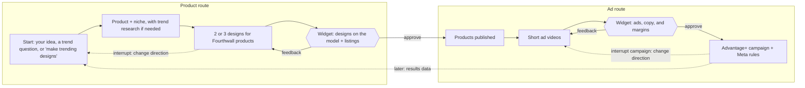

# wovain

An AI assistant for print-on-demand sellers that researches trends, designs products for your Fourthwall catalog, publishes them, and launches and manages their Meta ads from one conversation.

## The unique kernel
Each step ends with a widget you approve, and nothing else is manual. The design starts from Fourthwall's real products, placements, sizes, and prices, and the campaign's rules start from each product's real margin.

## Who it's for
A solo print-on-demand merchant, starting with the learner. Today one product takes five tools:

| Step | Today | With wovain |
|---|---|---|
| Find a trend | Trend tools and own research | Ask in chat |
| Design and tech pack | Long back-and-forth in ChatGPT | Designed in chat for a specific Fourthwall product |
| List the product | Manual upload to Fourthwall | One approval |
| Make ads | A separate video tool | Videos and ad copy generated and reviewed in chat |
| Launch the campaign | Built by hand in Meta Ads Manager | One approval |

## The core loop

You steer every step, and Meta runs the campaign once you approve.

## Inspiration and identity

| Principle | In practice |
|---|---|
| Talk to it | Voice in ChatGPT if the widgets work there; speech-to-text otherwise |
| Reuse, don't rebuild | Fourthwall and Meta Ads MCPs, fal's video models, Meta's Advantage+ and automated rules for optimization |
| Use all of ChatGPT | Inline widgets for the UI (side panels and viewers are Work and desktop only), plus built-in image generation through the design playbook, web search, and voice where it supports widgets, instead of rebuilding any of them |

## Why this matters to the learner
They want a working project "created with minimal code" that they can show, a first step toward "making profit in print on demand," and a test of how far ChatGPT's own capabilities go in a build of four hours at most.

## What "working" looks like
A one-minute recording of this script:

1. Ask ChatGPT for trending designs.
2. Pick 2 or 3 of the suggestions.
3. See them on the model with their listings (title, description, variants, price). Approve; the products are live.
4. See the ad videos, ad copy, and each product's margin. Approve.
5. Open Meta Ads Manager; the Advantage+ campaign is live with its rules.

The last step is the proof. Real products and a real campaign exist, and the learner only talked and approved.

## The POC boundary

| Area | In the POC |
|---|---|
| Host | A remote MCP server on Vercel that any agent connects to with OAuth (ChatGPT on chatgpt.com and the desktop app first, Claude too). It serves the tools, the widgets, and a playbook per step that tells the agent the flow |
| Trends | Web research when the merchant asks for it or for trending designs; skipped when they bring their own idea |
| Design | 2 or 3 designs generated in ChatGPT, each fitted to a Fourthwall product |
| Listing | Title, description, variants, and price for each product, on the design widget |
| Publishing | Fourthwall products published after widget approval |
| Ads | Short videos on fal (MiniMax H3 Max Reference by default; Kling one setting away) with generated background audio, plus ad copy (primary text and headline) |
| Economics | Price, Fourthwall cost, margin, and breakeven per product on the ad widget |
| Campaign | One Advantage+ campaign testing the designs, launched live |
| Management | Meta automated rules from each product's breakeven: kill thresholds per product, scaling for the whole campaign; Advantage+ handles targeting and budget |
| Settings | Every value (models, prices, budget, rules) editable from a Settings widget and per-widget quick settings |

## Later

| Item | Why later |
|---|---|
| Claude version | Claude can already connect to the same MCP server; ChatGPT comes first because it generates better images, and the widgets are tested there |
| The learner's own trend tools | Web research is enough to prove the loop |
| Campaign results widget in chat | Needs spend data first |
| Campaign results feeding back into trend research | Needs real spend and results first |
| TikTok Shop and TikTok ads, possibly through TikTok Agentic Hub skills | A second sales channel |
| Larger design batches | 2 or 3 designs prove the test pattern |

## Explicitly cut

| Item | Reason |
|---|---|
| A custom trend engine | Trend data is an input, and search already provides it |
| A custom video or image model | The goal is minimal code |
| A custom media-buying engine | Advantage+ and Meta rules already optimize campaigns |
| Draft or hidden products | Publishing directly takes fewer steps and carries little risk |

## Open questions for later phases

| Question | Phase |
|---|---|
| Exact kill and scale thresholds, and how breakeven is calculated (fees, shipping) | Resolved in `prd.md` |
| Can a plugin extension use ChatGPT's built-in image generation, or must designs come through the MCP server? | Resolved in `spec.md` |
| Which video generator? | Resolved in `spec.md` |
| Can the Meta Ads MCP create automated rules, or does that need the Marketing API? | Resolved in `spec.md` |
| Does the Fourthwall store already send purchase events to Meta (pixel or Conversions API)? Advantage+ needs them. | Resolved: built into Fourthwall, connect before the demo |
| Do ChatGPT app tools and widgets work in Live voice? Reports say support arrived 2026-09-23. | Resolved in `spec.md` |
