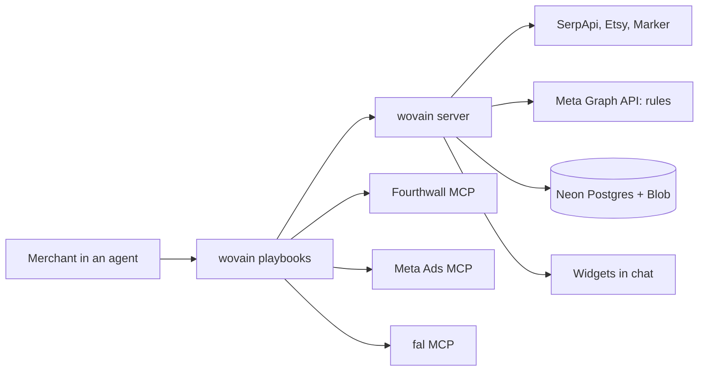

# wovain technical spec

An MCP server that is mostly wiring: its playbooks tell the agent what to do, three existing MCP servers (Fourthwall, Meta Ads, fal) do the heavy lifting, and wovain itself draws the widgets and fills the gaps no MCP covers.

Implements `prd.md` (all of **Features and Behavior**). Scope source: `scope.md > The POC boundary`.

## How This Works, In Plain Language

wovain is a hosted MCP server. You add its URL to an agent that speaks MCP over streamable HTTP with OAuth (ChatGPT, Claude and others), sign in once, and the agent can use it.

| Piece | What it is | What it does in wovain |
|---|---|---|
| Playbooks | Step-by-step instructions the wovain server hands the agent | The playbook for each step: design, ads, campaign (research and optimization come later) |
| Fourthwall MCP | Fourthwall's official server | Blanks, mockups, prices, publishing |
| Meta Ads MCP | Meta's official server | Campaign, ad set, video upload, ads, go live |
| fal MCP | fal's official server | Ad videos (MiniMax H3 Max Reference or Kling), background audio, upscaling, background removal |
| wovain server | Our Hono server, hosted on Vercel and reached over HTTPS | Serves the playbooks and widgets, does the margin math, trend lookups, Meta rules, settings |
| Widgets | Small web pages the agent shows inline (MCP Apps) | Trend, design, ad, campaign, optimization and settings widgets |

Why a wovain server at all: an agent can only show a widget that an MCP server serves, a widget's buttons can only call its own server, and two jobs have no MCP (Meta automated rules, trend APIs). Everything else goes through the official servers.

How the agent learns the flow: when it connects, wovain's MCP `instructions` list the steps. Before each step the agent reads that step's playbook, either with the `get_playbook` tool or as the MCP prompt of the same name. Nothing has to be installed on the agent's side.

How a click works: you press Approve on a widget. The widget posts a short message ("Approve design d2") into the chat. The agent follows the playbook and calls Fourthwall's tools, which you set to auto-approve. Then it calls wovain to redraw the widget as live. One click, one extra model turn.

Where things are kept: Neon Postgres keeps settings and the state of each run, one set of rows per user, so a new chat picks up where you left off. Staged artwork waits in a private Vercel Blob store until it is uploaded to Fourthwall.

Where you use it: in any agent that can reach `https://wovain.vercel.app/mcp`. ChatGPT works on chatgpt.com and in the desktop app, because the server is hosted rather than started on your Mac.

## The Core Journey Through the System

PRD ref: `prd.md > The Core Journey`.



| # | You do | What happens | You see |
|---|---|---|---|
| 1 | Ask for trending designs | `trends` playbook (later): web search for candidates, `trends_evidence` (SerpApi, Etsy, Marker), Meta ad library search for ad counts | Trend widget |
| 2 | Tick 2 or 3, click "Design the ones I picked" | The widget posts the picks; skipped if you bring your own idea | Next step starts |
| 3 | Wait | `design` playbook: the agent generates the art; `stage_artwork` measures it; wovain uploads it to Fourthwall; fal removes the background and upscales from that public URL when needed; Fourthwall picks the blank and renders mockups; `price_product` sets the price | Design widget per idea |
| 4 | Approve, Skip or give feedback | Approve posts "Approve design dN"; Fourthwall creates the product, sets prices, makes it public; `record_design` saves it | Design widget shows Live with a link |
| 5 | Wait | `ads` playbook: `video_plan` gives the fal request; fal renders two clips (MiniMax H3 Max Reference by default), then MMAudio; copy and margins are computed | Ad widget per product |
| 6 | Add to campaign, Skip or give feedback | `record_ad` saves the choice; after the last widget, the campaign step starts | Next ad widget, or the campaign widget |
| 7 | Wait | `campaign` playbook: checks payment method and pixel; `campaign_plan` gives the budget, ad names and links; Meta MCP creates campaign, ad set, uploads, ads; `create_rules` adds the five rules; Meta MCP activates | Campaign widget: Live, or Ready, blocked |
| 8 | Later: "How's my campaign?" | `optimize` playbook (later): `campaign_check` reads rule history and results; Fourthwall reports and sales by UTM add evidence | Optimization widget per fired rule |
| 9 | Apply the fix or Dismiss | The fix runs through the same tools (new video, new hook, price test) | Updated ad, campaign keeps running |

Steps 1, 2, 8 and 9 moved to later by the learner's call (`checklist.md > Revisions`); the own-idea path starts at step 3.

## Stack

| Layer | Choice | Version | Docs |
|---|---|---|---|
| Runtime and package manager | Bun | 1.4.3 | https://bun.sh/docs |
| MCP server | `@modelcontextprotocol/server` v2 over Streamable HTTP at `/mcp` | 2.3.1 | https://github.com/modelcontextprotocol/typescript-sdk |
| Web server | Hono on Vercel's Bun runtime (`framework: hono`, `bunVersion: 1.4.x`): `/mcp`, OAuth endpoints and metadata, and the sign-in and consent pages | 4.13.13 | https://hono.dev |
| Sign-in and OAuth | WorkOS AuthKit (hosted authorization server); `@workos-inc/node` and `jose` on the server | 11.0.0, 6.2.12 | https://workos.com/docs/authkit/mcp |
| Widget protocol | MCP Apps (`@modelcontextprotocol/ext-apps`) | 2.0.3 | https://github.com/modelcontextprotocol/ext-apps |
| Widget UI | React 19 + `@openai/apps-sdk-ui` + Tailwind CSS 4 (its peer) | 19.3 / 0.2.2 / 4.3 | https://developers.openai.com/plugins/build/chatgpt-ui |
| Widget build | Vite 8 + `vite-plugin-singlefile`, one HTML file per widget | 8.3 | https://vite.dev |
| Schemas | zod 4 (required by `ext-apps`), shared by tools and widgets | 4.6 | https://zod.dev |
| Lint and format | Ultracite with oxlint (type-aware via oxlint-tsgolint) and oxfmt (sorts imports and Tailwind classes) | 8.0.1 / 1.88 / 0.73 / tsgolint 7.0 | https://www.ultracite.ai |
| TypeScript | Official dual setup: `typescript` aliased to `@typescript/typescript6` (6.0 API for tools), `@typescript/native` aliased to `typescript@7` (`tsc` 7.0 for type checking) | 6.0.2 / 7.0.2 | https://devblogs.microsoft.com/typescript/announcing-typescript-7-0/ |
| Git hooks | Lefthook | 2.2.2 | https://lefthook.dev |
| Tests | `bun test` for the server and shared code; Vitest 5 with Playwright for widget stories | 1.4 / 5.0 | https://vitest.dev |
| Widget states | Storybook 10 (`@storybook/react-vite` with the a11y, docs, themes and vitest addons) | 10.6 | https://storybook.js.org |
| Commits and dead code | commitlint (conventional commits) and knip | 21.x / 6.x | https://commitlint.js.org |
| Database | Neon Postgres through Drizzle ORM (`drizzle-orm/bun-sql` on `Bun.SQL`), migrations by drizzle-kit; PGlite (Postgres in WASM, in-process) for tests | 0.45.4 / 0.31.11 / 0.5.8 | https://orm.drizzle.team |
| Infrastructure as code | A static `apps/server/vercel.json` for the Vercel project; the Neon project (branches `main` and `dev`, Neon Auth off) is set up once in Neon, with no config file (`vercel.ts` was tried and dropped: Vercel installs dependencies on Bun 1.3 to compile it, which ignores our lockfile) | — | https://vercel.com/docs/project-configuration |

- TypeScript everywhere: the learner chose it because OpenAI's examples and the ChatGPT UI kit are TypeScript.
- Bun: the learner chose it over Node with Express. Official examples assume Node, so `bunfig.toml` sets `[run] bun = true` and even Storybook, Vitest and other tools with a node shebang run on Bun. No Node install is needed.
- Hosting: wovain started as a desktop-only stdio plugin and became a hosted server, so it works on chatgpt.com and in other agents, and server or widget changes ship on deploy. One package, `apps/server`, holds the MCP server, the token check and the database. Its entry `src/index.ts` default-exports a Hono app, which Vercel runs as one function. Hono replaced Next.js once the pages turned out to be two forms, and those went too when AuthKit took over sign-in and consent; only the home page is left (`hono/html`). `bun run build` bundles the server with `bun build` because Vercel doesn't resolve source-only workspace packages such as `@wovain/shared`.
- Sign-in is WorkOS AuthKit: it registers agents, hosts sign-in and consent, and issues the tokens, so no auth tables live in Neon. It replaced self-hosted Better Auth 1.7.7, which needed four plugins, generated tables and our own sign-in and consent pages (free up to 1M monthly active users; WorkOS lists no separate price for MCP auth). Neon Auth was ruled out: its package only proxies to Neon's hosted auth server and has no OAuth-provider or MCP plugin (checked in the `@neondatabase/auth` 0.6.0-beta code).
- Ultracite with oxlint and oxfmt: the learner's choice (`ultracite init --linter oxlint`).
- React 19: both `@openai/apps-sdk-ui` and `ext-apps` support it; OpenAI's docs still show 18.

## Where It Runs and How Someone Tries It

wovain is a hosted MCP server. A Hono app (`apps/server`) on Vercel serves Streamable HTTP at `/mcp`, and any agent that supports remote MCP servers with OAuth can connect to it: ChatGPT on the web or in the desktop app, Claude, and others. The agent gets everything from the server: the tools, the widgets as `ui://` resources, the flow in the MCP `instructions`, and each step's playbook through `get_playbook` or as an MCP prompt.

Hosting was built in steps:

| # | Step | State |
|---|---|---|
| 1 | Hosted HTTP server | Done |
| 2 | Neon Postgres store and private Blob media | Done |
| 3 | OAuth 2.1 sign-in so anyone can connect | Done |
| 4 | Each user's own Meta account | Later |

How sign-in works:

| Piece | Behavior |
|---|---|
| Discovery | `/mcp` without a token answers 401 with `resource_metadata` pointing at `/.well-known/oauth-protected-resource/mcp`, which names the AuthKit domain (`WORKOS_AUTHKIT_DOMAIN`) as the authorization server. AuthKit's own metadata offers PKCE S256, CIMD and dynamic registration; both are switched on in the WorkOS dashboard under Connect → Configuration |
| Sign-in and consent | AuthKit's hosted pages (Google, plus the methods enabled in WorkOS). Its consent screen names the registering app |
| Token check | `requireMcpAuth` (`src/auth/auth.ts`) checks AuthKit's signature against its JWKS, the issuer, and an audience of exactly `<site>/mcp`. The audience comes from a resource indicator in WorkOS. For now production and local development share the WorkOS Staging environment, with `https://wovain.vercel.app/mcp` (the default) and `http://localhost:3000/mcp`. Without both WorkOS keys every call gets a 401 |
| Site URL | From Vercel (the production domain, or a preview's `VERCEL_URL`) or localhost; `WOVAIN_SITE_URL` overrides it |
| Allowlist | Until each merchant links their own Meta account, everyone signed in acts through the operator's Meta and fal keys, so sign-in is limited to the verified emails in `WOVAIN_ALLOWED_EMAILS`. The list is checked on every `/mcp` call against the user's verified email in WorkOS, so taking an email off it cuts off tokens already issued; an empty list lets nobody in |
| Static files | `apps/server/public/` (icon, favicon), served by Vercel's CDN; `bun run dev` serves them from the app |

| Need | Value |
|---|---|
| Agent | Any agent that speaks MCP over streamable HTTP with OAuth, such as ChatGPT (Plus, developer mode) or Claude |
| Host | Vercel (Bun 1.4 runtime); Bun 1.4 locally for development |
| Keys in `apps/server/.env` (project settings on Vercel) | `META_SYSTEM_USER_TOKEN`, `META_AD_ACCOUNT_ID`, `META_PAGE_ID`, `META_PIXEL_ID`, `SERPAPI_KEY`, `ETSY_API_KEY`, `MARKER_API_TOKEN`, `FAL_KEY` (live fal prices), `FAL_BILLING_KEY` (optional: what fal actually charged), `WORKOS_AUTHKIT_DOMAIN` (the AuthKit domain that issues `/mcp`'s tokens), `WORKOS_API_KEY` (reads each caller's email), `WOVAIN_ALLOWED_EMAILS` (who may use `/mcp`), `DATABASE_URL` (Neon: the `dev` branch locally) and `BLOB_READ_WRITE_TOKEN` (the private Blob store); on Vercel the Neon and Blob integrations set the last two |
| Rehearsal | Later: `WOVAIN_MOCK=1` (`bun run mock`) is meant to answer wovain's outside calls from fixtures and skip publish and launch steps; the flag is read but nothing uses it yet |
| Sign-ins in the agent | Fourthwall, Meta Ads and fal (OAuth, once), with auto-approve on for their tools |

Start it:

```bash
bun install
bun run skills:restore          # course skills from skills-lock.json
cp apps/server/.env.example apps/server/.env   # fill in keys (optional until a tool needs one)
bun run db:migrate              # applies apps/server/migrations to DATABASE_URL
bun run build                   # builds the widgets, then bundles the server into apps/server/dist
bun run dev                     # serves /mcp on localhost:3000
```

Connect it: add `https://wovain.vercel.app/mcp` as a remote MCP server (streamable HTTP) in the agent, or `https://<tunnel>/mcp` for a local `bun run dev`. The URL carries no credentials; the first call sends you to sign in with Google and approve access. Fourthwall, Meta Ads and fal are connected in the same agent as their own servers.

Demo recording: in a connected agent, follow `scope.md > What "working" looks like` in one chat, then open Ads Manager and the Fourthwall shop. Submission needs the video and the public GitLab repo (https://gitlab.com/gitlab-ai-hackathon/transcend-october-2026/43085639/showcase, mirrored to https://github.com/sami-m-g/wovain); the hosted server on Vercel is the deployment.

## Look and Feel

Carried from `prd.md > Look and Feel`.

- Widgets use `@openai/apps-sdk-ui` components and the host's system fonts, text, background and divider colors. Light and dark follow the host theme.
- One token, `--wovain-accent: #3B4CCA`, used only on primary buttons, badges and icons.
- Status colors stay semantic: green Live, amber Ready-blocked, red Paused.
- Each widget opens with one coach line, then the numbers. Money widgets lead with breakeven cost per sale; return on ad spend comes second. At most 2 buttons; the ⚙ quick-settings menu is an icon, not a button. No tabs or inner scrolling.
- Images use fixed aspect ratios and alt text. Videos are muted, tap to play, and the ⛶ control asks the host for full screen (`requestDisplayMode`), since the widget can't go full screen itself.
- No shadcn: ChatGPT requires its own design system, and `@openai/apps-sdk-ui` is the official kit.

## Components

### Server entry: instructions, playbooks and prompts

What it does: tells the agent what wovain is and how to run it. On initialize the server sends MCP `instructions`: the agent also needs the Fourthwall, Meta Ads and fal servers, here are the steps, and each step's playbook comes first. The server also advertises its name, title and logo (`/icon.png`). The URL carries no secret; the agent signs in through wovain's OAuth.

PRD ref: `prd.md > Screens and Layout`.

### Playbooks

One playbook per step in `apps/server/src/playbooks/`. Each has a description (when to use it) and a text that names the tools to call in order and the widget to finish with. The agent gets them three ways:

| Way | What the agent sees |
|---|---|
| MCP `instructions` | The list of steps with each playbook's description, on initialize |
| `get_playbook({ step })` | A read-only tool that returns one playbook's text |
| MCP prompts `design`, `ads`, `campaign` | The same text as a user message |

| Playbook | Steps | PRD ref |
|---|---|---|
| `trends` (later) | Web search for candidates, `trends_evidence`, Meta ad library counts, `show_trend_widget` | `prd.md > Trend research` |
| `design` | Generate art, `stage_artwork`, Fourthwall upload (`put_artwork`), fal background removal and upscale, blank and mockups, `price_product`, `show_design_widget`; on approve, publish and `record_design` | `prd.md > Design widgets`, `prd.md > Pricing and economics` |
| `ads` | `video_plan`, fal video ×2, fal MMAudio, copy, `show_ad_widget`, `record_ad` | `prd.md > Ad widgets` |
| `campaign` | Payment and pixel checks, `campaign_plan`, Meta campaign build with `utm_content` = ad ID on every ad link, `create_rules`, activate, `show_campaign_widget` | `prd.md > Campaign launch`, `prd.md > Campaign rules` |
| `optimize` (later) | `campaign_check`, Fourthwall reports and sales by UTM, `show_optimization_widget`, apply the fix or turn an ad back on | `prd.md > Optimization` |

Each playbook starts Fourthwall calls with `get-instructions`, `ecommerce_get-current-shop` and `load-skills`, as Fourthwall requires.

### wovain server

What it does: one Hono app in `apps/server`. `src/app.ts` holds every route: `/mcp`, `/.well-known/oauth-protected-resource[/mcp]` (the metadata naming AuthKit) and `/` (a short page with the connect URL). `src/routes/mcp.ts` checks the token and the allowlist, then hands the request to the MCP handler (`src/http.ts`): Streamable HTTP with a fresh server per request, and the widget files as `ui://` resources. Finished clips stay at the public `fal.media` URLs fal returns. Each tool file registers one step's tools, with zod input and output schemas from `packages/shared`. Tools return user-safe errors and never pass raw upstream errors through.

| Tool | Does | Talks to |
|---|---|---|
| `get_playbook` | Returns one step's playbook (read-only) | Playbooks |
| `trends_evidence` (later) | Growth, seasonality, Etsy count and trademark screen per idea | SerpApi, Etsy API, Marker API |
| `stage_artwork` | Receives the artwork (image generation's `data:` URL, a public https URL, or an `openai/fileParams` file for attachments, since a hosted server can't read files on your Mac), checks pixels and transparency, keeps the bytes for upload | records, Blob media |
| `put_artwork` | PUTs the artwork bytes to Fourthwall's signed upload URL with the signed `Content-Type` and `x-goog-content-length-range` headers | Fourthwall upload URL |
| `price_product` | Applies the pricing rule and returns the breakeven math (priciest size or size-weighted) | Settings |
| `record_design` | Saves design status (publishing, live, rejected, skipped), product ID and link; `get_design` lets the widget follow it while publishing | records |
| `video_plan` | Returns the fal endpoint and parameters from Settings (model, resolution, length, elements, audio) | Settings |
| `video_spend` | Reports what fal actually charged, when `FAL_BILLING_KEY` is set | fal billing API |
| `record_ad` | Saves ad choices and copy | records |
| `campaign_plan` | Returns the daily budget and, per added ad, the product link, copy, static image, finished videos, ad names (rules find ads by name) and URL tags for the Meta build | records, Settings |
| `create_rules` | Creates the five rules per the PRD | Meta Graph API |
| `campaign_check` (later) | Reads rule history and campaign results | Meta Graph API |
| `get_settings`, `update_settings` | Read and change any setting | records |
| `show_*_widget` | Return widget data and attach the widget: settings, design, ad and campaign now; trend and optimization later | Widgets |

PRD ref: `prd.md > Features and Behavior`.

### Widgets

One React component per widget, each built into a single HTML file. Buttons use `callTool` for wovain tools and `sendFollowUpMessage` for steps that need Fourthwall or Meta. Each widget keeps its in-progress state (ticked ideas, typed feedback) with `setWidgetState`.

| Widget | Buttons | Feedback | PRD ref |
|---|---|---|---|
| Trend (later) | Design the ones I picked (enabled at 2 or 3) | Chat | `prd.md > Trend research` |
| Design | Approve, Skip | Field and chat; regenerates the widget | `prd.md > Design widgets` |
| Ad | Add to campaign, Skip | Field and chat; regenerates the widget | `prd.md > Ad widgets` |
| Campaign | Open in Ads Manager | Chat | `prd.md > Campaign launch` |
| Optimization (later) | Apply the fix, Dismiss | Chat | `prd.md > Optimization` |
| Settings | Save | Fields | `prd.md > Screens and Layout` |

Approve and Add to campaign disable themselves while their action runs, so nothing is published or added twice (`prd.md > States and Boundaries`).

Each widget state from `prd.md > States and Boundaries` has a Storybook story with a mocked host bridge; accessibility and interaction tests run through Vitest.

### Settings

Every value in the PRD is a setting, edited in the Settings widget or a widget's ⚙ menu, saved in the merchant's records, and used by the next widget without a redeploy.

| Group | Settings (defaults) |
|---|---|
| Trends | ideas 5, pick 2 to 3 |
| Pricing | min profit $10, min margin 30%, round up to a clean price |
| Economics | card fee 2.9% + $0.30, shipping $5, sales tax 7%, refund reserve 2%; breakeven basis: priciest size (default) or size-weighted mix |
| Campaign | $15 per product per day (at most $500; the scale cap at most 5× the start) |
| Rules | kill at 3× breakeven with no sales, checked every 30 min; kill above 1.5× breakeven with 5+ sales in 7 days; scale +20% under 0.8× breakeven with 10+ sales, every 48 h, cap 2× start; kill a design at 4× breakeven with no sales across its ads; alert above breakeven; ad links tagged utm_content = ad ID |
| Video | model MiniMax H3 Max Reference (or with the print kept: Kling O1 Standard Reference up to 10 s, Kling v3 Standard or Pro; test runs without: MiniMax H3 Max Turbo, H3 Max), 720p, 15 s, 2 clips per product, elements on |
| Audio | source MMAudio (or Kling native, or off), prompt "upbeat background music, no vocals" |
| Meta | AI disclosure on, Graph API v26.0 |

## Development Tooling

Claude Code setup for building wovain, added in the first build step. Nothing here ships with the server.

| Tool | Type | What it does |
|---|---|---|
| Fourthwall, Meta Ads and fal MCPs in `.mcp.json` | MCP | Lets Claude try Fourthwall calls, Kling prompts, elements and MMAudio during the build, outside a chat with wovain |
| `/new-tool` (later) | Project skill | Scaffolds one wovain tool: zod schema in `packages/shared`, tool file, widget stub, fixture and test |
| `/demo-check` (later) | Project skill, user-only | Preflight before recording: `/mcp` reachable, widgets build, shop live, Meta payment method and pixel, fal credit, Etsy and Marker keys, and a claude-ads Meta audit of the ad account |
| claude-ads plugin (installed) | Plugin | `ads-math` and `ads-budget` check the economics, `ads-test` checks the rules, and its optimization guidance will seed the `optimize` playbook; claude-ads is MIT-licensed, and that playbook will credit it in a NOTICE file |
| `ultracite fix` after each edit | Hook (from `ultracite init --hooks claude`) | Lint and format every edit |
| GitLab Secret Detection (CI template) | CI | Flags secrets and tokens in every push and merge request; replaced the local gitleaks hook |
| Lefthook | Git hooks | Ultracite fix and type check before commits; commitlint on commit messages; tests, knip and story tests before pushes |
| commitlint | Commit check | Enforces conventional commits locally |
| knip | Dead-code check | Finds unused files, exports and dependencies before pushes and in CI |
| Storybook | Widget workshop | One story per widget state with a mocked host bridge; a11y and interaction tests |
| Mock mode (later) | Rehearsal | `bun run mock` sets `WOVAIN_MOCK=1`; the fixtures that would answer wovain's outside calls aren't built yet |
| GitLab CI/CD (`.gitlab-ci.yml`) | CI/CD | See the stage table below |
| GitLab Observability (`apps/server/src/telemetry.ts`, `@vercel/otel` 2.1.3) | Monitor | Sends OpenTelemetry traces over OTLP/HTTP when `OTEL_EXPORTER_OTLP_ENDPOINT` and `OTEL_EXPORTER_OTLP_HEADERS` are set (endpoint from the group's Observe → Observability configuration). `/mcp` adds an `mcp.request` span with the MCP method, tool and status, no user ids or arguments. Next.js's per-request spans went with Next.js. Unset means no telemetry |
| GitLab Duo Agent Platform | Agents | Provisioned in the hackathon workspace. With the Developer role we can run the developer flow (issue to MR), "Fix pipeline with Duo" on a failed pipeline, and code review (the MR template assigns `@GitLabDuo` as reviewer). SAST false-positive detection and SAST vulnerability resolution need a Maintainer to switch on; that request goes to GitLab contributor-success |
| semantic-release | Releases | semantic-release 25.0.9 in the `release` job (`.releaserc.json`): commit-analyzer, release-notes-generator, changelog, exec (`scripts/set-version.ts` writes the version to the root `package.json`), git (commits `CHANGELOG.md` and `package.json` as `chore(release): x [skip ci]`) and gitlab (a GitLab release). The tag `v0.1.0` on the first commit is the baseline. It replaces release-please. The release commit lands only on GitLab until the next local push sends it to the GitHub mirror |
| Renovate | Dependencies | renovate/renovate:44.138.0 on the weekly pipeline schedule opens update merge requests; `.gitlab/renovate.json` extends `config:recommended` with semantic commits, waits 7 days before taking a release, groups minor and patch updates. It replaces Dependabot |
| `skills` CLI | Skills sync | `prepare` copies package-shipped skills (ultracite) into `.claude/skills` |
| VS Code settings | Editor | oxc formatter on save and fix-all; recommends `oxc.oxc-vscode` and `TypeScriptTeam.native-preview` |
| Claude Code plugins (project scope) | Plugins | modern-web-guidance (web best practices for the widgets), security-guidance (warnings on edits and a background review on commit, push and stop), hookify (custom hook rules in `.local.md` files); also claude-ads, impeccable, ui-ux-pro-max, humanizer, context7 and commit-commands |

GitLab CI/CD stages (`.gitlab-ci.yml`, image `oven/bun:1.4.2`):

| Stage | Jobs | What runs |
|---|---|---|
| verify | `build`, `verify`, `stories`, `renovate` | In parallel: the build; check, typecheck, knip and tests; widget stories on Playwright's image. Installs use `--ignore-scripts` and no cache. Renovate only on its schedule ("Renovate dependency updates", Mondays 06:00 UTC) |
| test | GitLab templates | SAST, Secret Detection and Dependency Scanning, on merge requests too; the scanners start at once (`needs: []`) |
| deploy | `deploy:production` | `main` only: `vercel deploy --prod` (environment production, https://wovain.vercel.app). Merge requests get no preview deploy |
| monitor | `smoke:production` | Curls the live OAuth chain: `/mcp` 401, both metadata documents, the sign-in page |
| release | `release` | semantic-release, only after the smoke test passes |

CI variables: `VERCEL_TOKEN`, `GITLAB_TOKEN`, `RENOVATE_TOKEN` (all masked), `VERCEL_ORG_ID`, `VERCEL_PROJECT_ID`.

### Ultracite, TypeScript and Lefthook setup

Setup command (run once at the repo root):

```bash
bunx ultracite init --pm bun --linter oxlint --frameworks react vitest \
  --workspace-framework apps/widgets=react --editors vscode --agents claude codex \
  --hooks claude --integrations lefthook --type-aware --js-plugins oxlint-plugin-react-doctor --install-skill
```

| Piece | What it does |
|---|---|
| `--type-aware` | Type-aware lint rules through tsgolint (needs TS 7) |
| `--hooks claude` | Claude Code PostToolUse hook runs `ultracite fix` after every edit; merged with the Impeccable hooks |
| `--agents claude codex` | Writes lint rules for agents; point them at AGENTS.md, not a new CLAUDE.md |
| `--install-skill` | Installs the `ultracite` Claude skill |
| `--js-plugins oxlint-plugin-react-doctor` | React health rules, as in the sister wovain repo |
| oxlint plugins | eslint, typescript, unicorn, oxc, import, promise, node, react (rules of hooks), react-perf, jsx-a11y, vitest |
| VS Code `TypeScriptTeam.native-preview` | Switches the editor's language server between TS 7 and 6 |

`lefthook.yml`:

```yaml
pre-commit:
  parallel: true
  jobs:
    - run: bunx ultracite fix {staged_files}
      glob: ["*.{ts,tsx,json,jsonc,css,md,yml}"]
      exclude: ["devpost/**", ".claude/skills/**", ".agents/skills/**"]
      stage_fixed: true
    - name: typecheck
      run: bun run typecheck
commit-msg:
  jobs:
    - name: commitlint
      run: bunx commitlint --edit {1}
pre-push:
  parallel: true
  jobs:
    - name: test
      run: bun run test
    - name: knip
      run: bun run knip
    - name: stories
      run: bun run test:stories
```

Scripts in the root `package.json`:

```json
"build": "bun run --filter @wovain/server build",
"check": "ultracite check",
"fix": "ultracite fix",
"typecheck": "tsc -b --noEmit",
"typecheck:6": "tsc6 -b --noEmit",
"test": "bun test",
"mock": "WOVAIN_MOCK=1 bun run dev",
"prepare": "lefthook install && skills experimental_sync -y -a claude-code --copy",
"knip": "knip",
"skills:restore": "skills experimental_install -y",
"storybook": "bun run --filter @wovain/widgets storybook",
"test:stories": "bun run --filter @wovain/widgets test:stories",
"widgets:watch": "bun run apps/widgets/build.ts --watch",
"dev": "bun run --filter @wovain/server dev",
"db:generate": "bun run --filter @wovain/server generate",
"db:migrate": "bun run --filter @wovain/server migrate"
```

`prepare` installs the Lefthook hooks and syncs package-shipped skills; Vercel skips it with `bun install --ignore-scripts`. In `apps/server`, `dev` is `bun --hot src/index.ts` and `build` is the widgets build followed by `bun build src/index.ts --target bun --format esm --outdir dist --external hono`.

## Data Model

One `records` table in Neon Postgres, keyed by user, kind and id, read and written by the server only; the user is the `sub` of the merchant's access token (their WorkOS user id). Each record is one JSON row, checked against its zod schema on every read, and a `counters` table hands out ids, so two saves at once never share one. The Drizzle schema lives in `apps/server/src/db`: `records` keeps each record in a `jsonb` column, and there are no auth tables, since accounts live in WorkOS. drizzle-kit writes SQL migrations to `apps/server/migrations` (`bun run db:generate`), and `bun run db:migrate` applies them to the Neon branch in `DATABASE_URL`. Local development uses the Neon `dev` branch, each merge request preview gets its own branch `mr-<iid>` (deleted when the review environment stops), and tests run the same migrations on PGlite, so nothing needs a network in CI and there is no SQLite path. Staged artwork bytes go to the private Blob store `wovain-media`; local development uses it too, so there is no offline fallback.

| Data | Lives in | Updated by | When you come back |
|---|---|---|---|
| Settings | `settings` | `update_settings` | Same values |
| Ideas | `runs[runId].ideas` | `show_trend_widget` (later) | Trend widget can be redrawn |
| Designs | `designs` and `artworks` (art URL, customization ID, product ID, price, status; staged artwork size and file) | `stage_artwork`, `record_design` | Approved products stay live; pending ones can be redrawn |
| Ads | `runs[runId].ads` (video URLs, static URL, copy, status) | `record_ad` | Choices kept |
| Campaign | `runs[runId].campaign` (campaign, ad set, ad and rule IDs, status) | `create_rules`, campaign step | Optimization reads it |
| Media | Staged artwork in the private Blob store; public copies in Fourthwall's media library; clips at fal's own URLs | `stage_artwork` | Files stay until deleted |

Widget state inside a chat (ticks, typed feedback) lives in the widget's widget state; the host keeps it with the message.

## File Structure

```
wovain/
├── apps/
│   ├── server/                  # the one deployed package: Hono app with MCP, OAuth and database
│   │   ├── src/
│   │   │   ├── index.ts         # entry: default-exports the Hono app (Vercel and bun run dev)
│   │   │   ├── app.ts           # routes: /mcp, /.well-known/oauth-protected-resource, /
│   │   │   ├── runtime.ts       # env, Neon client, AuthKit token check and Blob from process.env
│   │   │   ├── routes/mcp.ts    # requireMcpAuth, allowlist check, mcp.request span
│   │   │   ├── http.ts          # Streamable HTTP handler for a verified caller
│   │   │   ├── server.ts        # McpServer: instructions, tools, widgets, playbooks
│   │   │   ├── playbooks/       # design.ts, ads.ts, campaign.ts; index.ts: instructions, get_playbook, prompts
│   │   │   ├── tools/           # settings.ts, design.ts, ads.ts, campaign.ts
│   │   │   ├── widgets.ts         # registers the ui:// widget resources
│   │   │   ├── env.ts           # zod-checked server keys
│   │   │   ├── store.ts         # records through Drizzle, artwork on Blob
│   │   │   ├── auth/            # auth.ts (AuthKit token check), env.ts (site URL, allowlist)
│   │   │   ├── pages/           # the home page as hono/html; styles.ts
│   │   │   ├── db/              # app-schema (records, counters), client, migrate, testing (PGlite)
│   │   │   ├── telemetry.ts     # @vercel/otel, on when the OTLP endpoint is set
│   │   │   └── lib/             # fal pricing and usage, image checks, artwork loading, meta-graph, video-plan
│   │   ├── test/                # tools, playbooks, app routes, auth chain, economics, store; fixtures/
│   │   ├── migrations/          # SQL from drizzle-kit (bun run db:generate)
│   │   ├── public/              # icon.png, favicon.ico (Vercel's CDN)
│   │   ├── drizzle.config.ts
│   │   ├── vercel.json          # framework hono, Bun 1.4.x, build to dist, ships ../widgets/dist/*.html
│   │   └── .env.example         # server keys (apps/server/.env, gitignored)
│   └── widgets/                   # React widgets, Vite single-file builds
│       ├── src/
│       │   ├── settings/ design/ ad/ campaign/   # each with *.stories.tsx
│       │   └── lib/bridge.ts    # host bridge feature checks
│       ├── .storybook/          # config, mocked host bridge
│       ├── build.ts             # builds every widget (--watch for widgets:watch)
│       ├── vite.config.ts
│       └── vitest.config.ts
├── packages/shared/             # zod schemas, economics and rule thresholds for server and widgets
├── .gitlab-ci.yml               # verify, test (security), deploy (production), monitor, release
├── .gitlab/                     # issue and MR templates, CODEOWNERS, renovate.json
├── .releaserc.json              # semantic-release plugins
├── .vscode/                     # settings.json, extensions.json
├── .claude/skills/              # course skills (bun run skills:restore) and the ultracite skill
├── scripts/                     # prepare.ts (hooks, skills sync), set-version.ts (release version)
├── .mcp.json                    # dev MCPs: Fourthwall, Meta Ads, fal
├── oxlint.config.ts, oxfmt.config.ts   # from Ultracite
├── lefthook.yml                 # pre-commit, commit-msg, pre-push
├── commitlint.config.ts         # conventional commits
├── knip.json                    # dead-code check
├── bunfig.toml                  # [run] bun = true: tools run on Bun, not Node
├── package.json                 # bun workspaces (apps/server, apps/widgets, packages/shared) and scripts
├── tsconfig.base.json           # strict, moduleResolution bundler, types ["bun"], no baseUrl (TS 7)
└── devpost/                     # planning docs (Markdown), app-map.html and plan.css
```

## External Services and Dependencies

| Service | Calls | Auth | Cost | Docs |
|---|---|---|---|---|
| Fourthwall MCP | `get-catalog-products`, `get-catalog-product-details`, `request-media-upload-link`, `save-media-library-image`, `generate-product-design-previews`, `get-customization-pricing`, `create-offers-from-designs`, `bulk-update-offer-variant-prices`, `update-offer-status`, `get-conversion-rates-report`, `get-visitors-report` | OAuth in the agent | $0 | https://docs.fourthwall.com/ai/mcp.md |
| Meta Ads MCP | `ads_get_ad_accounts`, `ads_get_datasets`, `ads_library_search`, `ads_create_campaign` (OUTCOME_SALES, campaign budget), `ads_create_ad_set` (pixel, PURCHASE), `ads_creative_upload_media` (VIDEO by URL), `ads_create_creative`, `ads_create_ad`, `ads_activate_entity`, `ads_get_ad_entities` | OAuth in the agent | Ad spend only | https://developers.facebook.com/docs/marketing-api |
| Meta Graph API | `POST /v26.0/act_{id}/adrules_library` (5 rules); `GET` rule history and insights | System user token, `ads_management` | $0 | https://developers.facebook.com/docs/marketing-api/ad-rules |
| fal MCP | `submit_jobs` / `wait_for_jobs` for `minimax/h3-max/reference-to-video` (references = mockup and artwork; Kling endpoints when chosen), `fal-ai/mmaudio-v2`, background removal, upscaler; live prices (`FAL_KEY`) | OAuth in the agent; `FAL_KEY` on the server | Kling v3 Standard $0.14/s ($2.10 per 15 s), H3 Max Turbo $0.01625/s ($0.24), MMAudio $0.001/s (list prices, Oct 19, 2026; the server reads live prices with FAL_KEY) | https://fal.ai/docs/model-apis/mcp |
| SerpApi | `engine=google_trends` (timeseries, related queries) | API key | Free 250 searches a month | https://serpapi.com/google-trends-api |
| Etsy Open API v3 | `GET /v3/application/listings/active?keywords=` (`count`, prices, links) | `x-api-key` | Free; app approval takes days to weeks | https://developers.etsy.com/documentation |
| Marker API | Trademark word search, filtered to class 025 | Token | Free tier (unverified) | https://markerapi.com |

POC running cost on top of ad spend: about $4.60 for 6 H3 Max Reference videos with audio ($12.70 with Kling v3, $1.55 with H3 Max Turbo for test runs), plus a few cents for upscaling; trend data free.

## Important Failure Modes

- **The agent can't register or sign in** → check that CIMD and DCR are on in WorkOS (Connect → Configuration) and that `WORKOS_AUTHKIT_DOMAIN` and `WORKOS_API_KEY` are set on Vercel.
- **Signed in, but every `/mcp` call is a 401** → the token's audience doesn't match `<site>/mcp`; add that URL as a resource indicator in WorkOS Staging.
- **The generated image is too small or not transparent** → fal removes the background and upscales; if still under the print size, the widget shows print quality red and Approve disabled (`prd.md > States and Boundaries` #4).
- **Fourthwall rejects the publish** → widget keeps edits and shows the reason; after 2 failures it links to Fourthwall's designer (#6).
- **A video or its audio fails** → the ad widget shows the failed slot with Retry, or image only (#7).
- **Meta blocks launch (no payment method or no purchase events)** → campaign widget shows Ready, blocked with the fix (#8, #9).
- **Etsy key not approved yet** → the Etsy field shows a search link instead of a count, labeled.

## What Was Simplified and Why

- **Official MCPs for Fourthwall, Meta and video** instead of our own API clients: least code. The fuller version would proxy every call through the wovain server for true one-step clicks.
- **Widget buttons post a chat message** for Fourthwall and Meta steps instead of calling them directly: a widget can only call its own server. Costs one model turn per click.
- **Optimization widget on check-in** instead of a pushed alert: the agent can't start a conversation. Meta's own rule notifications cover the gap. The fuller version would need a notification channel.
- **Print fidelity checked by eye** in the full-screen view instead of an automatic check: no provider offers one. The fuller version would compare video frames to the mockup with a vision model.
- **Trademark screening via Marker** instead of an official USPTO search API: none exists. Labeled screening, not legal advice.
- **One table of JSON records** instead of a table per entity: each record is checked by its zod schema on read, and Drizzle runs the same schema and migrations on Neon and, for tests, on PGlite.
- **Hosted sign-in and consent (WorkOS AuthKit)** instead of our own pages: less code and no auth tables, at the cost of AuthKit's generic consent screen and a WorkOS dependency for every account.
- **Server-rendered forms for sign-in and consent** instead of a React front end: two pages don't need one.

## Decisions and Open Issues

| Decision | Chosen by | Why | Tradeoff accepted |
|---|---|---|---|
| One MCP server with playbooks, beside the Fourthwall, Meta and fal MCPs (was: a ChatGPT plugin with child MCPs) | Learner | Any agent can connect with just a URL; reuse Fourthwall, Meta and fal; code only what's missing | One extra model turn per click; the agent must read the playbook before each step |
| Playbooks served by the server (MCP `instructions`, `get_playbook`, prompts `design`, `ads`, `campaign`) instead of plugin skills | Learner | Skills only reached ChatGPT through an installed plugin, and never through a server URL alone | Depends on the agent reading the instructions or calling `get_playbook` |
| Auto-approve for Fourthwall, Meta and fal tools | Learner | One click per widget | Fewer safety prompts; widgets stay the approval point |
| Video: MiniMax H3 Max Reference on fal by default (mockup and artwork as references) | Learner | Kept the print on-model in the first real test at $0.75 a clip, cheaper than Kling v3 ($2.10) after fal's price change | Newer model with less track record; Kling one setting away |
| Audio: fal MMAudio, configurable | Learner | Meta's music skips video ads; 42× cheaper than Kling audio | Generic background music |
| Every value in Settings and per-widget ⚙ | Learner | Tune without redeploys | A bigger settings schema |
| Trend data: free bundle | Learner | $0 a month | Etsy approval wait; Marker unverified |
| Bun, Vite, React 19, Ultracite with oxlint, TypeScript | Learner | Fast tooling and their preference | Official examples assume Node |
| Hosted server on Vercel (Bun runtime), Streamable HTTP | Learner | Works on chatgpt.com and in other agents, ships on deploy | A host and an OAuth server to run |
| One Hono package `apps/server` (was: Next.js `apps/web` plus `packages/db` around the server library) | Learner | Sign-in and consent are two forms, so Next.js was more than needed; one package holds MCP, auth and database | Server pre-bundled with `bun build`, since Vercel doesn't resolve source-only workspace packages; Next.js's per-request trace spans are gone |
| Planning docs in Markdown only (was: `.md` plus `.html` review pages kept in sync by `sync-plan`, `scripts/plan-sync.ts` and a Stop hook) | Learner | One copy to keep current | No styled review page per doc; `app-map.html` stays |
| Fidelity by eye | Learner | Smallest POC | Relies on attention |
| Superpowers plugin skipped | Learner | It would override the course skills | Revisit for `5-build` |
| Kill at 3× breakeven every 30 min; shop sales by UTM cross-check | Learner | Fewer false kills; the shop is the source of truth for sales | One ad can spend up to about $31 before it's paused |
| Design-level kill at 4×; breakeven on priciest size, size-weighted optional | Learner | Matches print-on-demand: the design is the test, sizes cost differently | Slightly stricter kills |
| TypeScript 6 + 7 dual setup, Ultracite with oxlint, oxfmt, Lefthook, Ultracite skill and hooks | Learner | Official setup; fast type checks and lint on every edit and commit | Two TypeScript versions to keep in step |
| DX set from the sister wovain repo: commitlint, knip, Lefthook with type check on commit, MSW with mock mode, Storybook, CI, Dependabot, release-please, plus modern-web-guidance, security-guidance and hookify; no shadcn | Learner | Same habits as their main project; rehearse without spending; check widget states outside a chat | About an hour more setup. Since then GitLab CI/CD, Renovate and semantic-release replaced the GitHub pieces, and MSW mock mode moved to later |
| JSON-record store on Neon, optimization on check-in | Derived | Follow from the choices above | See What Was Simplified |

Learning moment: the learner asked "why even a server, not a plain plugin with child MCP servers?" Three platform facts answered it: widgets must be served by our own MCP server, widget buttons can only call that server, and Meta rules and trend APIs have no MCP. The learner then picked the thinnest server. A second question, "what is elements, and can't we support it ourselves?", was clarified: it is reference-image conditioning inside the model, so only a provider that exposes it can offer it; our side can only add checks.

Verify early in the build, in this order:

| # | Check | If it fails |
|---|---|---|
| 1 | Desktop-only plugin installs from the local folder on Plus; the app starts the stdio server; a widget renders; a widget button's message triggers a Fourthwall tool with auto-approve (passed in build step 1; the plugin has since been replaced by the hosted server, see #10) | HTTP mode + ngrok on chatgpt.com |
| 2 | `openai/fileParams` delivers a ChatGPT image with a fetchable URL in the desktop app (build step 2: it doesn't; image generation returns a `data:` URL, which `stage_artwork` accepts) | Ask the merchant to upload the image |
| 3 | A fal video model keeps the print readable on-model; MMAudio adds audio (build step 3: MiniMax H3 Max Reference passed with the mockup and artwork as references) | Switch models in Settings |
| 4 | Meta accepts a fal.media video URL; one NOTIFICATION rule created with the system user token; rule filters match per-product ads by name | Upload from file; adjust filters |
| 5 | Meta MCP campaign gets `ADVANTAGE_PLUS_SALES` state | Set fields through the Graph API |
| 6 | Marker API is alive; Etsy app approved | Show labeled search links |
| 7 | Bun resolves the TS 6/7 npm aliases; `bunx tsc` runs 7.0 | Pin TS 6 only and skip type-aware lint |
| 8 | Ultracite's Claude hook merges cleanly with the Impeccable hooks in `.claude/settings.json` | Merge the hooks by hand |
| 9 | Storybook renders the widgets with the mocked host bridge | Use a plain Vite gallery page |
| 10 | An agent completes the OAuth flow (discovery, AuthKit registration, sign-in, consent) against the hosted `/mcp`; a widget renders on chatgpt.com | Check the 401 challenge and metadata URLs, then the WorkOS resource indicators |
| 11 | A connected agent reads wovain's `instructions` and calls `get_playbook` before a step, without the old plugin skills | Tell the agent to start with "read the wovain design playbook", or use the MCP prompt |

Carried from `prd.md > Open Questions` (still open, before the demo): Meta payment method, shop set live, Meta pixel and Conversions API connected in Fourthwall. Voice: tools work in Live voice since 2026-09-23; whether widgets render in voice is unverified, so voice stays a bonus.

Not decided by the learner and flagged for review: the `self_ai_disclosure` value on Meta creatives (default on) and the Meta API version pin (v26.0, given Meta's removals on 2026-10-27).
