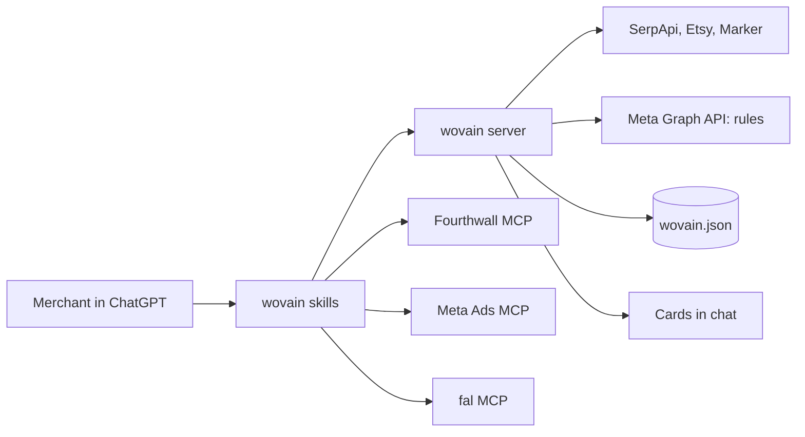

# wovain technical spec

A ChatGPT plugin that is mostly wiring: skills tell ChatGPT what to do, three existing MCP servers (Fourthwall, Meta Ads, fal) do the heavy lifting, and one small wovain server draws the cards and fills the gaps no MCP covers.

Implements `prd.md` (all of **Features and Behavior**). Scope source: `scope.md > The POC boundary`.

## How This Works, In Plain Language

wovain is a plugin you install in ChatGPT (Plus works). A plugin is a folder with a manifest, a few skills and a list of MCP servers.

| Piece | What it is | What it does in wovain |
|---|---|---|
| Skills | Instruction files ChatGPT reads | The playbook for each step: research, design, ads, campaign, optimization |
| Fourthwall MCP | Fourthwall's official server | Blanks, mockups, prices, publishing |
| Meta Ads MCP | Meta's official server | Campaign, ad set, video upload, ads, go live |
| fal MCP | fal's official server | Kling video, background audio, upscaling, background removal |
| wovain server | Our small Bun server, started by the ChatGPT desktop app | Draws the cards, does the margin math, trend lookups, video captions, Meta rules, settings |
| Cards | Small web pages ChatGPT shows inline | Trend, design, ad, campaign, optimization and settings cards |

Why a wovain server at all: ChatGPT can only show a card that an MCP server serves, a card's buttons can only call its own server, and three jobs have no MCP (Meta automated rules, trend APIs, caption burn-in). Everything else goes through the official servers.

How a click works: you press Approve on a card. The card posts a short message ("Approve design d2") into the chat. ChatGPT follows the skill and calls Fourthwall's tools, which you set to auto-approve. Then it calls wovain to redraw the card as live. One click, one extra model turn.

Where things are kept: a single JSON file on your laptop holds settings and the state of each run, so a restart or a new chat picks up where you left off.

Where you use it: wovain runs in the ChatGPT desktop app on the Mac, not on the web or phone.

## The Core Journey Through the System

PRD ref: `prd.md > The Core Journey`.



| # | You do | What happens | You see |
|---|---|---|---|
| 1 | Ask for trending designs | `wovain-trends` skill: web search for candidates, `trends_evidence` (SerpApi, Etsy, Marker), Meta ad library search for ad counts | Trend card |
| 2 | Tick 2 or 3, click "Design the ones I picked" | The card posts the picks; skipped if you bring your own idea | Next step starts |
| 3 | Wait | `wovain-design` skill: ChatGPT generates the art; `stage_artwork` receives it; fal removes the background and upscales; wovain uploads it to Fourthwall; Fourthwall picks the blank and renders mockups; `price_product` sets the price | Design card per idea |
| 4 | Approve, Skip or give feedback | Approve posts "Approve design dN"; Fourthwall creates the product, sets prices, makes it public; `record_design` saves it | Design card shows Live with a link |
| 5 | Wait | `wovain-ads` skill: `video_plan` gives the fal request; fal runs Kling twice, then MMAudio; `finish_video` burns in captions and brand; copy and margins are computed | Ad card per product |
| 6 | Add to campaign, Skip or give feedback | `record_ad` saves the choice; after the last card, the campaign step starts | Next ad card, or the campaign card |
| 7 | Wait | `wovain-campaign` skill: checks payment method and pixel; Meta MCP creates campaign, ad set, uploads, ads; `create_rules` adds the five rules; Meta MCP activates | Campaign card: Live, or Ready, blocked |
| 8 | Later: "How's my campaign?" | `wovain-optimize` skill: `campaign_check` reads rule history and results; Fourthwall reports and sales by UTM add evidence | Optimization card per fired rule |
| 9 | Apply the fix or Dismiss | The fix runs through the same tools (new video, new hook, price test) | Updated ad, campaign keeps running |

## Stack

| Layer | Choice | Version | Docs |
|---|---|---|---|
| Runtime and package manager | Bun | 1.4.3 | https://bun.sh/docs |
| MCP server | `@modelcontextprotocol/server` v2 over stdio | 2.3.1 | https://github.com/modelcontextprotocol/typescript-sdk |
| Card protocol | MCP Apps (`@modelcontextprotocol/ext-apps`) | 2.0.3 | https://github.com/modelcontextprotocol/ext-apps |
| Card UI | React 19 + `@openai/apps-sdk-ui` + Tailwind CSS 4 (its peer) | 19.3 / 0.2.2 / 4.x | https://developers.openai.com/plugins/build/chatgpt-ui |
| Card build | Vite 8 + `vite-plugin-singlefile`, one HTML file per card | 8.x | https://vite.dev |
| Schemas | zod 4 (required by `ext-apps`), shared by tools and cards | 4.2 | https://zod.dev |
| Lint and format | Ultracite with oxlint (type-aware via oxlint-tsgolint) and oxfmt (sorts imports and Tailwind classes) | 8.0.1 / 1.88 / 0.73 / tsgolint 7.0 | https://www.ultracite.ai |
| TypeScript | Official dual setup: `typescript` aliased to `@typescript/typescript6` (6.0 API for tools), `@typescript/native` aliased to `typescript@7` (`tsc` 7.0 for type checking) | 6.0.2 / 7.0.2 | https://devblogs.microsoft.com/typescript/announcing-typescript-7-0/ |
| Git hooks | Lefthook | 2.2.2 | https://lefthook.dev |
| Tests | `bun test` for the server; Vitest 5 with `@vitest/coverage-v8` for cards; MSW 3 mocks shared by tests, mock mode and Storybook | 1.4 / 5.0 / 3.x | https://vitest.dev |
| Card states | Storybook 10 (`@storybook/react-vite` with the a11y, docs, themes and vitest addons, plus `msw-storybook-addon`) | 10.6 | https://storybook.js.org |
| Commits and dead code | commitlint (conventional commits) and knip | 21.x / 6.x | https://commitlint.js.org |
| Video post-processing | ffmpeg bundled with the server (`ffmpeg-static`), so it runs wherever the server runs | 7.x | https://ffmpeg.org |

- TypeScript everywhere: the learner chose it because OpenAI's examples and the ChatGPT UI kit are TypeScript.
- Bun: the learner chose it over Node with Express. The tradeoff is that official examples assume Node, so Node 24 LTS or 26 stays the fallback if Bun misbehaves.
- The server keeps an optional Streamable HTTP mode behind a flag. It is the fallback if the desktop-only install fails: the laptop then runs the server, ngrok exposes it, and wovain is used on chatgpt.com. It listens on 127.0.0.1 only, needs a bearer token (`WOVAIN_HTTP_TOKEN`), and accepts only localhost and the tunnel host (`WOVAIN_HTTP_ALLOWED_HOSTS`), so the tunnel can't be used by anyone else to reach the shop or ads.
- Ultracite with oxlint and oxfmt: the learner's choice (`ultracite init --linter oxlint`).
- React 19: both `@openai/apps-sdk-ui` and `ext-apps` support it; OpenAI's docs still show 18.

## Where It Runs and How Someone Tries It

The ChatGPT desktop app for macOS is where you use it. wovain installs as a desktop-only plugin, and the app starts the wovain server on the Mac over stdio. No tunnel and no hosting. It works only in the desktop app's local threads, not on the web or phone. Source: https://developers.openai.com/plugins/deploy/desktop-only. Publishing local MCP servers is limited to approved partners, so build step 1 verifies the personal install path first.

| Need | Value |
|---|---|
| Plan | ChatGPT Plus, ChatGPT desktop app for macOS |
| Laptop | Bun 1.4 on the Mac |
| Keys in `.env` | `META_SYSTEM_USER_TOKEN`, `META_AD_ACCOUNT_ID`, `META_PAGE_ID`, `META_PIXEL_ID`, `SERPAPI_KEY`, `ETSY_API_KEY`, `MARKER_API_TOKEN`, `FAL_KEY` (fal storage uploads) |
| Rehearsal | `WOVAIN_MOCK=1`: wovain's outside calls are answered by MSW, and the skills skip publish and launch steps |
| Sign-ins in ChatGPT | Fourthwall, Meta Ads and fal (OAuth, once), with auto-approve on for their tools |

Start it:

```bash
bun install
bun run skills:restore          # course skills from skills-lock.json
cp .env.example .env            # fill in keys (optional until a tool needs one)
bun run plugin:install          # builds the cards and server binary, installs plugin/
```

Connect it: `bun run plugin:install` copies `plugin/` to `~/.codex/plugins/wovain` and lists it in the personal marketplace `~/.agents/plugins/marketplace.json`. Restart the ChatGPT desktop app, open Plugins, then Personal, click + on wovain, and start a new chat. The app runs a cached copy and launches the compiled server `bin/wovain-server`, so it needs no Bun on its PATH; the server stores data in `${PLUGIN_DATA}` and reads keys from the repo's `.env` through `WOVAIN_ENV_FILE`. Fourthwall, Meta Ads and fal are added directly in the app: declared inside the plugin, they timed out at startup and held up every turn (verified in build step 1).

Demo recording: in the ChatGPT desktop app on the Mac, follow `scope.md > What "working" looks like` in one chat, then open Ads Manager and the Fourthwall shop. Submission needs the video and a public GitHub repo; deployment is optional and not planned.

## Look and Feel

Carried from `prd.md > Look and Feel`.

- Cards use `@openai/apps-sdk-ui` components and ChatGPT's system fonts, text, background and divider colors. Light and dark follow the host theme.
- One token, `--wovain-accent: #3B4CCA`, used only on primary buttons, badges and icons.
- Status colors stay semantic: green Live, amber Ready-blocked, red Paused.
- Each card opens with one coach line, then the numbers. Money cards lead with breakeven cost per sale; return on ad spend comes second. At most 2 buttons; the ⚙ quick-settings menu is an icon, not a button. No tabs or inner scrolling.
- Images use fixed aspect ratios and alt text. Videos are muted with burned-in captions, tap to play, and the ⛶ control calls ChatGPT's full-screen view (`requestDisplayMode`), since the card can't go full screen itself.
- No shadcn: ChatGPT requires its own design system, and `@openai/apps-sdk-ui` is the official kit.

## Components

### Plugin package

What it does: tells ChatGPT what wovain is and how to start its server. `plugin.json` holds name, version, description and display info, per the Agent Plugins 1.0.0 schema. `mcp.json` lists one local stdio server, wovain (`./bin/wovain-server`, compiled from `apps/server` by `bun run plugin:build`, with the built cards in `cards/`). Fourthwall (`https://mcp.fourthwall.com/app`), Meta Ads (`https://mcp.facebook.com/ads`) and fal (`https://mcp.fal.ai/mcp-relay`) are connected in the app instead. It holds no secret, so it is committed as is; the binary and cards are build output.

PRD ref: `prd.md > Screens and Layout`.

### Skills

Five skills (ChatGPT's limit). Each one names the tools to call in order and the card to finish with.

| Skill | Steps | PRD ref |
|---|---|---|
| `wovain-trends` | Web search for candidates, `trends_evidence`, Meta ad library counts, `show_trend_card` | `prd.md > Trend research` |
| `wovain-design` | Generate art, `stage_artwork`, fal background removal and upscale, Fourthwall upload, blank and mockups, `price_product`, `show_design_card`; on approve, publish and `record_design` | `prd.md > Design cards`, `prd.md > Pricing and economics` |
| `wovain-ads` | `video_plan`, fal Kling ×2, fal MMAudio, `finish_video`, copy, `show_ad_card`, `record_ad` | `prd.md > Ad cards` |
| `wovain-campaign` | Payment and pixel checks, Meta campaign build with `utm_content` = ad ID on every ad link, `create_rules`, activate, `show_campaign_card` | `prd.md > Campaign launch`, `prd.md > Campaign rules` |
| `wovain-optimize` | `campaign_check`, Fourthwall reports and sales by UTM, `show_optimization_card`, apply the fix or turn an ad back on | `prd.md > Optimization` |

Each skill starts Fourthwall calls with `get-instructions`, `ecommerce_get-current-shop` and `load-skills`, as Fourthwall requires.

### wovain server

What it does: one Bun process serving MCP over stdio and the card files as `ui://` resources. Finished media goes to fal storage, which gives each file a public `fal.media` URL. Each tool is one file with a zod input and output schema from `packages/shared`. Tools return user-safe errors and never pass raw upstream errors through.

| Tool | Does | Talks to |
|---|---|---|
| `trends_evidence` | Growth, seasonality, Etsy count and trademark screen per idea | SerpApi, Etsy API, Marker API |
| `stage_artwork` | Receives ChatGPT's image (`openai/fileParams`), checks pixels, uploads it to fal storage so fal and Fourthwall can fetch it from a public URL | wovain.json, fal storage |
| `put_artwork` | PUTs the final artwork bytes to Fourthwall's signed upload URL | Fourthwall upload URL |
| `price_product` | Applies the pricing rule and returns the breakeven math (priciest size or size-weighted) | Settings |
| `record_design` | Saves design status, product ID and link | wovain.json |
| `video_plan` | Returns the fal endpoint and parameters from Settings (model, resolution, length, elements, audio) | Settings |
| `finish_video` | Downloads the clip, burns in captions and the brand for the first 3 seconds with ffmpeg-static, uploads the result to fal storage and returns the public URL for the ad card and Meta's upload by URL | ffmpeg, fal storage |
| `record_ad` | Saves ad choices and copy | wovain.json |
| `create_rules` | Creates the five rules per the PRD | Meta Graph API |
| `campaign_check` | Reads rule history and campaign results | Meta Graph API |
| `get_settings`, `update_settings` | Read and change any setting | wovain.json |
| `show_*_card` (6) | Return card data and attach the card | Cards |

PRD ref: `prd.md > Features and Behavior`.

### Cards

One React component per card, each built into a single HTML file. Buttons use `callTool` for wovain tools and `sendFollowUpMessage` for steps that need Fourthwall or Meta. Each card keeps its in-progress state (ticked ideas, typed feedback) with `setWidgetState`.

| Card | Buttons | Feedback | PRD ref |
|---|---|---|---|
| Trend | Design the ones I picked (enabled at 2 or 3) | Chat | `prd.md > Trend research` |
| Design | Approve, Skip | Field and chat; regenerates the card | `prd.md > Design cards` |
| Ad | Add to campaign, Skip | Field and chat; regenerates the card | `prd.md > Ad cards` |
| Campaign | Open in Ads Manager | Chat | `prd.md > Campaign launch` |
| Optimization | Apply the fix, Dismiss | Chat | `prd.md > Optimization` |
| Settings | Save | Fields | `prd.md > Screens and Layout` |

Approve and Add to campaign disable themselves while their action runs, so nothing is published or added twice (`prd.md > States and Boundaries`).

Each card state from `prd.md > States and Boundaries` has a Storybook story with a mocked `window.openai` bridge; accessibility and interaction tests run through Vitest.

### Settings

Every value in the PRD is a setting, edited in the Settings card or a card's ⚙ menu, saved in wovain.json, and used by the next card without a redeploy.

| Group | Settings (defaults) |
|---|---|
| Trends | ideas 5, pick 2 to 3 |
| Pricing | min profit $10, min margin 30%, round up to a clean price |
| Economics | card fee 2.9% + $0.30, shipping $5, sales tax 7%, refund reserve 2%; breakeven basis: priciest size (default) or size-weighted mix |
| Campaign | $15 per product per day (at most $500; the scale cap at most 5× the start) |
| Rules | kill at 3× breakeven with no sales, checked every 30 min; kill above 1.5× breakeven with 5+ sales in 7 days; scale +20% under 0.8× breakeven with 10+ sales, every 48 h, cap 2× start; kill a design at 4× breakeven with no sales across its ads; alert above breakeven; ad links tagged utm_content = ad ID |
| Video | model Kling v3 Standard, 720p, 15 s, 2 clips per product, elements on |
| Audio | source MMAudio (or Kling native, or off), prompt "upbeat background music, no vocals" |
| Overlay | captions on, brand for the first 3 s |
| Meta | AI disclosure on, Graph API v26.0 |

## Development Tooling

Claude Code setup for building wovain, added in the first build step. Nothing here ships in the plugin.

| Tool | Type | What it does |
|---|---|---|
| fal MCP (`https://mcp.fal.ai/mcp-relay`) in `.mcp.json` | MCP | Lets Claude try Kling prompts, elements and MMAudio during the build, not only inside ChatGPT |
| `/new-tool` | Project skill | Scaffolds one wovain tool: zod schema in `packages/shared`, tool file, card stub, fixture and test |
| `/demo-check` | Project skill, user-only | Preflight before recording: desktop plugin loaded, cards build, shop live, Meta payment method and pixel, fal credit, Etsy and Marker keys, and a claude-ads Meta audit of the ad account |
| claude-ads plugin (installed) | Plugin | `ads-math` and `ads-budget` check the economics, `ads-test` checks the rules, and its optimization guidance seeds the `wovain-optimize` skill; claude-ads is MIT-licensed, and `wovain-optimize` credits it in a NOTICE file |
| `ultracite fix` after each edit | Hook (from `ultracite init --hooks claude`) | Lint and format every edit |
| `gitleaks git --staged` in Lefthook pre-commit | Hook | Blocks secrets and tokens before they reach GitHub |
| Lefthook | Git hooks | Ultracite fix, type check and gitleaks before commits; commitlint on commit messages; knip, tests and story tests before pushes |
| commitlint | Commit check | Enforces conventional commits locally and on pull requests |
| knip | Dead-code check | Finds unused files, exports and dependencies before pushes and in CI |
| Storybook | Card workshop | One story per card state with a mocked `window.openai`; a11y and interaction tests |
| MSW mock mode | Rehearsal | `bun run mock` answers wovain's outside calls from `packages/mocks`, so the demo can be rehearsed without spending |
| GitHub Actions CI | CI | Actions pinned to commit SHAs: commitlint, check, typecheck, knip, test and story tests |
| Dependabot | Updates | Weekly bun and Actions updates, grouped minor and patch, 7-day cooldown |
| release-please | Releases | Changelog and version bumps from conventional commits |
| `skills` CLI | Skills sync | `prepare` copies package-shipped skills (ultracite) into `.claude/skills` |
| VS Code settings | Editor | oxc formatter on save and fix-all; recommends `oxc.oxc-vscode` and `TypeScriptTeam.native-preview` |
| Claude Code plugins (project scope) | Plugins | modern-web-guidance (web best practices for the cards), security-guidance (warnings on edits and a background review on commit, push and stop), hookify (custom hook rules in `.local.md` files); also claude-ads, impeccable, ui-ux-pro-max, humanizer, context7 and commit-commands |

### Ultracite, TypeScript and Lefthook setup

Setup command (run once at the repo root):

```bash
bunx ultracite init --pm bun --linter oxlint --frameworks react vitest \
  --workspace-framework apps/cards=react --editors vscode --agents claude codex \
  --hooks claude --integrations lefthook --type-aware --js-plugins oxlint-plugin-react-doctor --install-skill
```

| Piece | What it does |
|---|---|
| `--type-aware` | Type-aware lint rules through tsgolint (needs TS 7) |
| `--hooks claude` | Claude Code PostToolUse hook runs `ultracite fix` after every edit; merged with the existing sync-plan and Impeccable hooks |
| `--agents claude codex` | Writes lint rules for agents; point them at AGENTS.md, not a new CLAUDE.md |
| `--install-skill` | Installs the `ultracite` Claude skill |
| `--js-plugins oxlint-plugin-react-doctor` | React health rules, as in the sister wovain repo |
| oxlint plugins | eslint, typescript, unicorn, oxc, import, promise, node, react (rules of hooks), react-perf, jsx-a11y, vitest |
| VS Code `TypeScriptTeam.native-preview` | Switches the editor's language server between TS 7 and 6 |

`lefthook.yml`:

```yaml
pre-commit:
  parallel: true
  jobs:
    - run: bunx ultracite fix {staged_files}
      glob: ["*.js","*.jsx","*.mjs","*.ts","*.tsx","*.mts","*.json","*.jsonc","*.css","*.md","*.yml"]
      exclude: ["devpost/**", ".claude/skills/**"]
      stage_fixed: true
    - name: typecheck
      run: bun run typecheck
    - name: gitleaks
      run: gitleaks git --staged --redact --no-banner
commit-msg:
  jobs:
    - name: commitlint
      run: bunx commitlint --edit {1}
pre-push:
  parallel: true
  jobs:
    - name: knip
      run: bun run knip
    - name: test
      run: bun run test
    - name: stories
      run: bun run test:stories
```

Scripts in the root `package.json`:

```json
"check": "ultracite check",
"fix": "ultracite fix",
"typecheck": "tsc -b --noEmit",
"typecheck:6": "tsc6 -b --noEmit",
"knip": "knip",
"test": "bun test",
"test:cards": "vitest run",
"test:coverage": "vitest run --coverage",
"storybook": "storybook dev -p 6006",
"test:stories": "vitest run --project storybook",
"mock": "WOVAIN_MOCK=1 bun run apps/server/src/index.ts",
"prepare": "lefthook install && skills experimental_sync -y -a claude-code --copy && msw init apps/cards/.storybook/public"
```

## Data Model

One file, `wovain.json` in the plugin's data folder (`${PLUGIN_DATA}`; `apps/server/data/` in development, gitignored), read and written by the server only.

| Data | Lives in | Updated by | When you come back |
|---|---|---|---|
| Settings | `settings` | `update_settings` | Same values |
| Ideas | `runs[runId].ideas` | `show_trend_card` | Trend card can be redrawn |
| Designs | `runs[runId].designs` (art URL, customization ID, product ID, price, status) | `stage_artwork`, `record_design` | Approved products stay live; pending ones can be redrawn |
| Ads | `runs[runId].ads` (video URLs, static URL, copy, status) | `record_ad` | Choices kept |
| Campaign | `runs[runId].campaign` (campaign, ad set, ad and rule IDs, status) | `create_rules`, campaign step | Optimization reads it |
| Media | Local copies in `apps/server/data/media/`; public copies on fal storage | `stage_artwork`, `finish_video` | Files stay until deleted |

Card state inside a chat (ticks, typed feedback) lives in the card's widget state; ChatGPT keeps it with the message.

## File Structure

```
wovain/
├── plugin/                      # what ChatGPT installs
│   ├── plugin.json              # manifest: name, version, display info
│   ├── mcp.json                 # wovain (local stdio, compiled binary)
│   ├── bin/, cards/             # build output from bun run plugin:build (gitignored)
│   ├── skills/
│   │   ├── wovain-trends/SKILL.md
│   │   ├── wovain-design/SKILL.md
│   │   ├── wovain-ads/SKILL.md
│   │   ├── wovain-campaign/SKILL.md
│   │   └── wovain-optimize/SKILL.md
│   └── assets/logo.svg
├── apps/
│   ├── server/                  # Bun MCP server
│   │   ├── src/
│   │   │   ├── index.ts         # stdio MCP server (HTTP mode behind a flag)
│   │   │   ├── env.ts           # zod-checked environment
│   │   │   ├── store.ts         # wovain.json read and write
│   │   │   ├── tools/           # one file per tool
│   │   │   ├── cards.ts         # registers the ui:// card resources
│   │   │   └── lib/             # serpapi, etsy, marker, meta-graph, ffmpeg, economics, rules
│   │   ├── test/                # economics, rules, tool schemas, fixtures/
│   │   └── data/                # wovain.json, media/ (gitignored)
│   └── cards/                   # React cards, Vite single-file builds
│       ├── src/
│       │   ├── trend/ design/ ad/ campaign/ optimization/ settings/   # each with *.stories.tsx
│       │   └── lib/             # bridge.ts (window.openai feature checks), QuickSettings.tsx
│       ├── .storybook/          # config, mocked window.openai bridge
│       ├── test/
│       └── vite.config.ts
├── packages/shared/             # zod schemas and types for tools and cards
├── packages/mocks/              # MSW handlers: tests, mock mode, Storybook
├── .github/                     # workflows/ci.yml, workflows/release-please.yml, dependabot.yml
├── .vscode/                     # settings.json, extensions.json
├── .claude/skills/              # course skills (bun run skills:restore), plus new-tool/ and demo-check/
├── scripts/                     # plugin-build.ts, plugin-install.ts
├── .mcp.json                    # dev MCPs: Fourthwall, Meta Ads, fal
├── .env.example
├── oxlint.config.ts, oxfmt.config.ts   # from Ultracite
├── lefthook.yml                 # pre-commit, commit-msg, pre-push
├── commitlint.config.ts         # conventional commits
├── knip.json                    # dead-code check
├── .nvmrc                       # 26 (Node fallback)
├── package.json                 # bun workspaces and scripts
├── tsconfig.base.json           # strict, moduleResolution bundler, types ["bun"], no baseUrl (TS 7)
└── devpost/                     # planning docs
```

## External Services and Dependencies

| Service | Calls | Auth | Cost | Docs |
|---|---|---|---|---|
| Fourthwall MCP | `get-catalog-products`, `get-catalog-product-details`, `request-media-upload-link`, `save-media-library-image`, `generate-product-design-previews`, `get-customization-pricing`, `create-offers-from-designs`, `bulk-update-offer-variant-prices`, `update-offer-status`, `get-conversion-rates-report`, `get-visitors-report` | OAuth in ChatGPT | $0 | https://docs.fourthwall.com/ai/mcp.md |
| Meta Ads MCP | `ads_get_ad_accounts`, `ads_get_datasets`, `ads_library_search`, `ads_create_campaign` (OUTCOME_SALES, campaign budget), `ads_create_ad_set` (pixel, PURCHASE), `ads_creative_upload_media` (VIDEO by URL), `ads_create_creative`, `ads_create_ad`, `ads_activate_entity`, `ads_get_ad_entities` | OAuth in ChatGPT | Ad spend only | https://developers.facebook.com/docs/marketing-api |
| Meta Graph API | `POST /v26.0/act_{id}/adrules_library` (5 rules); `GET` rule history and insights | System user token, `ads_management` | $0 | https://developers.facebook.com/docs/marketing-api/ad-rules |
| fal MCP | `submit_job` / `check_job` for `fal-ai/kling-video/v3/standard/image-to-video` (start image = mockup, elements = artwork), `fal-ai/mmaudio-v2`, background removal, upscaler; fal storage uploads (`FAL_KEY`) | OAuth in ChatGPT; `FAL_KEY` on the server | Kling Standard $0.084/s ($1.26 per 15 s), MMAudio $0.001/s | https://fal.ai/docs/model-apis/mcp |
| SerpApi | `engine=google_trends` (timeseries, related queries) | API key | Free 250 searches a month | https://serpapi.com/google-trends-api |
| Etsy Open API v3 | `GET /v3/application/listings/active?keywords=` (`count`, prices, links) | `x-api-key` | Free; app approval takes days to weeks | https://developers.etsy.com/documentation |
| Marker API | Trademark word search, filtered to class 025 | Token | Free tier (unverified) | https://markerapi.com |

POC running cost on top of ad spend: about $8 for 6 videos with audio, plus a few cents for upscaling; trend data free.

## Important Failure Modes

- **Desktop-only install isn't available for a personal plugin** → switch the server to its HTTP mode and connect through ngrok on chatgpt.com. (Verified in build step 1: the personal install works.)
- **ChatGPT's image is too small or not transparent** → fal removes the background and upscales; if still under the print size, the card shows print quality red and Approve disabled (`prd.md > States and Boundaries` #4).
- **Fourthwall rejects the publish** → card keeps edits and shows the reason; after 2 failures it links to Fourthwall's designer (#6).
- **A video or its audio fails** → the ad card shows the failed slot with Retry, or image only (#7).
- **Meta blocks launch (no payment method or no purchase events)** → campaign card shows Ready, blocked with the fix (#8, #9).
- **Etsy key not approved yet** → the Etsy field shows a search link instead of a count, labeled.

## What Was Simplified and Why

- **Official MCPs for Fourthwall, Meta and video** instead of our own API clients: least code. The fuller version would proxy every call through the wovain server for true one-step clicks.
- **Card buttons post a chat message** for Fourthwall and Meta steps instead of calling them directly: ChatGPT only lets a card call its own server. Costs one model turn per click.
- **Optimization card on check-in** instead of a pushed alert: ChatGPT can't start a conversation. Meta's own rule notifications cover the gap. The fuller version would need a notification channel.
- **Print fidelity checked by eye** in the full-screen view instead of an automatic check: no provider offers one. The fuller version would compare video frames to the mockup with a vision model.
- **Trademark screening via Marker** instead of an official USPTO search API: none exists. Labeled screening, not legal advice.
- **One JSON file** instead of a database: one merchant, one laptop.
- **Desktop-only plugin on the Mac** instead of hosting: no tunnel or server to run; a public plugin would need a hosted server with OAuth.

## Decisions and Open Issues

| Decision | Chosen by | Why | Tradeoff accepted |
|---|---|---|---|
| Plugin with child MCPs plus a thin wovain server | Learner | Reuse Fourthwall, Meta and fal; code only what's missing | One extra model turn per click |
| Auto-approve for Fourthwall, Meta and fal tools | Learner | One click per card | Fewer safety prompts; cards stay the approval point |
| Video: Kling v3 Standard 720p on fal, elements on | Learner | Cheapest model that holds the print; fal has the only official MCP with elements | Lower resolution than Pro; one setting away |
| Audio: fal MMAudio, configurable | Learner | Meta's music skips video ads; 42× cheaper than Kling audio | Generic background music |
| Every value in Settings and per-card ⚙ | Learner | Tune without redeploys | A bigger settings schema |
| Trend data: free bundle | Learner | $0 a month | Etsy approval wait; Marker unverified |
| Bun, Vite, React 19, Ultracite with oxlint, TypeScript | Learner | Fast tooling and their preference | Official examples assume Node |
| Desktop-only plugin, server over stdio | Learner | No tunnel or hosting, like Claude's local plugins | Desktop app only; no web or phone |
| Fidelity by eye | Learner | Smallest POC | Relies on attention |
| Superpowers plugin skipped | Learner | It would override the course skills | Revisit for `5-build` |
| Kill at 3× breakeven every 30 min; shop sales by UTM cross-check | Learner | Fewer false kills; the shop is the source of truth for sales | One ad can spend up to about $31 before it's paused |
| Design-level kill at 4×; breakeven on priciest size, size-weighted optional | Learner | Matches print-on-demand: the design is the test, sizes cost differently | Slightly stricter kills |
| TypeScript 6 + 7 dual setup, Ultracite with oxlint, oxfmt, Lefthook, Ultracite skill and hooks | Learner | Official setup; fast type checks and lint on every edit and commit | Two TypeScript versions to keep in step |
| DX set from the sister wovain repo: commitlint, knip, Lefthook with type check on commit, MSW with mock mode, Storybook, CI, Dependabot, release-please, plus modern-web-guidance, security-guidance and hookify; no shadcn | Learner | Same habits as their main project; rehearse without spending; check card states outside ChatGPT | About an hour more setup |
| JSON store, optimization on check-in, ffmpeg captions | Derived | Follow from the choices above | See What Was Simplified |

Learning moment: the learner asked "why even a server, not a plain plugin with child MCP servers?" It was clarified by three platform facts: cards must be served by our own MCP server, card buttons can only call that server, and Meta rules, trend APIs and caption burn-in have no MCP. The learner then picked the thinnest server. A second question, "what is elements, and can't we support it ourselves?", was clarified: it is reference-image conditioning inside the model, so only a provider that exposes it can offer it; our side can only add checks.

Verify early in the build, in this order:

| # | Check | If it fails |
|---|---|---|
| 1 | Desktop-only plugin installs from the local folder on Plus; the app starts the stdio server; a card renders; a card button's message triggers a Fourthwall tool with auto-approve | HTTP mode + ngrok on chatgpt.com |
| 2 | `openai/fileParams` delivers a ChatGPT image with a fetchable URL in the desktop app | Ask the merchant to upload the image |
| 3 | fal Kling v3 Standard with elements and a mockup start frame keeps the print readable; MMAudio adds audio | Switch to Pro 1080p in Settings |
| 4 | Meta accepts a fal.media video URL; one NOTIFICATION rule created with the system user token; rule filters match per-product ads by name | Upload from file; adjust filters |
| 5 | Meta MCP campaign gets `ADVANTAGE_PLUS_SALES` state | Set fields through the Graph API |
| 6 | Marker API is alive; Etsy app approved | Show labeled search links |
| 7 | Bun resolves the TS 6/7 npm aliases; `bunx tsc` runs 7.0 | Pin TS 6 only and skip type-aware lint |
| 8 | Ultracite's Claude hook merges cleanly with sync-plan and Impeccable hooks in `.claude/settings.json` | Merge the hooks by hand |
| 9 | Storybook renders the cards with the mocked `window.openai` bridge | Use a plain Vite gallery page |

Carried from `prd.md > Open Questions` (still open, before the demo): Meta payment method, shop set live, Meta pixel and Conversions API connected in Fourthwall. Voice: tools work in Live voice since 2026-09-23; whether cards render in voice is unverified, so voice stays a bonus.

Not decided by the learner and flagged for review: the `self_ai_disclosure` value on Meta creatives (default on) and the Meta API version pin (v26.0, given Meta's removals on 2026-10-27).
