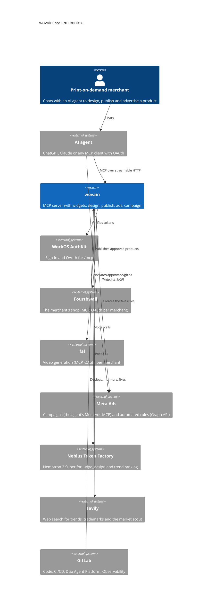
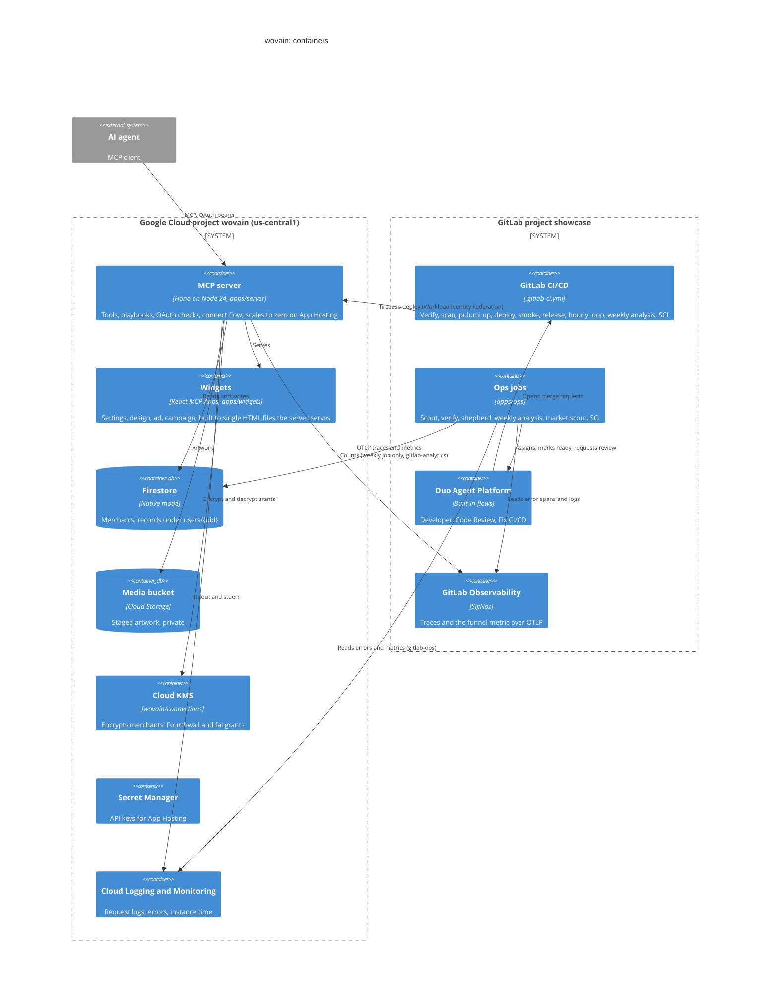
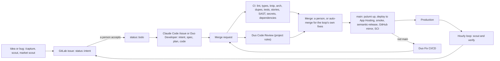

# Architecture

C4-style views of wovain: who uses it and what it talks to (context), then what runs where (containers), then how the code moves from an idea to production (delivery). The code map is in [app-map.html](app-map.html), the records in [data-model.md](data-model.md), and the self-healing loop in [loop.md](loop.md).

## 1. System context

## 2. Containers

## 3. Delivery

## Boundaries

- Everything in Google Cloud and GitLab is declared in `infra/` (Pulumi); CI applies it on `main`. What stays manual is in the README.
- Spending (Fourthwall publish, fal generation, Meta launch) happens only after the merchant approves in a widget.
- CI reaches Google Cloud with Workload Identity Federation: four service accounts, each trusted only from one GitLab environment (`production`, `infrastructure`, `operations`, `analytics`). Only the weekly analysis account can read Firestore.
