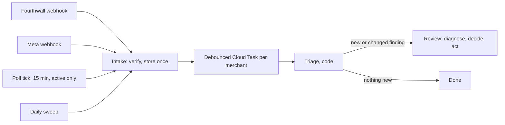
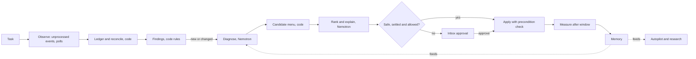

# Spec: Optimization agent, a per-merchant loop that diagnoses, acts, measures and learns

Paused 2026-10-25: code removed from main in [!80](https://gitlab.com/gitlab-ai-hackathon/transcend-october-2026/43085639/showcase/-/merge_requests/80), plan kept. Leftover data: see [intent.md](intent.md).

Intent: [intent.md](intent.md)

## Requirements

1. A merchant who turns the optimizer on is reviewed when something happens, with no host agent: a Fourthwall or Meta webhook, a poll that finds new numbers, or a daily sweep. `optimizer_review` also starts a review on demand.
2. Webhook endpoints accept only correctly signed requests (Fourthwall HMAC-SHA256, Meta `X-Hub-Signature-256`), answer within Fourthwall's 2-second limit, and store each event once: a repeated delivery is acknowledged and dropped.
3. Each stored event enqueues a Cloud Task for its merchant, debounced: every event inside one window (default 120 s) leads to one run.
4. Meta insights are polled every 15 minutes for a merchant only while at least one of their campaigns is delivering or spent in the last 24 hours. Polling stops when nothing runs and restarts on a Meta status webhook, a launch, or an optimizer resume.
5. A reconciliation poll reads Fourthwall orders, refunds, fulfillment and the catalog on the same 15-minute cadence while campaigns run, and once a day otherwise, so a missed webhook delays a decision and never changes it.
6. Every run saves what it observed per source, and every review saves its diagnoses, its proposed actions, what it applied, and why. `optimizer_status` returns them.
7. Sales are counted from Fourthwall: orders minus refunds, cancellations and chargebacks. Meta purchases are a signal. When the two disagree past the threshold on settled data, no kill action runs on the affected ads, designs or campaign.
8. A diagnosis has `what`, `cause`, `evidence[]` (each with its source: `fourthwall`, `meta`, `trends`, `wovain` or `computed`), `confidence` (`high`, `medium`, `low`, `unknown`) and `missing[]` (evidence that would change it).
9. An action has a type, a target (ad, design, campaign or product), an expected impact computed by code, a risk class (`safe`, `risky` or `advice`), a measurement window, a rollback, a precondition (the remote state it expects) and an idempotency key.
10. Code builds the menu of candidate actions and enforces every limit. Nemotron diagnoses, ranks and explains; it never picks a tool, an amount or a target outside the menu.
11. Safe actions apply on their own only when `autonomy` is `safe`, every guardrail passes and the precondition still holds. The default is `advise`. Risky actions always wait for approval and expire after `approvalTtlHours`.
12. Kill actions (`pause_ad`, `pause_design`, `budget_down`) judge only settled data: Fourthwall data older than `shopSettleMinutes` (60) and Meta data older than `conversionLagHours` (72). Operations pauses (a blank out of stock) don't wait, because they rest on Fourthwall facts, not on sales counts.
13. Each applied action is measured after its window: `improved`, `no_change`, `worse` or `inconclusive`, with the numbers. A safe action that came out `worse` is rolled back within the same guardrails.
14. Outcomes update a per-merchant memory of features (hook, angle, audience note, design tags, blank, color, price point). Autopilot's idea scoring and ad copy, research ranking and the creative refresh read it.
15. The optimizer never activates a campaign the merchant hasn't launched, never deletes, never exceeds the merchant's budget cap, and never changes a price, bundle or promotion without approval. Unit tests read the action table and the upstream allowlist to prove it.
16. Without a Meta grant the optimizer works in check-in mode: Fourthwall events and polls still run, the host agent passes the Meta insights it read with its own Meta MCP, and every Meta action is advice for the agent to apply after the merchant agrees.
17. Without `NEBIUS_API_KEY`, or with the operator switch `WOVAIN_OPTIMIZER=off`, reviews answer `configured: false` for the model steps; event intake, reconciliation and the code rules still run.
18. claude-ads skills are vendored unchanged and pinned by hash; a CI check fails if a vendored file changes. `NOTICE` credits claude-ads under MIT.

## Design

### 1. Reusing claude-ads

claude-ads 2.1.0 (MIT, Daniel Agrici, https://github.com/AgriciDaniel/claude-ads) ships its skills as thin procedures (`skills/ads-*/SKILL.md`) over shared references in `ads/references/`. The parts that matter here:

| claude-ads piece | What wovain takes from it |
| --- | --- |
| `ads-optimize` | The loop shape: load snapshot, prior decisions, monitoring, experiments, lag and economics; compare no-change, experiment and mutation options; ranked recommendations with confidence and success measures; apply only through a gate that rechecks remote state; never delete |
| `ads-monitor` | Compare snapshots only over compatible, finalized windows; separate learning, seasonality, reporting lag and planned changes from real anomalies; don't alert on percentage changes with tiny denominators |
| `ads-meta` and `ads/references/meta-audit.md` | The cold-start contract (account, pixel and conversion maturity judged separately, `unknown` when evidence is missing); the controls wovain checks: M01 pixel, M02 CAPI, M03 deduplication, M04 match quality, M13 and M14 learning phase, M28 creative fatigue, M29 hook rate, M39 UTM parameters, M40 A/B testing; the recommendation boundary (evidence, owner threshold, mechanism, confidence, reversible step, window, rollback) |
| `ads-attribution` | Platform-attributed and shop numbers are reported side by side and never added; reconcile over one window and one definition of a sale |
| `ads-creative` | Fatigue only from time series, never from age alone; concepts counted by hook and angle, not by resize; refresh briefs with hypothesis, audience, format, success measure |
| `ads-math` and `ads/references/budget-allocation.md` | The formulas (CPA, ROAS, break-even CPA and ROAS, marginal CPA, contribution after ads), base, downside and upside cases, no hidden division by zero, platform-attributed and shop revenue kept apart |
| `ads-budget` | Scale only when data has matured, tracking is healthy and marginal performance is inside the owner's boundary; the change packet (amounts, object IDs, rationale, expected effect, rollback trigger, idempotency key) |
| `ads-test` | Hypothesis, one decision surface, sample and duration from stated assumptions, no peeking, plain-language readout |
| `ads-report` | Render from one validated record, keep confidence and missing inputs visible, never hide partial evidence in the summary |
| `ads/references/thinking-framework.md` | Principle 8 (accept failed hypotheses after lag and a fair window) and 10 (every recommendation carries its measurement plan) |

**How it's vendored.** The `skills` CLI (1.7.2, already a dev dependency) installs the ten skills unchanged into `.agents/skills/` and pins each in `skills-lock.json` with its `computedHash`:

```bash
pnpm skills add AgriciDaniel/claude-ads --skill ads ads-optimize ads-meta ads-attribution ads-creative ads-math ads-budget ads-test ads-monitor ads-report -y --copy
```

- `ads` is included because the others read `ads/references/` from it.
- The copies are committed (owner decision 8), so CI, Duo and reviewers read the same files. A `skills:check` step in `pnpm check` and the verify job recomputes each hash and fails on any edit. Whether `skills` 1.7.2 has a built-in verify command is unverified; if not, the check is a short TypeScript script in `scripts/`.
- `.agents/skills/claude-ads/LICENSE` is not part of a skill folder, so the MIT text goes into `NOTICE` at the repo root, with the copyright line, the version and the list of wovain files that adapt it.

**The print-on-demand overlay** is wovain's own skill, `.agents/skills/wovain-pod-ads/`. Its `SKILL.md` says: read the matching claude-ads skill first, then apply these rules. Its references hold the rules in section 4, each with an ID (`POD-E1` and so on). The overlay serves two readers:

- coding agents working on the optimizer (Claude Code, Duo) read it as a skill;
- the server can't read `.agents/` at runtime, so `apps/server/src/optimizer/guidance.ts` holds the condensed system prompt, and the deterministic rules are code in `packages/shared/src/optimizer/`. A unit test reads the overlay's rule IDs and fails if any ID has neither a code rule nor a guidance line, which keeps the three in step.

### 2. Events and polling



#### Fourthwall webhooks

Fourthwall's webhook catalog (docs.fourthwall.com, `openapi/platform.json`, checked 2026-10-22):

| Event | What it covers for the optimizer |
| --- | --- |
| `ORDER_PLACED` | "Fired when a new order is successfully placed and paid": order created and paid are one event. Carries `trackingParams` (UTM), offers, variants, amounts |
| `ORDER_UPDATED` | Status, shipping address or email changed (`update.type`). Status is one of `CONFIRMED`, `PARTIALLY_IN_PRODUCTION`, `IN_PRODUCTION`, `PARTIALLY_SHIPPED`, `SHIPPED`, `PARTIALLY_DELIVERED`, `DELIVERED`, `CANCELLED`, `COMPLETED`: production, shipping, delivery and cancellation |
| `PRODUCT_CREATED`, `PRODUCT_UPDATED` | Product and variant changes, including variant stock (`Limited` or `Unlimited`) and availability |
| `PROMOTION_STATUS_CHANGED` | A promotion started or ended, so a sales jump isn't credited to an ad |
| `CART_ABANDONED_1H`, `_24H`, `_72H` | Checkout drop-off per product, a funnel signal between session and sale |
| `PLATFORM_APP_DISCONNECTED` | Stop intake for that shop |

There are no events for refunds, returns, chargebacks, production errors or the blank catalog. Those come from the reconciliation poll.

- **Signature.** `X-Fourthwall-Hmac-SHA256`: base64 HMAC-SHA256 of the raw body with the webhook's secret. A Platform App's webhooks use `X-Fourthwall-Hmac-Apps-SHA256` with the app's HMAC key. The handler reads the raw body before parsing and compares with `crypto.timingSafeEqual`.
- **Delivery.** At least once and not guaranteed; no ordering across topics (`ORDER_UPDATED` can arrive before `ORDER_PLACED`); 5 attempts with a 5-second timeout; a reply slower than 2000 ms may count as failed. Each event has an `id` to dedupe on and a `shopId` to route on, and `testMode` events are stored but never acted on.
- **Registration.** `POST /open-api/v1.0/webhooks` with `{ url, allowedTypes }` returns the webhook's `id` and `secret`. It takes an OAuth token with scope `webhook_write`, or Basic auth. The Fourthwall MCP tools have no webhook tool, and whether #19's MCP token works on the Platform API is unverified (intent open question 1). Chunk 1 tries it; the fallbacks in order are a Fourthwall Platform App with `webhook_write` (multi-shop OAuth, a second Fourthwall grant) and polling only. Registration runs when the merchant turns the optimizer on, from optimizer code, not from the connections files; the secret is stored encrypted with `lib/cipher.ts`.

#### Meta webhooks

Meta's ads webhooks (Marketing API "Ads Webhooks", expanded July 2026) on the `ad_account` object:

| Field | Use |
| --- | --- |
| `effective_status` | Delivery status changed on a campaign, ad set or ad (rejected, blocked, back to active). Starts and stops polling |
| `with_issues_ad_objects` | An object entered `WITH_ISSUES`, with `error_code` and `error_summary` when present |
| `in_process_ad_objects` | An object finished publishing |
| `creative_fatigue` | Meta thinks an ad's creative is fatiguing: a signal next to POD-C1, never a trigger by itself |
| `ad_recommendations` | A new Meta recommendation, shown as evidence |
| Unified ads subscriptions | Filtered object changes and insights thresholds (for example spend crossing a value). Only a filter example is documented; chunk 7 verifies thresholds before relying on them |

- **Signature.** `X-Hub-Signature-256: sha256=<hex>`, HMAC-SHA256 of the raw body with the Meta app secret. The `GET` verification answers `hub.challenge` when `hub.verify_token` matches the `meta-webhook-verify-token` secret.
- **Delivery.** Batches of up to 1000 changes, retried with decreasing frequency for 36 hours, duplicates possible. A change has no event id, so the idempotency key is a hash of account, field, object id, value and `time`. Payloads say something changed; the run reads the details from the API.
- **Registration.** Two steps: the app subscribes to `ad_account` fields with its callback URL and verify token (`POST /{app-id}/subscriptions`, app token), declared in `infra/meta.ts` through the `magodo/restful` provider the WorkOS settings already use; then each merchant's ad account adds the app (`POST /act_{id}/subscribed_apps`) with the merchant's token, which needs #19's Meta grant with `ads_management` and, for non-testers, App Review.

#### Polling

- **Meta insights.** Meta refreshes insights about every 15 minutes (Marketing API, Insights "Limits and Best Practices"), so polling faster buys nothing. A merchant is polled every 15 minutes while `activeUntil > now`, where `activeUntil` is pushed 24 hours past the last time a campaign was seen delivering. One account-level call per poll (`level=ad`, today and yesterday), which keeps well inside Meta's per-account throttling. When nothing has delivered for 24 hours, polling stops; an `effective_status` webhook to an active state, a launch through wovain, or an optimizer resume sets `activeUntil` again.
- **Fourthwall reconciliation.** On the same tick while active, and once a day otherwise: orders updated since the last cursor (`ecommerce_get-orders`), cancellations and refunds (`ecommerce_get-order-cancellation-by-ids`), unfulfilled orders and fulfillment detail (`ecommerce_get-unfulfilled-orders`, `ecommerce_get-fulfillment-details`), payout transactions for chargebacks (`ecommerce_get-payout-transactions`; whether chargebacks appear there is unverified), and the blanks of live designs (`ecommerce_get-catalog-product-details`, stock and colors). Any change the webhooks didn't deliver becomes a synthetic event with `source: "poll"`.
- **Analytics reports** (sales over time, by source, by UTM, sessions by source, conversion rates, top products, AOV, visitors, profit) are daily aggregates, so they're read once per review and cached for an hour.
- **Trends.** Each niche a merchant sells in (the design tags and Qloo entities saved on their designs) gets one Tavily search and one Qloo call per day, cached per niche across merchants. The daily sweep compares them with last week's and raises a `trend_shift` event when a niche rises or falls past the threshold.
- **Daily sweep.** Once a day per enabled merchant, at `reviewHourUtc`: the idle reconciliation, the trend check, measurement of due actions, expiry of stale approvals, and a review even if no event arrived.

#### Intake and debounce

- `POST /webhooks/fourthwall` and `GET|POST /webhooks/meta` (`apps/server/src/routes/webhooks.ts`). Each verifies the signature, routes to a merchant through the top-level indexes `fourthwallShops/{shopId}` and `metaAdAccounts/{actId}` (uid only, no merchant data), and creates `users/{uid}/optimization/state/events/{key}` with Firestore `create()`. A `create()` that fails with "already exists" is a duplicate: answer 200 and stop.
- After a new event, the handler enqueues task `<uid>-run-<window>` on the `optimizer` queue, where `window = floor(now / debounceSeconds)`, scheduled for the window's end plus 10 seconds. Cloud Tasks rejects a second task with the same name, which the handler treats as success, so a burst of orders in one window makes one task. Windows are fixed, not sliding, so a steady stream still produces a run every `debounceSeconds`.
- An unknown `shopId` or ad account, a bad signature or a body over 1 MB gets 401 or 404 and nothing is stored. The handlers never call upstream, so they answer in milliseconds.

### 3. The loop



#### Observe

A run takes a lease, reads the merchant's unprocessed events, refreshes only what those events touched (an order event refreshes that order and its product; a Meta status event re-reads that object), and folds them into the day's normalized snapshot (`packages/shared/src/optimizer/snapshot.ts`). Each row keeps its source.

| Source | Calls (merchant's grant) | Normalized into |
| --- | --- | --- |
| Fourthwall orders | `ORDER_PLACED`, `ORDER_UPDATED`; `ecommerce_get-orders`, `ecommerce_get-order-details-by-ids` (product, variant, size, quantity, totals, `trackingParams`) | `order` rows: the sales ledger per ad (by `utm_content`), design, product and variant |
| Fourthwall refunds, cancellations, chargebacks | `ecommerce_get-order-cancellation-by-ids`, `ecommerce_get-payout-transactions` | Ledger reversals with their reason |
| Fourthwall fulfillment | Order status from `ORDER_UPDATED`; `ecommerce_get-unfulfilled-orders`, `ecommerce_get-fulfillment-details` (skipped and cancelled fulfillments) | `fulfillment` rows: days in each status, production errors, shipping holds |
| Fourthwall catalog | `PRODUCT_UPDATED`; `ecommerce_get-catalog-product-details` for each live design's blank | `stock` rows per product, variant and color |
| Fourthwall customers | Order emails hashed in memory to a per-shop customer key (never stored in clear) | Repeat rate, units per order |
| Fourthwall analytics | `ecommerce_get-sales-over-time-report`, `-sales-by-source-report`, `-sales-by-utm-report`, `-sessions-by-source-report`, `-conversion-rates-report`, `-top-products-by-units-sold-report`, `-average-order-value-report`, `-visitors-report`, `-total-profit-report` | `funnel` per product where the report allows it, shop-wide otherwise; profit as a cross-check on the ledger |
| Meta structure | `ads_get_ad_entities` (status, effective status, budget, names); webhooks | Entities, mapped to wovain designs by ad name (`wovain d1 · A`) |
| Meta performance | Ad-level daily insights: spend, impressions, reach, frequency, clicks, CTR, CPM, 3-second plays, purchases, purchase value. Which Meta Ads MCP tool returns raw daily ad-level rows is unverified (`ads_insights_performance_trend` is the candidate); otherwise Graph `GET /act_{id}/insights?level=ad&time_increment=1` on the merchant's token, if #19's token works on Graph (open in #19) | `adDay` rows |
| Meta signal health | `ads_get_dataset_quality`, `ads_get_dataset_stats`, `ads_insights_anomaly_signal`; `creative_fatigue` and `ad_recommendations` webhooks | `tracking` block, Meta's own hints |
| Trends | `lib/tavily.ts` (news and competitor ads in the niche), #21's `lib/qloo.ts` (taste affinity over time), cached per niche | `trend` rows: direction, size, evidence links |
| wovain records | Designs (`quote`, base cost per size, tags), ads (slots, hooks, copy), campaign, settings, autopilot runs (#22), past optimizer runs, actions and outcomes; the merchant's own funnel steps (connect, idea, set approved, ad approved, campaign created, the same step names as #27's anonymous metrics) | Joined in |

#### Reconcile

`packages/shared/src/optimizer/ledger.ts` and `reconcile.ts` turn the rows into one view per ad, design and campaign over each window, with each source's number kept separately:

- **Net sales** = Fourthwall orders attributed to the ad by `utm_content`, minus refunds, cancellations and chargebacks on those orders. This is the count every decision uses.
- **Meta purchases** stay a signal: they can raise confidence and they can block a kill; they never cause a kill or a scale by themselves.
- **Settled.** A Fourthwall window is settled `shopSettleMinutes` (60) after it closes, a Meta window `conversionLagHours` (72) after. Refunds keep landing later, so the measure step reads them again at the end of each action's window.
- **Checks**, each a finding when it fails:

| Check | Compares | Fails when |
| --- | --- | --- |
| R1 Purchases | Meta purchases vs net sales from `utm_source=meta`, same settled window | Gap over `disagreementPct` (30%) and at least 2 sales apart |
| R2 Clicks to sessions | Meta link clicks vs Fourthwall sessions from Meta (`sessions-by-source`) | Sessions under half of clicks (stripped UTMs, a slow or broken page) |
| R3 UTM coverage | Sales by source (Meta) vs sales by UTM with an ad id | Under 80% of Meta-sourced sales carry an ad id |
| R4 Revenue | Ledger contribution vs Fourthwall's profit report, same days | Off by more than 10% (a fee or cost wovain doesn't model) |
| R5 Trend | The merchant's niche trend vs the shop's sales trend | Both move the same way: the swing is market-wide, not one ad's doing |

- **Disagreement blocks kills.** While R1 or R2 is open on an entity (or on the campaign above it), `pause_ad`, `pause_design` and `budget_down` aren't built for it; `hold`, `fix_tracking` and operations actions still are. The block lifts when the check passes on a later settled window or the merchant dismisses it with a reason, which is saved.

#### Diagnose

Code computes the facts first (`math.ts`, `pod.ts`, `ops.ts`): breakeven per sale, realized breakeven from the actual size mix, CPA on net sales and on Meta purchases, contribution after ads and refunds, CTR and hook-rate trends against each ad's own first week, frequency trend, funnel rates, refund rate per design, days in production per order, stock per variant. Then the rules in section 4 produce **findings**: a finding names an entity and a pattern (`creative_fatigue`, `no_click`, `clicks_no_sale`, `source_disagreement`, `tracking_gap`, `missed_sale`, `size_mix_erodes_margin`, `winner_capped`, `blank_out_of_stock`, `color_discontinued`, `fulfillment_delay`, `production_error`, `shipping_issue`, `refund_spike`, `chargeback`, `trend_shift`).

**Triage** (code only, every run) compares the findings with the open ones. If nothing is new or changed, the run ends without a model call. Otherwise Nemotron (call N1) gets the new findings and their evidence rows as untrusted JSON and returns one diagnosis per finding: `what` (plain words), `cause` (one of the causes code allows for that pattern, or `unknown`), the evidence it relied on (references to rows code gave it), `confidence`, `missing`. Code then caps the confidence: `high` needs settled data from both sources and R1 passing; a cold pixel or a conversion cold start (the `ads-meta` contract) caps it at `low`.

#### Decide

Code builds the candidate menu from the findings. Each candidate is fully specified by code: type, target, amount, expected impact, risk, window, precondition, rollback.

| Action | Built when | Expected impact (code) | Risk | Window |
| --- | --- | --- | --- | --- |
| `pause_ad` | Ad-level kill (POD-K1) on settled data, no open R1 or R2 | Spend saved per day; contribution change | safe | 3 days |
| `resume_ad` | A paused ad has a net sale by UTM that Meta missed (POD-M3) | Recovered contribution at its shop CPA | safe | 3 days |
| `pause_product_ads` | A product can't ship: its blank, every listed color, or a size carrying most of its sales is out of stock or discontinued (POD-O1), or production errors cancel its orders (POD-O4) | Spend saved until it can ship; sales lost are ones that couldn't be fulfilled | safe | Until restocked |
| `resume_product_ads` | Stock is back on ads `pause_product_ads` paused | Restored sales at its last shop CPA | safe | 3 days |
| `budget_up` | Winner capped (POD-B1) on net sales, within `maxBudgetChangePctPerDay` and the cap | Extra sales at marginal CPA, base and downside cases | safe | 7 days |
| `budget_down` | Campaign CPA on net sales above breakeven on settled data, nothing to pause, no open R1 or R2 | Spend saved, sales lost at marginal CPA | safe | 7 days |
| `pause_design` | Design-level kill (POD-K2) | Spend saved on all its ads | risky | 7 days |
| `quality_check` | Refund spike on a design (POD-O2) | Refund cost avoided if the cause is the print; the brief asks the merchant to order a sample and check print, size chart and photos | advice | 14 days |
| `ops_alert` | Fulfillment delay, shipping issue, production error or chargeback the merchant must handle with Fourthwall (POD-O3 to O5) | None; links to the orders and Fourthwall's help | advice | next review |
| `refresh_creative` | Fatigue (POD-C1), a no-click ad on a design that sells elsewhere, or a color the ads show is discontinued | Restore the ad's first-week CTR at today's CPM (upside), no change (downside); fal cost from `video_plan` prices | risky (spends fal credits) | 7 days after learning |
| `ab_test` | Two credible hooks or prices and enough budget for the sample (`ads-test`) | Decision value, test cost, duration from the stated sample | risky | Test length |
| `audience_change` | A Qloo audience the memory rates well and Advantage+ delivery stuck on one segment (weak signal, low confidence) | Unknown, labeled as a hypothesis | risky (learning reset) | 7 days |
| `price_change` | Clicks with no sale and a price above the shop's sold median, or margin room (POD-E3) | Breakeven and CPA at the new price | risky (shopper-facing, always approval) | 14 days |
| `bundle_offer` | Low AOV and multi-unit orders in the shop (POD-E4) | Breakeven per order with one shipping and one card fee | risky (shopper-facing, always approval) | 14 days |
| `hold` | Always, as the no-change option `ads-optimize` asks for | Current trajectory | none | next review |
| `fix_tracking` | R1, R2 or R3 open, or tracking gap (POD-M1) | None until fixed; blocks kills | advice | next review |

Nemotron (call N2) gets the diagnoses, the menu and the merchant's memory, and returns the menu IDs it recommends in order, a one-line reason each, and the coach line for the report. Code drops any ID not on the menu and re-sorts so that `hold` always appears when the model ranked nothing above it.

For `refresh_creative`, a third call (N3) writes three new hooks and angles from Tavily's "why now" news for the design's niche, Qloo's audience tastes, and the memory's best hooks for this merchant. Code applies autopilot's D7 limits (length, no price or discount claims, no five-word overlap with competitor text) and makes the creative brief part of the approval.

#### Act

`apps/server/src/optimizer/act.ts` applies one action:

1. Check autonomy and risk: `safe` actions apply only under `autonomy: "safe"`; everything else goes to the inbox.
2. Check guardrails (section 7) against today's ledger of applied changes, and that the data the action rests on is settled.
3. Re-read the target and compare it with the action's precondition (status, budget, stock). A mismatch cancels the action as `stale`.
4. Write the action as `applying` with its idempotency key, call upstream, write `applied` with the response IDs, or `failed` with a user-safe reason.
5. Save the baseline numbers the measure step will compare against.
6. A pause or resume moves `activeUntil` so polling follows.

Writes go through `upstream.call` on the merchant's grant with the optimizer's own fixed allowlist (`optimizer/allowlist.ts`): Meta `ads_update_entity` (status `PAUSED` or `ACTIVE` on ads already live, `daily_budget` on the campaign), `ads_experiment_abtest_create_test`; Fourthwall `ecommerce_bulk-update-offer-variant-prices`, `ecommerce_create-bundle`, `ecommerce_create-shop-promotion`, and `POST /open-api/v1.0/webhooks` for registration; fal only through the ads pipeline on approval. `ads_activate_entity` and every delete tool are absent, and `ads_update_entity` to `ACTIVE` is allowed only on an ad wovain itself paused (its action record says so) inside a campaign that is already live. The allowlist has no Fourthwall order tools: refunds, cancellations and order changes stay the merchant's.

In check-in mode (no Meta grant) nothing is written to Meta. The tool reply lists the approved actions and the playbook tells the host agent to apply them with its own Meta MCP, then call `optimizer_decide` with `applied: true`.

#### Measure

Each applied action has `measureAt`. The daily sweep measures every action that is due:

- Compare the target's contribution after ads and refunds per day, CPA on net sales, and the pattern's own metric (CTR for a refresh, spend for a pause, refund rate for a quality check) between the saved baseline and the window after, on settled data only.
- Use the other live ads and designs as a rough control (difference in differences) so a shop-wide swing isn't credited to one action. R5 marks windows where the niche moved.
- Label the outcome `improved`, `no_change`, `worse` or `inconclusive` (too little data, an open R1 or R2, or tracking broke during the window). Thresholds are settings, with defaults labeled as heuristics.
- A safe action that came out `worse` gets a rollback action (for example `budget_down` back to the old budget) that goes through Act again.

#### Learn

`users/{uid}/optimization/state/memory/{featureKey}` keeps one record per feature value the merchant has tried: `hook:<cluster>`, `angle:<tag>`, `audience:<note>`, `style:<tag>`, `blank:<id>`, `color:<name>`, `price:<band>`. Each holds trials, wins (beat breakeven on net sales over the window), losses, refund rate, the last outcome and a decayed Beta score (prior Beta(1,1), 60-day half-life so last season's lessons fade). Hooks are clustered by a tag Nemotron gives each hook when it is created, so "cat dad energy" and "for cat dads" count as one. A blank with a refund spike or repeated stock-outs loses score, so autopilot stops picking it.

`optimizer/memory.ts` exports `getLearnings(userId)`, which returns the top and bottom features with their scores. Readers:

- autopilot (#22): D1 idea scoring adds a `fit` signal from the memory, and its `autopilot.weights` refit (the ±0.05 per review rule in #22's spec section 9) uses the optimizer's outcomes instead of reading sales itself;
- autopilot D7 and N3: the best hooks and angles go into the prompt as examples, the worst as ones to avoid;
- `research_trends` (#3, #21): ideas that match a winning style or audience rank higher.

### 4. Print-on-demand rules (the overlay)

Each rule is code in `packages/shared/src/optimizer/pod.ts` or `ops.ts` unless marked as guidance.

**Economics**

- **POD-E1 Breakeven per sale.** `breakeven(price, baseCost, economics).perSale` from `economics.ts`, on the base cost Fourthwall quoted for the blank. Break-even CPA equals breakeven per sale; break-even ROAS is `price / perSale` (already `roas` in `Breakeven`).
- **POD-E2 Margin per size.** The planned breakeven uses the priciest size. Once a design has sales, code computes the realized breakeven from the actual size mix in Fourthwall orders. If 2XL and up carry enough of the mix that realized breakeven falls more than 10% below plan, the finding `size_mix_erodes_margin` proposes a `price_change` on those sizes only (Fourthwall prices per variant).
- **POD-E3 Price room.** A price change is offered only above the pricing rule's minimum (`priceProduct`), never below it, and with the new breakeven and kill thresholds shown. Always approval.
- **POD-E4 Low AOV and bundles.** With a $10 breakeven, one sale moves CPA a lot. When orders with two or more units exist and campaign CPA sits between 1× and 1.5× breakeven, code prices a two-item bundle (one shipping charge, one fixed card fee) and offers `bundle_offer` with its breakeven per order. Always approval.
- **POD-E5 Small samples.** Kill and scale decisions use net sales and report a downside case; with fewer than three sales, confidence is at most `medium`.
- **POD-E6 Refunds count.** Contribution subtracts refunded and charged-back orders, with Fourthwall's fees on them where the profit report shows them. A design with good ROAS on Meta and a high refund rate isn't a winner.

**Kills: ad versus design**

- **POD-K1 Ad-level kill.** One ad spent `killNoSalesMultiple` × breakeven on settled data with no net sale and no Meta purchase, while another ad on the same design has sold, or the ad's CTR is under half its siblings'. The design works; this creative doesn't. `pause_ad`, safe, but never the last active ad of a design.
- **POD-K2 Design-level kill.** All of a design's ads together spent `killDesignMultiple` × breakeven on settled data with no net sale, and the shop shows visits to the product with no sale. The product or price is the problem, so a new creative won't fix it. `pause_design`, risky, with `price_change` offered next to it when price room exists. Meta's rules can only judge one object at a time, which is why `rules.ts` skips the design kill when a campaign holds more than one product; the optimizer covers that case.
- **POD-K3 No clicks.** Low CTR across all of a design's ads, with spend under the design kill line: the creative never reached the page, so the design isn't judged yet. `refresh_creative`, not a kill.
- **POD-K4 Unsettled spend.** Spend past the kill line on data that hasn't settled yet goes to the inbox as an early warning with `pause_ad` proposed, never applied on its own. Meta's own rules stay on as the safety net in the meantime.

**Creative fatigue on apparel**

- **POD-C1 Fatigue.** From each ad's own daily series, never from its age: CTR over the last three settled days below 70% of the ad's first-week CTR, frequency up by 30% or more, and hook rate (3-second plays over impressions) down, with at least one breakeven of spend in the window. Meta's `creative_fatigue` webhook raises confidence; it doesn't fire the rule alone. Niche apparel audiences are small, so fatigue tends to show earlier than on broad products (guidance, unverified). The fix keeps the design and changes the hook, angle or scene; the print stays the same.
- **POD-C2 Concept count.** Two clips of one hook are one concept (`ads-creative`). The report shows concepts per design, and a design with one concept gets a `refresh_creative` or `ab_test` candidate before any kill.

**Operations**

- **POD-O1 Can't ship.** When the blank, every color a design is listed in, or the sizes that carry most of its sales go out of stock or are discontinued (`PRODUCT_UPDATED`, catalog check), code builds `pause_product_ads` for every ad on that product, safe and immediate (no settle wait: it rests on Fourthwall's stock, not on sales). A single discontinued color that the ads show builds `refresh_creative` instead. `resume_product_ads` follows when stock returns, only for ads this rule paused.
- **POD-O2 Refund spike.** A design's refund and return rate over the last 30 days is at least twice the shop's and at least 3 orders: `quality_check` (advice), and its kills and scales wait until the merchant answers. Whether Fourthwall exposes a refund reason is unverified; if it does, the brief quotes it.
- **POD-O3 Fulfillment delay.** Orders sitting in `CONFIRMED` or `IN_PRODUCTION` past Fourthwall's stated production time for that blank (from `omni_knowledge`, not a table in code; unverified per blank) raise `fulfillment_delay`. One late order is an `ops_alert`; late orders on most of a product's recent sales also build `budget_down` on that product's ads (risky), since new buyers will wait too.
- **POD-O4 Production errors.** Skipped or cancelled fulfillments (`get-fulfillment-details`) and orders cancelled after `CONFIRMED`: `ops_alert`, and `pause_product_ads` when they repeat on one product.
- **POD-O5 Shipping and chargebacks.** Orders `SHIPPED` with no `DELIVERED` past the carrier window, shipping address changes after shipping, and chargebacks raise `ops_alert`. Chargebacks also reverse the sale in the ledger (POD-E6).

**Seasonality and trends**

- **POD-S1 Seasonal designs.** A design can carry `season: { endsAt }` (Halloween, Christmas, Mother's Day, back to school). Seven days before the shop's ship-by cutoff, scaling stops on it; after `endsAt` it gets `pause_design` (risky). The cutoffs come from Fourthwall's `omni_knowledge` each season, not a table in code (dates unverified).
- **POD-S2 Drops.** A design launched as a limited drop is judged only after `conversionLagHours` and its learning period. A drop's first 48 hours are excluded from fatigue baselines.
- **POD-S3 Shop-wide swings.** When every design moves together (a holiday weekend, a creator's post, a promotion that `PROMOTION_STATUS_CHANGED` reported), code labels it `shop_wide` and Nemotron may not blame one ad for it.
- **POD-S4 Niche trends.** A falling niche (R5, Tavily and Qloo both down, or a new competitor running many ads on the same angle) caps confidence on that design's kills at `medium` and argues for `hold`; a rising niche with net sales supports `budget_up`. Trend text is evidence, never a trigger alone.

**Measurement through Fourthwall**

- **POD-M1 Pixel and CAPI.** Fourthwall fires Meta's standard pixel events itself and can send server events through the Conversions API once a Meta dataset is connected to the shop (Fourthwall help: [Meta pixel](https://help.fourthwall.com/manage-my-shop/apps-features-and-integrations/set-up-meta-pixel.md), [Conversions API](https://help.fourthwall.com/manage-my-shop/apps-features-and-integrations/facebook-conversions-api.md)). Meta recommends both together with deduplication by event ID (claude-ads `conversion-tracking.md`). A dataset with no CAPI events, or R1 failing, raises `tracking_gap`: kills are blocked and the fix links to Fourthwall's CAPI guide.
- **POD-M2 Shop first.** Every ad link carries `utm_content={{ad.id}}` (`URL_TAGS` in `tools/campaign.ts`). Per ad, the sale count is net sales with that `utm_content`. Meta's purchases are shown next to it and feed R1; view-through sales the shop can't attribute stay a signal. If the merchant turned tagging off (`rules.tagUtmContent: false`), only design-level and campaign-level decisions run (by product and by source), and confidence drops one step.
- **POD-M3 Missed sale.** A paused ad (by Meta's rules or the optimizer) with a net sale by UTM after its pause check gets `resume_ad` (PRD state 7).

### 5. The model

- Nemotron 3 Super (`nebius/nvidia/nemotron-3-super-120b-a12b`) through Genkit, a new `models.optimizer` entry in `lib/ai.ts`, called with the existing `generateObject` (JSON mode, zod 4 schema crossing as JSON Schema). No tool calling: the model never chooses an upstream call (same choice as #22).
- Three calls per review at most: N1 diagnose, N2 rank, N3 creative brief (only when a refresh is on the menu). Triage skips all three when nothing is new. A malformed reply retries once at temperature 0, then the review falls back to code-only output: findings as diagnoses with `cause: "unknown"`, and the menu ranked by expected impact.
- The system prompt (`optimizer/guidance.ts`) carries the condensed claude-ads rules (no fixed multiple as sole reason, lag before judgment, keep no-change as an option, label unknowns, never add platform and shop numbers) and the POD overlay, and marks every input as untrusted data.
- Every reply is stored with the run, so the report can show what Nemotron said and where code overrode it.

### 6. Running on events

Same constraint as #22: App Hosting throttles CPU after a response, so each unit of work is one short HTTP request.

- **Cloud Tasks** queue `optimizer`: 3 attempts, 30 s minimum backoff, 2 concurrent dispatches (App Hosting's `maxInstances: 2`), dispatch rate 5 per second. Each task POSTs `/tasks/optimizer/run` with `{ uid, reason }`.
- **Cloud Scheduler** job `optimizer-poll`, every 15 minutes, POSTs `/tasks/optimizer/poll`. It queries `optimizerDue/{uid}` (`enabled == true`, `activeUntil > now`, limit 200) and enqueues one task per merchant named `<uid>-poll-<slot>`. Job `optimizer-daily`, hourly, enqueues `<uid>-daily-<date>` for merchants whose `reviewHourUtc` is this hour.
- **The run handler** takes a 120 s lease on `users/{uid}/optimization/state` in a transaction. If the lease is held, it enqueues itself 60 s later and returns. Otherwise it runs observe, triage, and, when needed, the review, in steps of about 45 s, saves each step, marks the events it used as processed, and enqueues a follow-up if it isn't finished.
- All `/tasks/optimizer/*` routes verify the OIDC token (audience `<site>/tasks/optimizer/...`, the task service account), as #22's `/tasks/autopilot` does.
- The queue code is shared with autopilot: `lib/tasks.ts` (`enqueue(queue, name, body, scheduleAt)`, treating `ALREADY_EXISTS` as success, `verifyTaskToken`), with an in-process version for `pnpm dev` and Vitest. Whichever of #22 MR 2 and this work lands first writes it; the other reuses it.
- **infra/**:
  - `infra/tasks.ts` (new): the `optimizer` queue, the two scheduler jobs, `cloudtasks.googleapis.com` and `cloudscheduler.googleapis.com` enabled, the shared `tasks-invoker` service account (`roles/iam.serviceAccountUser` for the App Hosting account, `roles/cloudtasks.enqueuer`), and `WOVAIN_OPTIMIZER`, `WOVAIN_OPTIMIZER_QUEUE` and `WOVAIN_OPTIMIZER_DEBOUNCE_SECONDS` in `apphosting.yaml`.
  - `infra/meta.ts` (new, chunk 7): the app's `ad_account` webhook subscription through `magodo/restful`, and the `meta-webhook-verify-token` secret. It needs #19's Meta app id and secret.
  - `firestore.indexes.json`: a composite on `optimizerDue` (`enabled`, `activeUntil`) and one on events (`processedAt`, `receivedAt`).

Cloud Run jobs were considered and rejected for the reason #22 gives: a second image and deploy that App Hosting doesn't build. Pub/Sub push was considered for intake and rejected: Cloud Tasks already gives named-task dedupe, scheduled delivery and the OIDC check, and Pub/Sub has no debounce.

### 7. Guardrails, cost and rate limits

New settings group `optimizer` in `packages/shared/src/settings.ts` (defaults parse old documents):

| Setting | Default | Meaning |
| --- | --- | --- |
| `enabled` | false | The merchant turns the optimizer on (this registers the webhooks) |
| `autonomy` | `advise` | `off`, `advise` (propose everything), `safe` (apply safe actions on their own); `safe` only by the merchant's choice |
| `maxDailyBudget` | `campaign.dailyBudgetPerProduct` × products × `rules.scaleCapMultiple` | Total daily budget the optimizer may reach, at most 500 |
| `maxBudgetChangePctPerDay` | 20 | Largest budget move per campaign per day |
| `maxAutoPausesPerDay` | 3 | Safe kill pauses per day; more go to approval (operations pauses don't count) |
| `cooldownHours` | 72 | No second change to the same object inside this window (Meta learning) |
| `conversionLagHours` | 72 | Meta data younger than this isn't settled |
| `shopSettleMinutes` | 60 | Fourthwall data younger than this isn't settled |
| `disagreementPct` | 30 | R1 threshold |
| `refundSpikeMultiple` | 2 | POD-O2 threshold |
| `approvalTtlHours` | 72 | A pending approval expires and is re-proposed only if still true |
| `reviewHourUtc` | 7 | When the daily sweep runs |

Hard limits in code, whatever the settings say: no activation of a campaign the merchant hasn't launched, no delete, no budget above $500 a day (the settings maximum), no price under `priceProduct`'s minimum, no price, bundle or promotion change without approval, no second campaign, no order tool, no kill while R1, R2 or a tracking gap is open.

Per-merchant cost and rate limits, on #19's quota mechanism (`rate-limiter-flexible` or the Firestore counter #19 picks), keyed on the WorkOS `sub`:

| Resource | Limit per merchant per day | Typical use |
| --- | --- | --- |
| Runs | 400 | Debounced events and polls; past the limit, events queue for the next window |
| Nemotron calls | 12 | Only runs with new findings call it, 2 to 3 per review |
| On-demand `optimizer_review` | 3 | The merchant asking "how's my campaign?" |
| Tavily searches | 4 | 1 per niche a day (shared cache), 2 per creative brief |
| Qloo calls | 4 | 1 per niche a day (shared cache), 1 to 2 per creative brief |
| Upstream calls (Meta, Fourthwall) | 800 | About 4 per 15-minute poll while active (about 400), plus event refreshes and reviews |

A merchant over a limit gets a code-only review with a note in the report. Meta's own Marketing API throttling is per ad account; one account-level insights read per poll stays well under it (exact limits unverified for MCP calls). Fourthwall's Platform API allows 100 requests per 10 seconds per shop.

Operator cost per merchant per day (estimates): Nemotron about 40k input and 8k output tokens on a busy day, about $0.02 at $0.30 and $0.90 per million (third-party listing, unverified); Tavily up to $0.03 on days with a creative brief; Qloo unknown (hackathon key). Cloud Tasks at 400 tasks a merchant a day is about 12k a month per merchant, inside the free million operations up to about 80 merchants (unverified); two scheduler jobs fit the free three. fal spend for a refresh is the merchant's own and needs approval.

### 8. Records

All under `users/{uid}/optimization/state` and its subcollections, read and written only through `firebase-admin`, zod-checked on read (`packages/shared/src/optimizer/records.ts`):

| Path | Holds |
| --- | --- |
| `optimization/state` | Lease, `activeUntil`, poll cursors per source, `lastRunAt`, `lastReviewAt`, today's change ledger (pauses, budget moves per object), quota counters, open reconciliation blocks |
| `optimization/state/hooks/{provider}` | Webhook registration: Fourthwall webhook id and encrypted secret, Meta `subscribed_apps` status, last delivery seen |
| `optimization/state/events/{key}` | Source (`fourthwall`, `meta`, `poll`, `trend`, `wovain`), type, external id, `receivedAt`, `processedAt`, the fields the optimizer reads (no customer names, emails or addresses), `testMode`; deleted by a TTL field after 30 days |
| `optimization/state/runs/{runId}` | Reason, status, steps, events used, model replies, overrides, errors |
| `optimization/state/snapshots/{date}` | That day's normalized rows by source (one document per day keeps each under 1 MB; 30 days kept by TTL, so refunds can still land on them) |
| `optimization/state/findings/{id}` | Open and closed findings, with the reconciliation checks and their blocks |
| `optimization/state/diagnoses/{id}` | Diagnosis per finding, with the run that made it |
| `optimization/state/actions/{id}` | Action, status (`proposed`, `approved`, `applying`, `applied`, `dismissed`, `expired`, `stale`, `failed`, `rolled_back`), precondition, baseline, idempotency key, who approved |
| `optimization/state/outcomes/{actionId}` | Label, numbers before and after, control, confidence |
| `optimization/state/memory/{featureKey}` | Trials, wins, losses, refund rate, decayed score, last outcome |
| `optimization/state/inbox/{id}` | Items that need the merchant: approvals, blocks, operations alerts, measured outcomes; `seenAt` |
| `optimizerDue/{uid}` (top level) | `enabled`, `activeUntil`, `reviewHourUtc`: the scheduler's index, no merchant data |
| `fourthwallShops/{shopId}`, `metaAdAccounts/{actId}` (top level) | `uid`: webhook routing only |
| `trendCache/{nicheKey}/{date}` (top level) | One niche's Tavily and Qloo result for the day, shared across merchants; no merchant data |

`createOptimizationStore(db, uid)` in `apps/server/src/optimizer/store.ts` wraps these, following `store.ts`' pattern without changing it.

### 9. What the merchant sees

**Tools** (`apps/server/src/tools/optimizer.ts`):

```ts
optimizer_review({ insights?: unknown })   // run now; insights only in check-in mode
optimizer_status({ since?: string })       // report data: findings, sources, actions, outcomes, inbox
optimizer_decide({ actionId, decision: "approve" | "dismiss", applied?: boolean, note?: string })
optimizer_undo({ actionId })               // roll back an applied action
show_optimization_widget({ runId? })
```

Settings use the existing `get_settings` and `update_settings` with the new `optimizer` group.

**Playbook** `apps/server/src/playbooks/optimize.ts`, registered in `playbooks/index.ts`, answering "how's my campaign?": call `optimizer_status`, show the widget, relay approvals, and in check-in mode read insights with the host's Meta MCP first. The `instructions` gain one line: when a wovain result carries `inbox`, tell the merchant before anything else.

**Optimization report widget** (`apps/widgets/src/optimization/`), replacing slice 6's per-rule widget: a coach line from N2; a sources strip (shop sales, Meta purchases, whether they agree); "What happened" (diagnoses with confidence); "What I did" (applied actions with Undo); "What I recommend" (approvals with expected impact, risk and Approve or Dismiss, the creative brief inline for refreshes); "Shop operations" (stock, delays, refunds); "How past changes did" (outcomes); a banner when a reconciliation block or tracking gap is open. Wireframe:

```
┌─ Optimizer · updated 2 min ago · autonomy: advise ───────────┐
│ "Video B wore out. Sakura Tee's blank is out of stock in M,  │
│  so I'd pause its ads until it's back."                      │
│ Sales (7 days)  shop 14 · Meta 15 · agree                    │
│ What happened                                                │
│  ● Video B: CTR 0.6% vs 1.4% first week, frequency 3.1 (high)│
│  ● Sakura Tee: size M out of stock, 60% of its sales (high)  │
│ What I recommend                                             │
│  ⏸ Pause Sakura Tee ads · saves ~$12/day · safe              │
│                                     [Approve] [Dismiss]      │
│  ✎ New hooks for Video B · fal ~$1.53 · medium risk ▸        │
│ Shop operations                                              │
│  ! Cat Sunset: 4 refunds in 30 days (shop avg 1) · check     │
│    a sample                                                  │
│ How past changes did                                         │
│  ✓ Paused Video A (Oct 18): saved $27, no sales lost         │
└──────────────────────────────────────────────────────────────┘
```

Buttons call `optimizer_decide` and `optimizer_undo` with `callTool`. Stories cover advise, safe, check-in mode, sources disagree, operations alert, empty (no campaign yet) and limit reached, light and dark.

**Settings section**: an "Optimizer" group in the Settings widget with enabled, autonomy, the budget cap, change per day and pauses per day, plus the webhook status per provider.

**Notifications**: the in-chat inbox only (owner decision 5). ChatGPT can't start a conversation, so every wovain tool result carries `inbox: { count, urgent }` when items are waiting, and the playbook says to mention them first. Meta's own rule notifications keep working as before.

### 10. Order of dependencies

| Needs | From | Without it |
| --- | --- | --- |
| Fourthwall grant and `upstream.call` | #19 chunks 1 and 2 (merged in 0.20.0) | Available now |
| Fourthwall webhook registration | #19's token with `webhook_write`, or a Fourthwall Platform App | Polling only, at the same 15-minute cadence while active |
| Meta grant (`meta_ads` provider), Graph on the merchant's token, Meta app id and secret | #19 chunk 7, then App Review (chunk 8) | Check-in mode for Meta: advice, host agent applies; no Meta webhooks |
| Campaigns with `wovain dN · slot` ad names and UTM tags | Campaign step (slice 4) and autopilot MR 5 (#22) | Nothing to optimize |
| Creative pipeline on the merchant's fal (`video_plan`, `generate_videos`) | `tools/ads.ts` owners, #19 chunk 4 | `refresh_creative` stays advice with the brief |
| Shared Cloud Tasks module | #22 MR 2 | This work writes it |
| `lib/qloo.ts`, Tavily search | #21, #3 | Trend checks run on Tavily alone; N3 runs on memory |
| Per-user quotas | #19 rate-limit chunk | A simple Firestore counter in `optimizer/quota.ts` until then |
| Funnel step names | #27 | The optimizer reads the merchant's records directly either way |

## Areas of concern

- **Acting on bad data.** The worst failure is pausing a design that sells because Meta lost the purchases. Kills count Fourthwall's net sales, need settled data from both sources, and are blocked while the sources disagree. Confidence caps keep cold accounts at `low`.
- **Missed or late webhooks.** Fourthwall doesn't guarantee delivery and has no refund events; Meta retries for 36 hours. The reconciliation poll catches both, and decisions never depend on a webhook having arrived.
- **Event storms.** A sale spike or a Meta batch of 1000 changes makes one task per window, and the daily run limit stops a runaway. Triage keeps the model out of runs with nothing new.
- **Webhook abuse.** Unsigned or wrongly signed requests are refused before anything is stored; the routing indexes hold only uids; payloads are capped at 1 MB; a valid event can only make wovain read the merchant's own data sooner.
- **Fixed multiples.** claude-ads says no fixed CPA multiple may be the only reason to change an account. wovain's multiples are thresholds the merchant approved in Settings, and they apply only with settled data from both sources and no open disagreement.
- **Fighting Meta's rules.** Meta's five rules stay on as a safety net (owner decision 7), so both can act on one ad. The optimizer reads Meta's rule history and the `effective_status` webhook before acting, never resumes an ad Meta's "too expensive" rule paused unless POD-M3 applies, and the report names which system acted.
- **Learning resets.** Each budget or audience change can restart Meta's learning phase. `cooldownHours`, one change per object per window, and the 20% step limit keep changes small.
- **Model mistakes.** The model only picks from code's menu and writes text. Amounts, targets and limits come from code, and every reply is stored with what code overrode.
- **Prompt injection.** Webhook payloads, ad names, Fourthwall product text, Tavily and Qloo results reach the model as JSON marked untrusted, and nothing the model returns can call a tool.
- **Customer data.** Order events carry names, emails and addresses. The intake keeps only what the rules read (ids, variants, amounts, statuses, UTM, a hashed customer key) and drops the rest before storing.
- **Task endpoint abuse.** `/tasks/optimizer/*` accepts only the task service account's OIDC token for its audience, and the body's `uid` must have an enabled state document.
- **Cost runaway.** Per-merchant quotas, triage before the model, code-only fallback, polling only while campaigns run, shared trend cache, and the operator switch `WOVAIN_OPTIMIZER=off`.
- **Merchant trust.** Defaults are off and `advise`; every applied action has Undo and a measured outcome; the report shows each source's number and says what wovain did, not only what it thinks.
- **Unverified facts.** Webhook registration on #19's Fourthwall token, Platform App availability to other shops, refund reasons and chargebacks in Fourthwall's API, Fourthwall production times per blank, Meta insights-threshold subscriptions, the raw insights tool in the Meta Ads MCP, Graph access with the #19 token, Qloo and Nemotron prices, Fourthwall's ship-by cutoffs, and the free-tier sizes. The chunks that touch each one verify it and record the result in `verify.md` and `docs/spec.md`.
- **License.** claude-ads is MIT: copies keep its text and copyright in `NOTICE`, and wovain's adaptations are its own files.
