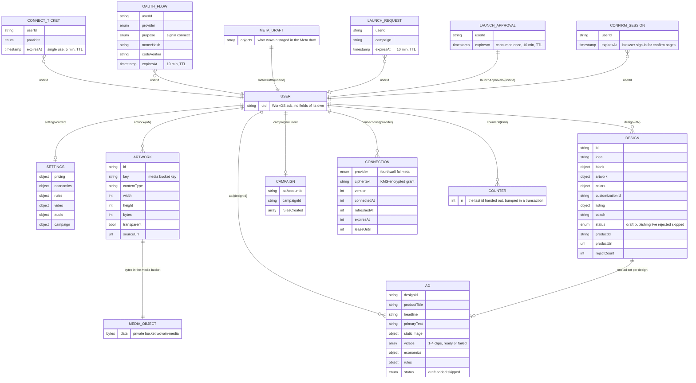

# Data model

wovain keeps each merchant's records in Firestore and staged artwork in a private Cloud Storage bucket. Only the server reads or writes them, through `firebase-admin`; `apps/server/firestore.rules` and `storage.rules` deny every client. A merchant is the `sub` of their WorkOS access token. There are no migrations: every document is parsed with its zod schema on every read (`apps/server/src/store.ts`, `apps/server/src/lib/connections.ts`, schemas in `packages/shared/src/`), so a schema change has to keep reading the documents already saved.

## Collections

| Path | Holds | Written by | Read by | Lifetime |
| --- | --- | --- | --- | --- |
| `users/{uid}/settings/current` | Pricing, economics, rule multiples, video model, audio, campaign options (`packages/shared/src/settings.ts`) | `update_settings` | Every step | Until changed |
| `users/{uid}/artwork/{aN}` | Staged artwork metadata; the bytes are in the media bucket under `key` | `stage_artwork` | `put_artwork`, the design widget | Kept |
| `users/{uid}/design/{dN}` | One design: the hero product and the `range` of drop products (art per placement, customization, offer id, quote), drop name, collection id, listing, coach line and status (`packages/shared/src/design.ts`) | `show_design_widget`, `publish_design`, `record_design` | Design widget, ads, campaign | Kept; live products stay live |
| `users/{uid}/ad/{designId}` | The ad set for a design: copy, static image, video clips and their state, economics, rule thresholds, the merchant's choice (`packages/shared/src/ad.ts`) | `generate_videos`, `add_video_audio`, `record_ad` | Ad widget, `campaign_plan`, `create_rules` | Kept |
| `users/{uid}/campaign/current` | The Meta ad account, campaign id and which of the five rules exist in Meta | `create_rules` | Campaign widget | Until the next campaign |
| `users/{uid}/connections/{provider}` | The merchant's OAuth grant for Fourthwall, fal or Meta, encrypted with the `wovain/connections` KMS key (the document path is the additional authenticated data), with a version and a refresh lease so two instances never spend one refresh token | Connect flow, token refresh | The `fourthwall` and `fal` proxy tools, `generate_videos` | Until revoked |
| `users/{uid}/counters/{kind}` | The next id per kind, bumped in a transaction | Every save of a new record | Same | Kept |
| `connectTickets/{id}` | A single-use connect link: who and which provider | A tool that needs an unconnected provider (`lib/upstream.ts`) | `/connect/:provider` | 5 minutes; Firestore TTL on `expiresAt` deletes leftovers |
| `oauthFlows/{state}` | A pending sign-in or connect: PKCE verifier, discovery state, the hash of the browser's nonce cookie | `/connect/:provider` | The OAuth callbacks | 10 minutes; TTL on `expiresAt` |
| `metaDrafts/{uid}` | Every object wovain staged in the merchant's Meta draft, from Meta's own replies; later draft calls build only on these, and `launch_campaign` publishes only these (`lib/meta-staged.ts`) | `campaign_draft` | `campaign_draft`, `launch_campaign` | Until the next campaign |
| `launchRequests/{id}` | A pending launch confirm page for one merchant and campaign, with the hashes of its cookie and CSRF token (`lib/launch-approvals.ts`) | `request_launch` | wovain's confirm page | 10 minutes; TTL |
| `launchApprovals/{uid}` | The merchant's confirmed launch, written only by the confirm page's POST and consumed once by `launch_campaign` | The confirm page | `launch_campaign` | 10 minutes; TTL |
| `confirmTickets`, `confirmFlows`, `confirmSessions` | The browser sign-in behind confirm pages: a single-use link (5 minutes), the sign-in flow (10 minutes) and the signed-in browser session, keyed by hashes (`lib/browser-confirm.ts`) | `approval_link`, the confirm pages | The confirm pages | Checked on read |
| Bucket `wovain-media`, key per artwork | Staged artwork bytes | `stage_artwork` | `put_artwork` (uploads to Fourthwall's media library) | Kept |

Outside wovain: published products and their images live in Fourthwall, video clips at fal's URLs, campaigns and rules in Meta, accounts in WorkOS. Widget state inside a chat (ticks, typed feedback) lives in the host's widget state with the message.

## Who else reads it

- The weekly job (`apps/ops/src/records.ts`) reads statuses, video states and rule counts through field masks as `gitlab-analytics` (`datastore.viewer`), an account only that job uses, trusted only from the `analytics` environment, and reports counts only. Neither account can decrypt connections: only the App Hosting runner may use the KMS key.
- Nothing else: CI tests run on the emulators (project `demo-wovain`).

## Indexes and TTL

- Single-field indexes only (Firestore's defaults); the server reads by document path, never by query.
- TTL on `expiresAt` in `connectTickets`, `oauthFlows`, `launchRequests` and `launchApprovals` (`infra/index.ts`).
