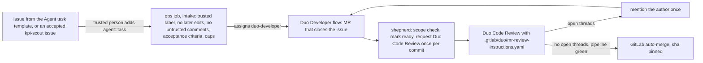
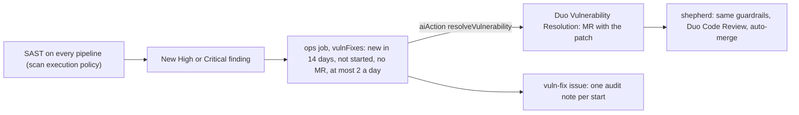

# wovain's Duo flows: life after code

Code that has merged keeps going without anyone at the keyboard. Production errors become fixes, product KPIs become proposals, accepted issues become merged changes, and new security findings become patches. GitLab Duo Agent Platform does the agent work. A small ops job (`apps/ops`, no model calls of its own) does the routing, the checks and the bookkeeping, using a person's token, because GitLab starts a flow only for a human's action.

| Flow | Starts on | Duo part | Ends with |
| --- | --- | --- | --- |
| 1. Self-healing | Repeated production error in Cloud Logging | Custom flow `wovain heal` | A merged fix, a closed incident and the fix verified in production |
| 2. KPI scout | Daily schedule | Custom flow `wovain scout` | Up to three ranked issues against `.gitlab/duo/kpis.yml` |
| 3. Issue to completion | A trusted person adds `agent::task` | Developer flow, then Duo Code Review | An auto-merged merge request |
| 4. Vuln to fix | A new High or Critical SAST finding | Duo Vulnerability Resolution, then Duo Code Review | An auto-merged patch |

Each flow's work is done by the same pieces:

- `apps/ops/src/ops.ts`: the ops job, every 10 minutes (schedule "wovain ops"). It runs the phases `heal`, `verifyHeals`, `intake`, `vulnFixes`, `shepherd` and `statusPage`.
- `.gitlab/duo/catalog/`: the custom flows and the read-only `wovain explain` agent, synced to the AI Catalog by GitLab's `ai-catalog` component (`.gitlab/ci/duo.yml`).
- `infra/duo.ts`: flow triggers, schedules, labels, the status page domain and the Ultimate-only Govern pieces, as Pulumi code.

## Flow 1: self-healing

```mermaid
flowchart LR
  flag["Feature flag fault-injection-checkout on"] --> traffic["Traffic: pnpm --filter @wovain/ops traffic"]
  traffic --> web["apps/web GET /api/checkout/quote throws ZodError"]
  web --> logs["evlog wide event, Cloud Logging and Error Reporting"]
  logs --> ops["ops job, heal phase: 3+ events in 30 min, new signature"]
  ops --> issue["heal issue: error class, route, signature, untrusted log context"]
  ops --> incident["GitLab incident, severity High, timeline event"]
  issue -->|"assigned to the heal flow's service account"| heal["wovain heal flow: failing test 'heal F', fix, push, MR with the signature"]
  heal --> ci["heal:verify: the test fails on main with ZodError and passes with the fix"]
  ci --> shepherd["shepherd: Duo Code Review, guardrails, auto-merge"]
  shepherd --> deploy["main pipeline deploys to Cloud Run"]
  deploy --> verify["verifyHeals: no signature events 20 to 35 min after the merge"]
  verify --> closed["heal::verified, incident closed, status page updated"]
```

The fault is realistic: with the flag on, the demo catalog returns a variant without a price (`apps/web/src/lib/checkout/catalog.ts`), and `parseVariants` rejects it, so every quote fails. The fix belongs in `apps/web/src/lib/checkout/quote.ts`: handle unpriced variants. The harness itself is off-limits to the flow and to auto-merge.

The signature (`apps/ops/src/heal.ts`) is a hash of the error class, method, route and normalized message. Every field is allowlisted or normalized, because callers can shape error text. The issue carries the signature as a base64url marker; the heal flow copies it into its MR; `heal:verify` (`apps/ops/src/heal-verify.ts`) runs the MR's `heal <fingerprint>` tests on the MR and again with every non-test change reverted, and requires a fail with the original error class first and a pass after. The shepherd checks the MR's signature equals the issue's before auto-merge.

**Demo in under a minute** (fix already prepared off-camera if time is short):

1. Deploy > Feature flags: turn `fault-injection-checkout` on.
2. `pnpm --filter @wovain/ops traffic --requests 20` (defaults to https://wovain.com): every response is 500.
3. Build > Pipeline schedules > "wovain ops" > Run. The heal issue and its incident appear, and the heal flow starts (Automate > Sessions).
4. Show the flow's MR: the failing test, the fix, `heal:verify` green, Duo Code Review, auto-merge set.
5. After the deploy, run "wovain ops" again: the issue gets `heal::verified`, the incident closes, status.wovain.com shows it resolved. Turn the flag off.

## Flow 2: KPI scout

KPIs are measured from three sources: `metric` (Cloud Monitoring, e.g. p95 latency), `log-ratio` (counts of evlog wide events, e.g. checkout quote success, sign-up success, 5xx rate) and `ui` (one mobile page load of wovain.com: LCP, CLS, console errors, plus a screenshot and the ARIA snapshot). Each KPI's gap to target times its weight ranks it (`apps/ops/src/kpis.ts`). The flow has no tools that change code, and nothing from the pipeline event reaches its prompt.

**Demo in under a minute:** Build > Pipelines > Run pipeline on `main` with `SCOUT=1`. Show the `kpi-snapshot` issue, then the scout session, then the new `kpi-scout` issues with the KPI, current value, target and expected impact. Add `agent::task` to one to hand it to flow 3.

## Flow 3: issue to completion

**Demo in under a minute:** Plan > Issues > New issue > template "Agent task": goal "Return 422 instead of 500 for an empty cart quote" with acceptance criteria. Run "wovain ops". Show the Developer session, its MR, Duo Code Review's comments, and "Auto-merge set by wovain ops".

## Flow 4: vuln to fix

GitLab links the MR to the finding (`Vulnerability.mergeRequest`), so the shepherd binds them through GitLab, never through MR text. A patch outside the auto-merge scope (a dependency bump, for one) waits for a person.

**Demo in under a minute:** Secure > Vulnerability report: show a High SAST finding. Run "wovain ops". Show the note on the `vuln-fix` issue, the Resolution MR, the review and the auto-merge.

## Status page

The ops job renders `public/index.html` every run and the `pages` job publishes it to status.wovain.com: health (incident, degraded, operational), incidents of the last 30 days with durations, DORA metrics (deployments a week, lead time from GitLab's DORA API when the tier has it, change failure rate as incidents per deployment, time to restore) and the SCI score from the latest `sci` job. Only numbers and titles the ops job wrote are shown.

## Guardrails

| Guardrail | Where |
| --- | --- |
| Only the ops job starts the Developer and heal flows (assign), and only Duo Code Review on request (assign_reviewer); `merge_request_ready` and the Fix CI/CD trigger are off | `infra/duo.ts`, `infra/Pulumi.prod.yaml` |
| `agent::task` counts only when a trusted person (`TRUSTED_USERS`, plus the token's owner) added it, nobody edited the issue later, and only trusted people or Duo commented | `apps/ops/src/intake.ts` |
| Caps: 2 tasks in flight and 5 Developer sessions a day; 1 heal issue in flight and 3 a day; 2 Vulnerability Resolutions a day; one review per commit | `intake.ts`, `heal.ts`, `vulns.ts`, `ops.ts` |
| Log text is never trusted: allowlisted error class, method and normalized route; the message only inside a block marked untrusted | `apps/ops/src/heal.ts` |
| Auto-merge only for `apps/web/src`, `apps/web/test` and `packages/api/src/routers`, not auth, env, logging, the fault harness or any config; at most 10 files and 200 lines; Duo reviewed the head commit with no open threads; nobody else wrote on it; pipeline green, `heal:verify` included | `apps/ops/src/guardrails.ts` |
| New High or Critical findings in an MR need a Maintainer's approval (Ultimate) | `.gitlab/security-policies/policy.yml` |

## Tool allow-lists

| Agent | Tools | Writes |
| --- | --- | --- |
| `wovain heal` (custom flow, full clone) | `get_issue`, `list_issue_notes`, `create_issue_note`, `read_file`, `list_dir`, `find_files`, `mkdir`, `edit_file`, `create_file_with_contents`, `run_command`, `create_merge_request` | Files in its clone, a branch, one MR, issue notes |
| `wovain scout` (custom flow, no clone) | `list_issues`, `get_issue`, `gitlab_issue_search`, `get_repository_file`, `list_repository_tree`, `gitlab_blob_search`, `create_issue` | New issues only |
| `wovain explain` (custom agent, chat) | `get_pipeline_errors`, `get_pipeline_failing_jobs`, `get_merge_request`, `list_merge_request_diffs`, `get_commit_diff`, `get_repository_file`, `gitlab_documentation_search` | Nothing |
| Developer flow (built-in) | GitLab's Developer toolset | Branch, MR |
| Code Review flow (built-in) | GitLab's Code Review toolset | Review notes |
| Vulnerability Resolution (built-in) | GitLab-managed | Branch, MR |

`apps/ops/test/flows.test.ts` fails the build when a custom flow names a tool outside its list, or when the scout gets a tool that changes code.

## DevSecOps stages

| Stage | What covers it |
| --- | --- |
| Plan | Agent task template, `agent::task` intake, the KPI file and the scout's ranked `kpi-scout` issues (flows 2, 3) |
| Create | Developer flow, heal flow, Vulnerability Resolution, Duo Code Review with project rules (flows 1, 3, 4) |
| Verify | `verify` job (check, types, knip, tests with JUnit), `heal:verify` reproduces the production error (flow 1) |
| Package | The web image built and pushed by `image:production` (`.gitlab/ci/deploy.yml`), deployed by every merged fix |
| Secure | SAST, Secret Detection, Dependency Scanning; vuln to fix (flow 4); scan execution policy |
| Release | Auto-merge to `main`, deploy to Cloud Run, GitLab feature flags (`fault-injection-checkout`) |
| Configure | Triggers, schedules, labels, Pages domain and policies as Pulumi code (`infra/duo.ts`); `.gitlab/duo/agent-config.yml` for flow runners |
| Monitor | Cloud Logging and Error Reporting, incidents with timelines, verify-in-production, KPI snapshot, status page with DORA and SCI (flows 1, 2) |
| Govern | Trusted-user checks, caps, guardrails, tool allow-lists, the `vuln-fix` audit issue, approval policy and compliance framework (Ultimate), SCI report |

## Setup

1. `pulumi up` in `infra/` (a person runs it): triggers, schedules, labels, the Pages domain; with `pulumi config set wovain:ultimate true` and `wovain:complianceGroup <top-level group>`, the compliance framework and the policy link.
2. CI variables: `GITLAB_TOKEN` (a person's token, `api` scope; flows bill the namespace), `TRUSTED_USERS`, `SITE_URL=https://wovain.com`. When GitLab names the service accounts differently, `DUO_DEVELOPER_ACCOUNT`, `DUO_HEAL_ACCOUNT`, `DUO_REVIEW_ACCOUNT`.
3. After the first main pipeline syncs `wovain heal` to the AI Catalog, enable it in the project (Automate > AI Catalog > Flows > Enable), then run `pulumi up` again so `infra/duo.ts` adds its trigger.
4. Cloud Run needs `GITLAB_FEATURE_FLAGS_URL` and `GITLAB_FEATURE_FLAGS_INSTANCE_ID` (Deploy > Feature flags > Configure) for the fault flag to work.
5. DNS: `status.wovain.com` CNAME to the project's Pages host, and the TXT record from the `statusDomainVerification` output.
