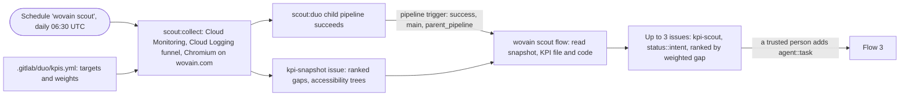
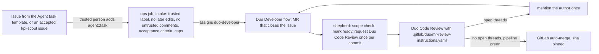
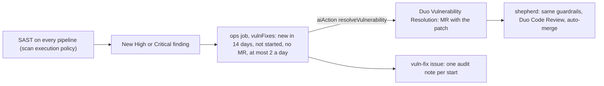
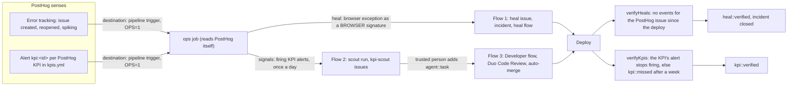

# wovain's Duo flows: life after code

Code that has merged keeps going without anyone at the keyboard. Production errors become fixes, product KPIs become proposals, accepted issues become merged changes, and new security findings become patches. GitLab Duo Agent Platform does the agent work. A small ops job (`apps/ops`, no model calls of its own) does the routing, the checks and the bookkeeping, using a person's token, because GitLab starts a flow only for a human's action.

| Flow | Starts on | Duo part | Ends with |
| --- | --- | --- | --- |
| 1. Self-healing | Repeated production error in Cloud Logging, or a browser exception PostHog error tracking groups | Custom flow `wovain heal` | A merged fix, a closed incident and the fix verified in production (Cloud Logging or PostHog) |
| 2. KPI scout | Daily schedule, or a PostHog KPI alert (at most once a day) | Custom flow `wovain scout` | Up to three ranked issues against `.gitlab/duo/kpis.yml`, verified in PostHog after they ship |
| 3. Issue to completion | A trusted person adds `agent::task` | Developer flow, then Duo Code Review | An auto-merged merge request |
| 4. Vuln to fix | A new High or Critical SAST finding | Duo Vulnerability Resolution, then Duo Code Review | An auto-merged patch |

Each flow's work is done by the same pieces:

- `apps/ops/src/ops.ts`: the ops job, every 10 minutes (schedule "wovain ops"). It runs the phases `heal`, `verifyHeals`, `intake`, `vulnFixes`, `shepherd`, `statusPage`, `signals` and `verifyKpis`. PostHog's destinations also start it right away (see [The PostHog loop](#the-posthog-loop)).
- `infra/posthog/`: PostHog's alerts, destinations, dashboard and survey, as OpenTofu code with PostHog's official provider (`.gitlab/ci/posthog.yml`).
- `.gitlab/duo/catalog/`: the custom flows and the read-only `wovain explain` agent, synced to the AI Catalog by GitLab's `ai-catalog` component (`.gitlab/ci/duo.yml`).
- `infra/duo.ts`: flow triggers, schedules, labels, the status page domain and the Ultimate-only Govern pieces, as Pulumi code.

## Flow 1: self-healing

```mermaid
flowchart LR
  flag["Feature flag fault-injection-checkout on"] --> traffic["Traffic: pnpm --filter @wovain/ops traffic"]
  traffic --> web["apps/web GET /api/checkout/quote throws ZodError"]
  web --> logs["evlog wide event, Cloud Logging and Error Reporting"]
  logs --> ops["ops job, heal phase: 3+ events in 30 min, new signature"]
  ops --> issue["heal issue: error class, route, signature, untrusted log context"]
  ops --> incident["GitLab incident, severity High, timeline event"]
  issue -->|"assigned to the heal flow's service account"| heal["wovain heal flow: failing test 'heal F', fix, push, MR with the signature"]
  heal --> ci["heal:verify: the test fails on main with ZodError and passes with the fix"]
  ci --> shepherd["shepherd: Duo Code Review, guardrails, auto-merge"]
  shepherd --> deploy["main pipeline deploys to Cloud Run"]
  deploy --> verify["verifyHeals: no signature events 20 to 35 min after the merge"]
  verify --> closed["heal::verified, incident closed, status page updated"]
```

The fault is realistic: with the flag on, the demo catalog returns a variant without a price (`apps/web/src/lib/checkout/catalog.ts`), and `parseVariants` rejects it, so every quote fails. The fix belongs in `apps/web/src/lib/checkout/quote.ts`: handle unpriced variants. The harness itself is off-limits to the flow and to auto-merge.

The signature (`apps/ops/src/heal.ts`) is a hash of the error class, method, route and normalized message. Every field is allowlisted or normalized, because callers can shape error text. The issue carries the signature as a base64url marker; the heal flow copies it into its MR; `heal:verify` (`apps/ops/src/heal-verify.ts`) runs the MR's `heal <fingerprint>` tests on the MR and again with every non-test change reverted, and requires a fail with the original error class first and a pass after. The shepherd checks the MR's signature equals the issue's before auto-merge.

**Demo in under a minute** (fix already prepared off-camera if time is short):

1. Deploy > Feature flags: turn `fault-injection-checkout` on.
2. `pnpm --filter @wovain/ops traffic --requests 20` (defaults to https://wovain.com): every response is 500.
3. Build > Pipeline schedules > "wovain ops" > Run. The heal issue and its incident appear, and the heal flow starts (Automate > Sessions).
4. Show the flow's MR: the failing test, the fix, `heal:verify` green, Duo Code Review, auto-merge set.
5. After the deploy, run "wovain ops" again: the issue gets `heal::verified`, the incident closes, status.wovain.com shows it resolved. Turn the flag off.

## Flow 2: KPI scout

KPIs are measured from three sources: `metric` (Cloud Monitoring, e.g. p95 latency), `log-ratio` (counts of evlog wide events, e.g. checkout quote success, sign-up success, 5xx rate) and `ui` (one mobile page load of wovain.com: LCP, CLS, console errors, plus a screenshot and the ARIA snapshot). Each KPI's gap to target times its weight ranks it (`apps/ops/src/kpis.ts`). The flow has no tools that change code, and nothing from the pipeline event reaches its prompt.

**Demo in under a minute:** Build > Pipelines > Run pipeline on `main` with `SCOUT=1`. Show the `kpi-snapshot` issue, then the scout session, then the new `kpi-scout` issues with the KPI, current value, target and expected impact. Add `agent::task` to one to hand it to flow 3.

## Flow 3: issue to completion

**Demo in under a minute:** Plan > Issues > New issue > template "Agent task": goal "Return 422 instead of 500 for an empty cart quote" with acceptance criteria. Run "wovain ops". Show the Developer session, its MR, Duo Code Review's comments, and "Auto-merge set by wovain ops".

## Flow 4: vuln to fix

GitLab links the MR to the finding (`Vulnerability.mergeRequest`), so the shepherd binds them through GitLab, never through MR text. A patch outside the auto-merge scope (a dependency bump, for one) waits for a person.

Where the role or tier can't call Vulnerability Resolution ("AI features are not enabled"), the ops job notes that on the `vuln-fix` log issue, doesn't ask again for a week, and instead files one confidential `agent::task` + `vuln-fix` issue per finding still on the default branch: deduplicated by a marker, at most 3 open, reopened when a closed one's finding is still reported a day later. Intake then hands each to the Developer flow (flow 3). Findings the latest default-branch scan no longer reports are skipped.

The ops job's `resolveGone` phase sets those no-longer-detected SAST and Dependency Scanning findings to Resolved with `vulnerabilityResolve` (at most 10 a run, each logged on the `vuln-fix` issue). With Ultimate and the linked policy project, the `vulnerability_management_policy` in `.gitlab/security-policies/policy.yml` does the same declaratively.

**Demo in under a minute:** Secure > Vulnerability report: show a High SAST finding. Run "wovain ops". Show the note on the `vuln-fix` issue, the Resolution MR, the review and the auto-merge.

## The PostHog loop

PostHog senses, Duo acts, PostHog verifies. PostHog sees what logs can't: real visitors' funnel, browser exceptions, rage and dead clicks, field web vitals, survey ratings and every Nemotron call's cost. GitLab Duo stays the only actor on code, inside the guardrails above.

| Who | What | Where |
| --- | --- | --- |
| PostHog senses | Error tracking issues and spikes from `posthog-js` exceptions; one daily alert per PostHog KPI (funnel steps, visitors, browser errors, rage and dead clicks, field LCP, run rating, Nemotron cost per run), each firing while its KPI misses the target in `kpis.yml` | `apps/web/src/lib/analytics-client.ts`, `infra/posthog/kpis.tf` |
| PostHog nudges GitLab | Two webhook destinations call GitLab's pipeline trigger API with a fixed body (`OPS=1`). The trigger token can only run a pipeline; nothing from the PostHog event reaches GitLab | `infra/posthog/signals.tf`, `infra/duo.ts` |
| ops routes | `heal` reads PostHog's browser exceptions of the last 30 minutes next to Cloud Logging and files the most frequent new one; `signals` reads the alerts and starts the scout early, at most once a day | `apps/ops/src/ops.ts`, `heal.ts`, `signals.ts`, `posthog.ts` |
| Duo acts | The heal flow fixes errors; the scout reads the snapshot (now with PostHog's top pages, frustrated clicks, experiments and alert states) and files `kpi-scout` issues; a trusted person hands one to the Developer flow | Flows 1 to 3 |
| PostHog verifies | `verifyHeals` counts the PostHog issue's exceptions since the deploy; `verifyKpis` labels a merged `kpi-scout` issue `kpi::verified` once the KPI's alert stops firing, or `kpi::missed` if it still fires a week later | `apps/ops/src/ops.ts`, `signals.ts` |

The trigger token lives only in PostHog's redacted sensitive inputs and a masked, protected CI variable. The payload is a nudge, not an input: the ops job runs every 10 minutes anyway, so a lost webhook only delays detection, and a forged one only runs the same checks early. Its caps (one heal in flight, three a day, one early scout a day) hold whatever starts it. Error tracking's own GitLab integration can also link a PostHog issue to the GitLab issue by hand (Error tracking > issue > Create issue > GitLab).

**Experiments.** A UX change for signed-in merchants ships behind a PostHog flag named `exp-<KPI id>` (control and test), declared as a `posthog_experiment` in `infra/posthog`. The flag lives outside the auto-merge scope, so a person approves each experiment. The snapshot's experiments table shows exposures and runs started per variant; the scout proposes shipping a clear winner and removing the flag, or removing a loser. Experiments target signed-in merchants (identified on sign-in) because anonymous visitors who haven't consented are cookieless and have no stable id.

**GitLab feature flags stay for fault injection.** `fault-injection-checkout` is part of the self-healing harness, not the product: it is evaluated server-side through GitLab's Unleash endpoint, toggled from Deploy > Feature flags during the demo, and kept off-limits to Duo and auto-merge. PostHog flags are for product rollouts and experiments, where exposure analytics matter. Keeping them apart means an experiment cleanup can never switch the harness, and the demo has no PostHog dependency.

**LLM analytics.** `packages/core/src/nemotron.ts` wraps the OpenAI SDK on Nebius with `@posthog/ai`: every Nemotron call is a `$ai_generation` with its step (`$ai_span_name`: `design_brief`, `design_judge`, `ad_copy`, `autopilot_*`), tokens, latency and cost at Nebius list prices ($0.30 and $0.90 per million tokens), grouped by run (`$ai_trace_id` is the run id) and merchant. The "wovain health" dashboard shows cost and model time per run and per step; `llm-cost-per-run` is a KPI with an alert.

**Product dashboards** (`infra/posthog/dashboards.tf`): Growth, Retention, Agent quality and cost, and Web vitals, as code; the KPI insights of `kpis.yml` join them. Everything in PostHog is code: change it there, never in the UI or through the API. `infra/posthog/import.tf` adopts the objects first created by hand, and is deleted after that apply.

**The "wovain health" dashboard** (`infra/posthog/health.tf`): the merchant funnel, browser errors per 1,000 pageviews, field web vitals (LCP, INP, CLS at p75), rage and dead clicks by page, Nemotron per run and per step, and one tile per PostHog KPI.

### PostHog's agentic features, and why wovain uses each or not

As of October 2026; prices are PostHog Cloud's monthly free tier, then pay as you go.

| Feature | Use here | Cost | GitLab or GitHub |
| --- | --- | --- | --- |
| Error tracking, issue alerts and spike alerts | Senses browser exceptions; destinations start ops | 100k exceptions free | Alerts go to any webhook; issue creation and source links work with GitLab |
| Insight alerts | One per PostHog KPI | Included with product analytics (1M events free) | Webhook |
| Workflows and destinations (Hog functions) | Webhook to GitLab's pipeline trigger API; a native GitLab destination (`template-gitlab`) also exists | Alert and error-tracking destinations ride on those products | Either |
| Experiments and feature flags | `exp-<KPI id>` experiments | 1M flag requests free | Either |
| Surveys | "Run rating" (draft until a person launches it) | Free tier of survey responses | Either |
| LLM analytics | Nemotron cost, latency and steps | 100k LLM events free | Either |
| Web analytics, web vitals, rage and dead clicks | KPIs and dashboard tiles | Product analytics events | Either |
| Session replay and Replay Vision | Replays of visitors who consented: cookieless "on_reject" mode records none until the banner's Accept, or implied consent outside the opt-in countries in `apps/web/src/lib/consent.ts`. Inputs and dashboard text are masked. Replay Vision not used yet | 5k recordings free; Replay Vision 2,500 credits free, then $0.01 a credit | Either |
| Self-driving: Signals scouts, Inbox, reports, Tasks and PostHog Code, Loops | Not used to act: they open pull requests through PostHog's GitHub App only, and their external signal sources are GitHub Issues, Jira, Linear and Zendesk. wovain lives on GitLab, so Duo acts and PostHog senses | Open beta; AI credits (500 free, then $0.01 a credit; beta features are free) | GitHub only |

## Status page

The ops job renders `public/index.html` every run and the `pages` job publishes it to status.wovain.com: health (incident, degraded, operational), incidents of the last 30 days with durations, DORA metrics (deployments a week, lead time from GitLab's DORA API when the tier has it, change failure rate as incidents per deployment, time to restore) and the SCI score from the latest `sci` job. Only numbers and titles the ops job wrote are shown.

## Guardrails

| Guardrail | Where |
| --- | --- |
| Only the ops job starts the Developer and heal flows (assign). Duo Code Review runs on every merge request a person creates (`merge_request`, action `created`) and again on request (`assign_reviewer`); Duo's own MRs get it from the shepherd. The Fix CI/CD trigger is off | `infra/duo.ts`, `infra/Pulumi.prod.yaml` |
| `agent::task` counts only when a trusted person (`TRUSTED_USERS`, plus the token's owner) added it, nobody edited the issue later, and only trusted people or Duo commented | `apps/ops/src/intake.ts` |
| Caps: 2 tasks in flight and 5 Developer sessions a day; 1 heal issue in flight and 3 a day; 2 Vulnerability Resolutions a day; one review per commit | `intake.ts`, `heal.ts`, `vulns.ts`, `ops.ts` |
| Log text is never trusted: allowlisted error class, method and normalized route; the message only inside a block marked untrusted | `apps/ops/src/heal.ts` |
| Auto-merge only for `apps/web/src`, `apps/web/test` and `packages/api/src/routers`, not auth, env, logging, the fault harness or any config; at most 10 files and 200 lines; Duo reviewed the head commit with no open threads; nobody else wrote on it; pipeline green, `heal:verify` included | `apps/ops/src/guardrails.ts` |
| New High or Critical findings in an MR need a Maintainer's approval (Ultimate) | `.gitlab/security-policies/policy.yml` |

## Tool allow-lists

| Agent | Tools | Writes |
| --- | --- | --- |
| `wovain heal` (custom flow, full clone) | `get_issue`, `list_issue_notes`, `create_issue_note`, `read_file`, `list_dir`, `find_files`, `mkdir`, `edit_file`, `create_file_with_contents`, `run_command`, `create_merge_request` | Files in its clone, a branch, one MR, issue notes |
| `wovain scout` (custom flow, no clone) | `list_issues`, `get_issue`, `gitlab_issue_search`, `get_repository_file`, `list_repository_tree`, `gitlab_blob_search`, `create_issue` | New issues only |
| `wovain explain` (custom agent, chat) | `get_pipeline_errors`, `get_pipeline_failing_jobs`, `get_merge_request`, `list_merge_request_diffs`, `get_commit_diff`, `get_repository_file`, `gitlab_documentation_search` | Nothing |
| Developer flow (built-in) | GitLab's Developer toolset | Branch, MR |
| Code Review flow (built-in) | GitLab's Code Review toolset | Review notes |
| Vulnerability Resolution (built-in) | GitLab-managed | Branch, MR |

`apps/ops/test/flows.test.ts` fails the build when a custom flow names a tool outside its list, or when the scout gets a tool that changes code.

## DevSecOps stages

The nine stages, with PostHog in Plan and Monitor:

| Stage | What covers it |
| --- | --- |
| Plan | Agent task template, `agent::task` intake, the KPI file and the scout's ranked `kpi-scout` issues (flows 2, 3); PostHog KPI alerts start the scout, and its snapshot carries PostHog's pages, frustrated clicks, experiments and alert states |
| Create | Developer flow, heal flow, Vulnerability Resolution, Duo Code Review with project rules (flows 1, 3, 4) |
| Verify | `verify` job (check, types, knip, tests with JUnit), `heal:verify` reproduces the production error (flow 1) |
| Package | The web image built and pushed by `image:production` (`.gitlab/ci/deploy.yml`), deployed by every merged fix |
| Secure | SAST, Secret Detection, Dependency Scanning; vuln to fix (flow 4); scan execution policy |
| Release | Auto-merge to `main`, deploy to Cloud Run, GitLab feature flags (`fault-injection-checkout`), PostHog experiments (`exp-<KPI id>`) |
| Configure | Triggers, schedules, labels, Pages domain, policies and the PostHog trigger token as Pulumi code (`infra/duo.ts`); PostHog alerts, destinations, dashboard and survey as OpenTofu code (`infra/posthog`); `.gitlab/duo/agent-config.yml` for flow runners |
| Monitor | Cloud Logging and Error Reporting, PostHog error tracking, KPI alerts, web vitals and LLM analytics, incidents with timelines, verify-in-production (Cloud Logging or PostHog), `verifyKpis`, KPI snapshot, status page with DORA and SCI (flows 1, 2) |
| Govern | Trusted-user checks, caps, guardrails, tool allow-lists, the `vuln-fix` audit issue, approval policy and compliance framework (Ultimate), SCI report |

## Setup

1. `pulumi up` in `infra/` (a person runs it): triggers, schedules, labels; with `pulumi config set wovain:ultimate true` and `wovain:complianceGroup <top-level group>`, the compliance framework and the policy link.
2. CI variables: `GITLAB_TOKEN` (a person's token, `api` scope; flows bill the namespace), `TRUSTED_USERS`, `SITE_URL=https://wovain.com`. When GitLab names the service accounts differently, `DUO_DEVELOPER_ACCOUNT`, `DUO_HEAL_ACCOUNT`, `DUO_REVIEW_ACCOUNT`.
3. After the first main pipeline syncs `wovain heal` to the AI Catalog, enable it in the project (Automate > AI Catalog > Flows > Enable), then run `pulumi up` again so `infra/duo.ts` adds its trigger.
4. Cloud Run needs `GITLAB_FEATURE_FLAGS_URL` and `GITLAB_FEATURE_FLAGS_INSTANCE_ID` (Deploy > Feature flags > Configure) for the fault flag to work.
5. `status.wovain.com` is a Cloud Run domain mapping to the web service, which proxies it to the project's Pages site (`apps/web/next.config.ts`); no Pages domain is needed.
6. PostHog (project "wovain", id 687269, US cloud): a person creates a personal API key at Settings > Personal API keys, scoped to this project, with `query:read`, `alert:write`, `insight:write`, `dashboard:write`, `hog_function:write`, `survey:write`, `feature_flag:write`, `experiment:write` and `project:write` (for `infra/posthog/settings.tf`). Then `pulumi config set --secret posthog-personal-api-key phx_...` and `pulumi config set posthogProjectId 687269`; main's `pulumi up` sets the CI variables. A pipeline trigger token needs Maintainer, so it's opt-in: a Maintainer runs `pulumi config set wovain:posthogTrigger true` and `pnpm run infra:up -- --policy-pack-config policy/maintainer.json`, which creates the trigger and `POSTHOG_TRIGGER_TOKEN`. `infra/posthog/settings.tf` sets cookieless server hash mode and the default test account filters (dev traffic, signed-in team members, bots). In PostHog, exception autocapture, web vitals, heatmaps and dead clicks are already on; turn on spike detection in Error tracking > Configuration.
7. The next main pipeline that touches `infra/posthog` or `kpis.yml` plans the PostHog config (`posthog:plan`); a person reviews the plan and runs `posthog:apply`. Then launch the "Run rating" survey in PostHog when it should start showing.
