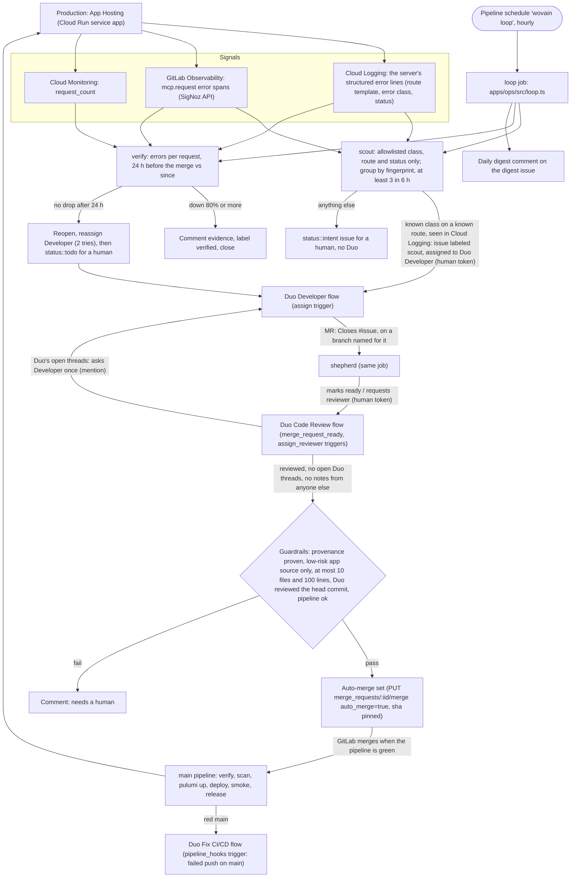

# The self-healing loop

wovain finds its own production errors, has GitLab Duo fix them, and checks that the fix worked. A person reads the digest and steps in only when the loop hands something back.

## Who does what

| Step | Done by | How it starts |
| --- | --- | --- |
| Read errors, file an intent | `loop` CI job (`apps/ops/src/scout.ts`) | Hourly pipeline schedule `wovain loop` (`infra/gitlab.ts`) |
| Write the fix and open the MR | Duo Developer flow | The job assigns the issue to `duo-developer-gitlab-ai-hackathon` (the `assign` trigger) |
| Review | Duo Code Review flow | The job marks the draft ready or requests the reviewer (`merge_request_ready`, `assign_reviewer`) |
| Address review threads | Duo Developer flow | The job mentions it once on the MR (`mention`) |
| Merge | GitLab auto-merge | The job sets it after the guardrails pass; GitLab merges when the pipeline is green |
| Fix a red main | Duo Fix CI/CD flow | Failed push pipeline on main (`pipeline_hooks`, filtered) |
| Deploy and smoke test | `main` pipeline | The merge |
| Check the fix, close or reopen | `loop` CI job (`apps/ops/src/scout.ts`) | The next hourly run, two hours or more after the merge |

## Why a CI job chains the flows

GitLab starts a flow only for a person's action. `RunService` refuses non-human users (`ee/app/services/ai/flow_triggers/run_service.rb`, "cannot be triggered by non-human users"), and the event workers skip events a flow caused unless the `ai_flow_trigger_chaining` feature flag is on (`ee/app/workers/concerns/ai/cloud_events_flow_trigger_worker.rb`). So the Developer flow opening an MR never starts Code Review by itself. The loop job acts with `GITLAB_TOKEN`, a person's access token, so its assignment, ready and reviewer requests are human actions and each starts the next flow. The Developer flow supports only the `assign` and `mention` triggers (`ee/app/models/ai/catalog/foundational_flow/developer/definition.rb`), which is why the job assigns instead of relying on an issue-created trigger.

The custom scout flow (`.gitlab/duo/catalog/flows/scout.yml`) is enabled in the project with a pipeline trigger (`wovain:duoCustomFlows`, `infra/duo.ts`) that fires only on a successful child pipeline on `main`. Only the weekly schedule's `scout:duo` job creates one (`.gitlab/ci/scout-signal.yml`), so the Duo scout checks `main` and production once a week. Its prompt is fixed text, so no comment or pipeline field reaches it. A `mention` trigger would let anyone who comments steer it. It can't have its own schedule: a `scheduled` trigger runs as a service account GitLab creates in the project, and that needs `create_service_account`, which our role doesn't have.

## Untrusted input

Anyone who can send a request to production can put text into its logs: an error message, a URL, a header. The scout's issues go to the Duo Developer flow, and its MRs can be auto-merged, so that text must never reach an issue. The scout builds issues only from fields the server controls (`apps/ops/src/signals.ts`, tested in `apps/ops/test/signals.test.ts` and `scout.test.ts`):

- **What the server logs.** `apps/server/src/lib/request-errors.ts` writes one JSON line per failed request: the route pattern Hono matched with the method it was registered for (never the raw path), the error's class name (never its message) and the status. Cloud Run turns it into `jsonPayload.wovain`.
- **What the scout reads.** Cloud Logging entries from the service's own stdout and stderr logs, filtered by the labels Cloud Run sets (project, location `us-central1`, service and configuration `app`, revisions `app-*`), never the request log, which carries raw URLs. From GitLab Observability, only the `error.type` and status of the server's `mcp.request` spans. No log message, sample or log body is read.
- **Allowlists.** The error class must be on a list of known class names, or it becomes `UnknownError`; the route must be one the server registers, or it becomes `UnknownRoute`. The title is always `scout: <ErrorClass> on <ROUTE> (<status>)`, and the body lists the class, route, status, count, window, sources and fingerprint.
- **Who gets it.** Duo gets a problem only when its class and route are both known and Cloud Logging saw it. Anything else is filed as `status::intent` for a human and isn't assigned. GitLab Observability's OTLP endpoint accepts telemetry without a token until enforcement is on (docs.gitlab.com, operations/observability/ci_cd), so a problem only it saw is never handed to Duo. Turning enforcement on needs Observability's Editor role or an administrator, which our Developer role doesn't have (docs/transcend.md). Red `main` pipelines go to the Fix CI/CD flow, which starts from the failed job, a name the pipeline controls.

## Guardrails

Auto-merge is set only when all of these hold (`apps/ops/src/guardrails.ts`, tested in `apps/ops/test/guardrails.test.ts`):

- **Provenance.** The issue was filed by the loop's user, carries its marker and the `scout` label, and is assigned to the Developer service account, with the loop's "assigned" marker note. The MR's author is that service account. GitLab binds the MR to the issue: `closes_issues` lists it, or the source branch carries its number. Text in the MR is never trusted. A Duo session (GraphQL `duoWorkflowWorkflows`) with definition `developer/*`, source `FLOW_TRIGGER`, started by the loop's user on that issue after the assignment, and linked to this MR must exist; a session not linked to it yet means a person decides.
- **Allowlist.** Every changed path is low-risk application source or its tests: `apps/server/src/lib/**` and `apps/server/src/tools/**`; `apps/server/test/unit|integration/**`; `apps/widgets/src/**`; `packages/shared/src/**`. Anything that signs in, holds credentials, spends money or launches ads is denied inside those trees: `auth/`, `routes/`, `lib/{launch-approvals,connections,cipher,oauth-client,upstream,approval}.ts`, `lib/meta-*`, `lib/browser-*`, `lib/autopilot-*`, `lib/optimizer/`, `tools/{meta,connections,campaign,publish,autopilot}.ts` and `packages/shared/src/optimizer/`. So are what the scout reads (`lib/request-errors.ts`, `lib/tool-result.ts`) and the fetch guards (`lib/fetch-*`). The server's entry points and `playbooks/` aren't allowed at all. Dotfiles, `*.config.*`, `tsconfig*`, `package.json`, YAML, JSON, lockfiles and rules files are denied inside those trees too. Everything else (`apps/ops/**` itself, `infra/`, `.gitlab/`, CI files, `.agents/`, `.claude/`, `AGENTS.md`, docs) needs a human. `.gitlab/CODEOWNERS` lists the same paths, so a person is requested as reviewer.
- **Size.** At most 10 files and 100 changed lines.
- **Review freshness.** The commit Duo Code Review covered equals the MR's head `sha`: a diff note names it (`position.head_sha`); a general note is matched to the MR version current when it was written (`GET merge_requests/:iid/versions`). Commit dates aren't used. Duo's state in the reviewers API is reviewed, approved or requested_changes (`unreviewed` means it's still running). Duo didn't request changes, and none of Duo Code Review's threads is open, counted over every page of the MR's discussions (the project's `blocking_discussions_resolved` is always true while "All threads must be resolved" is off, so it isn't used). The loop asks for a review once per head commit and hands a review that hasn't landed in 2 hours to a person.
- **Who wrote on it.** Every note on the MR is from Duo Code Review, the Developer flow, the loop's user or GitLab itself. A note from anyone else hands the MR to a person, and the loop asks the Developer flow to act only on Duo Code Review's threads.
- **State.** Not a draft, no conflicts, and the head pipeline (from the single-MR endpoint) is on the head `sha` and created, pending, running or successful.

The path, size and provenance checks run before any review is requested, so an MR that can't be auto-merged spends no review credits.

GitLab still waits for the green pipeline: auto-merge (`auto_merge=true` on the merge API, with the reviewed `sha` pinned) merges only when it passes, and a new push cancels it. The project setting "Pipelines must succeed" needs a Maintainer and is off, so the loop never sets auto-merge on an MR whose pipeline failed.

## Credits

Only the Duo flows spend credits, and they bill the person behind `GITLAB_TOKEN`. The job keeps that small: at most one new issue per run, at most two scout issues with Duo at once, two Developer attempts per problem, one review fix round per MR, and nothing for pipeline failures (the filtered Fix CI/CD trigger covers red main).

## Sources and what's not read yet

- Cloud Logging and Cloud Monitoring, as the `gitlab-ops` service account (logs and metrics viewer only), through Workload Identity Federation from the `operations` environment.
- GitLab Observability's query API (error spans only, never log bodies), once someone with the Developer role on the group creates an API key (group → Observe → API Keys) and sets it with `pulumi config set --secret o11y-api-key` in `infra/`. Until then the loop reads Google Cloud only and says so in its report. The server sends traces to the group's OTLP endpoint already (`apphosting.yaml`).
- GitLab error tracking needs a Maintainer to turn on, so the loop doesn't use it.

## Known limits

- A read takes at most 5,000 Cloud Logging entries and 500 GitLab Observability rows per window, so a flood of errors is undercounted. That makes the "before" window look smaller, never the fix look better than it is, as long as the "after" window is under the cap.
- Each unverified scout issue with a merged MR costs two Cloud Logging reads an hour, for at most 24 hours.
- Code owner approval isn't required: "Require approval from code owners" on the protected branch needs a Maintainer. CODEOWNERS only requests the reviewer, and the guardrails keep those paths out of auto-merge.
- Each phase (verify, scout, shepherd) runs even when another fails; failures go in the report and fail the job, so the pipeline shows them.
