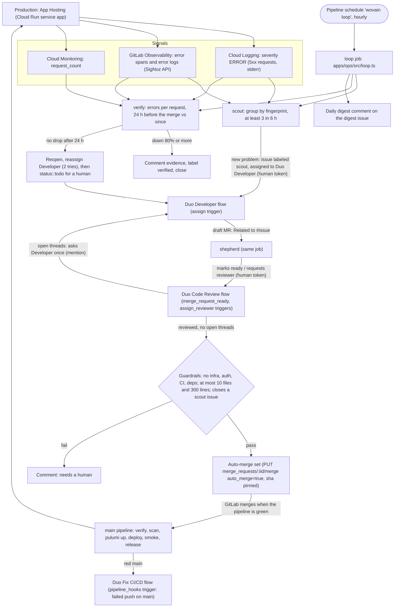

# The self-healing loop

wovain finds its own production errors, has GitLab Duo fix them, and checks that the fix worked. A person reads the digest and steps in only when the loop hands something back.

## Who does what

| Step | Done by | How it starts |
| --- | --- | --- |
| Read errors, file an intent | `loop` CI job (`apps/ops/src/scout.ts`) | Hourly pipeline schedule `wovain loop` (`infra/gitlab.ts`) |
| Write the fix and open the MR | Duo Developer flow | The job assigns the issue to `duo-developer-gitlab-ai-hackathon` (the `assign` trigger) |
| Review | Duo Code Review flow | The job marks the draft ready or requests the reviewer (`merge_request_ready`, `assign_reviewer`) |
| Address review threads | Duo Developer flow | The job mentions it once on the MR (`mention`) |
| Merge | GitLab auto-merge | The job sets it after the guardrails pass; GitLab merges when the pipeline is green |
| Fix a red main | Duo Fix CI/CD flow | Failed push pipeline on main (`pipeline_hooks`, filtered) |
| Deploy and smoke test | `main` pipeline | The merge |
| Check the fix, close or reopen | `loop` CI job (`apps/ops/src/scout.ts`) | The next hourly run, two hours or more after the merge |

## Why a CI job chains the flows

GitLab starts a flow only for a person's action. `RunService` refuses non-human users (`ee/app/services/ai/flow_triggers/run_service.rb`, "cannot be triggered by non-human users"), and the event workers skip events a flow caused unless the `ai_flow_trigger_chaining` feature flag is on (`ee/app/workers/concerns/ai/cloud_events_flow_trigger_worker.rb`). So the Developer flow opening an MR never starts Code Review by itself. The loop job acts with `GITLAB_TOKEN`, a person's access token, so its assignment, ready and reviewer requests are human actions and each starts the next flow. The Developer flow supports only the `assign` and `mention` triggers (`ee/app/models/ai/catalog/foundational_flow/developer/definition.rb`), which is why the job assigns instead of relying on an issue-created trigger.

The scheduled custom scout flow (`.gitlab/duo/catalog/flows/scout.yml`) stays synced but disabled: enabling a custom flow in a project needs it enabled in the top-level group first, which our role can't do.

## Guardrails

Auto-merge is set only when all of these hold (`apps/ops/src/guardrails.ts`, tested in `apps/ops/test/guardrails.test.ts`):

- The MR was opened by the Duo Developer flow and refers to an issue labeled `scout`.
- It isn't a draft and has no conflicts; its pipeline hasn't failed.
- Duo Code Review submitted a review after the latest commit, didn't request changes, and no review thread is open.
- It touches at most 10 files and 300 lines, and nothing under `infra/`, `.gitlab/`, `.gitlab-ci.yml`, `.config/`, `.agents/`, `.claude/`, `apps/server/src/auth/`, `apphosting.yaml`, `firebase.json`, `*.rules`, any `package.json`, the lockfile or `AGENTS.md`.

GitLab still waits for the green pipeline: auto-merge (`auto_merge=true` on the merge API, with the reviewed `sha` pinned) merges only when it passes, and a new push cancels it. The project setting "Pipelines must succeed" needs a Maintainer and is off, so the loop never sets auto-merge on an MR whose pipeline failed.

## Credits

Only the Duo flows spend credits, and they bill the person behind `GITLAB_TOKEN`. The job keeps that small: at most one new issue per run, at most two scout issues with Duo at once, two Developer attempts per problem, one review fix round per MR, and nothing for pipeline failures (the filtered Fix CI/CD trigger covers red main).

## Sources and what's not read yet

- Cloud Logging and Cloud Monitoring, as the `gitlab-ops` service account (logs and metrics viewer only), through Workload Identity Federation from the `operations` environment.
- GitLab Observability's query API, once someone with the Developer role on the group creates an API key (group → Observe → API Keys) and sets it with `pulumi config set --secret o11y-api-key` in `infra/`. Until then the loop reads Google Cloud only and says so in its report. The server sends traces to the group's OTLP endpoint already (`apphosting.yaml`).
- GitLab error tracking needs a Maintainer to turn on, so the loop doesn't use it.
