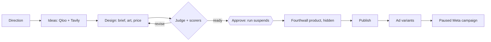

# wovain — Product Requirements

A print-on-demand product, on the website and in ChatGPT, that takes an independent fashion designer or small label from a direction to hidden Fourthwall products and a paused Meta campaign, one approval at a time. Source: `scope.md > The Unique Kernel`, `scope.md > Who It's For`, `scope.md > The Core Loop`. Last updated 2026-10-26.

## The Core Journey

Source: `scope.md > What "Working" Looks Like`.

1. The designer signs in at <https://wovain.com> with Google or email (or adds the wovain app in ChatGPT and signs in there).
2. They connect their own Fourthwall shop and Meta ad account, and, once shipped, their own fal key. Free accounts start with 40 credits a month, about two drops (proposal).
3. They describe a drop. wovain asks Qloo for the direction's entities and taste themes, then Tavily for the past month's news and marketplace listings inside those themes, and saves ranked ideas with evidence.
4. They pick the ideas they like and click See designs: wovain draws a design for each picked idea and for no other (nothing is drawn before that click). For each, Nemotron writes a design brief and listing, fal draws transparent print art, and the price comes from the blank's base cost.
5. Nemotron judges the design and scorers grade it. Code checks the print size itself; a `revise` verdict lists the fixes.
6. The designer approves or rejects the design (with a reason). The run waits for this decision.
7. An approved design becomes a Fourthwall product, hidden. The designer publishes it as a separate step.
8. Nemotron writes up to three ad variants (angle, headline, message) and wovain stages a Meta campaign, ad set and ads, all paused, for the countries and daily budget chosen.
9. Success: the product is in the Fourthwall shop and the paused campaign is in Meta Ads Manager. The designer starts it when ready. Paid steps are charged in credits.

Autopilot (paid plans only in production; on for every plan, Free included, in dev and next) does steps 3 to 8 in one run: Nemotron picks the lead idea and reviews each design, and the run stops if it approves none; a design the judge says to revise is never approved.

## Screens and Layout

| Surface | What it holds | Status |
| --- | --- | --- |
| Landing | What wovain does for independent labels, guides, use cases, integrations | Live; product rewrite in review |
| Sign in and sign up | Google and email through Better Auth; password reset | Live; Better Auth UI screens in review |
| Account settings | Profile, sessions, linked accounts | In review |
| Dashboard | Setup checklist, new-drop wizard (with the capsule step), the Drops page (every drop; the old Runs address redirects), designs, products, campaigns | Live; app UI pass in progress |
| Connections | Connect Fourthwall and Meta (OAuth); fal API key | Fourthwall and Meta live; fal in progress |
| Pricing and billing | Plans, credit balance, upgrade screens, Polar checkout and portal | In review |
| ChatGPT | The same steps as MCP tools at `https://mcp.wovain.com/api/mcp`, with widgets for trends, designs, products and campaigns | Live |
| Consent | The OAuth consent page ChatGPT sends the designer to | Live |
| Docs | <https://docs.wovain.com> in English, French and Spanish | Live |

## Look and Feel

Editorial and restrained, on the designer's side, honest about money (`scope.md > Inspiration & Identity`). Studio words (drop, capsule, piece, blank, margin, paused); no "agent", "AI-powered", model or protocol names on marketing pages. Example line: "Campaigns are created paused. Nothing spends until you turn it on." shadcn/ui on Base UI and Tailwind CSS 4, light and dark themes, readable on a phone. The logo is used only through the `<Logo/>` component while the new mark is designed.

## Features and Behavior

### Sign-in and accounts

- As a designer, I want to sign in with Google so that I don't make another password.
  - [x] Google and email sign-in through Better Auth; Better Auth is also the OAuth server for ChatGPT.
  - [ ] Better Auth UI screens for sign-in, sign-up, reset and account settings, with English error messages.

### Connectors

- As a designer, I want wovain to work inside my own accounts so that the products, art and ads are mine.
  - [x] Fourthwall and Meta connect through each service's OAuth; tokens are sealed with AES-256-GCM.
  - [ ] fal connects with the designer's own API key, sealed the same way; until then the platform key is used (in progress, required before billing goes live).
  - [x] wovain pays for Nebius, Tavily and Qloo itself; they are not merchant connectors.

### Drop research

- As a designer, I want ideas that come with evidence so that I trust what I design.
  - [x] Each idea shows its Qloo and Tavily signals, its source links and its score inputs.
  - [x] Names Qloo matched for the direction are never printed on a design.
  - [x] "Why this idea" shows Qloo's taste map: the matched entities, the theme's tag and the cross-domain affinities with each entity's share.
  - [x] Every idea is a Qloo taste tag. When Qloo can't place the brief, the run stops and asks the designer to name a band, film, brand or place, with examples. The comparison with an LLM-only run is an offline eval, not a run option.
  - [x] A missing Qloo, Tavily or Nebius key fails only that step, with an error naming the variable.

### Designs and judging

- As a designer, I want a priced, checked design before I approve.
  - [x] Price is at least $10 profit and 30% margin after card fees, sales tax and a refund reserve.
  - [x] The print-size check is computed by code and overrides Nemotron.
  - [x] The judge checks title, description, idea fit, originality and that the subject is not a garment, looks at the drawn art (no garment or mockup, no background or cropping, the printed words, contrast on each garment color) and returns a verdict, score and up to five fixes. A design sent back is redrawn once, then shown flagged.

### Publishing and ads

- As a designer, I want to approve before anything is published or spent.
  - [x] A product is created hidden on Fourthwall and published only by a separate step.
- As a designer, I want wovain to run my store, with me approving anything customers see or that moves money.
  - [ ] A readiness check, one collection per drop, publish, pause and retire, scheduled launch codes, samples and per-size prices, each through the approval queue (in review, flag `store-management`).
  - [ ] Refunds and cancels always wait for me and show what will be charged to my card.
  - [x] Every Meta object is created paused, and wovain reads it back to check.
  - [ ] wovain starts a campaign only through an approval, inside the designer's daily and monthly spend caps, and pauses it on request (in progress, behind `media-buying-live`).
  - [x] Daily budget is between $1 and $500 and targeting is limited to the chosen countries.

### Runs, approval and autopilot

- As a designer, I want one command to run the loop, pausing for my approval or with Nemotron deciding.
  - [x] Nemotron picks the lead idea and reviews each design in autopilot; a design the judge says to revise is never approved.
  - [x] The reason for each approval or rejection is stored on the design.
  - [ ] Runs are durable Mastra workflows: the run returns at once, suspends at approval and resumes to product and campaign after the decision, and survives a restart (in progress).
  - [ ] Each step is recorded on the run; a failed run shows where it stopped and why, and a retry does not duplicate a Fourthwall product or Meta campaign (in progress).
  - [ ] Every 6 hours, autopilot scans each brand's Qloo audience and this week's Tavily news, saves up to two suggested drops with their sources, and queues each run in the approval queue within the designer's autonomy level and a daily credit cap; the designer starts or dismisses each one in the decision log (dev only, `autopilot-triggers` flag).

### Quality

- As a designer, I want every draft checked so that I don't put my name on something generic or broken.
  - [x] Code facts (print size, price floor, budget range) override any model output.
  - [ ] Mastra scorers grade every agent and step (brief, art, judge, ad copy, autopilot picks); LLM judges are calibrated against human labels (planned).
  - [ ] Guardrails on inputs and outputs: no names the direction matched, no trademark or unsafe prompts, length limits (planned).
  - [ ] Scores are traced per run and sent to PostHog as `agent_score` (planned).

### Billing and credits

- As a designer, I want a small free allowance and a clear price so that I can try a real drop before paying.
  - [ ] Polar is the merchant of record. Proposed plans (docs/pricing-proposal.md): Free 40 credits a month, Studio $29 for 300, Label $79 for 1,000 (rolls over), and a 100-credit pack for $15. A drop is about 18 credits.
  - [ ] Credits are reserved before a paid step and returned if it fails; research 5, design 4, assist 1 (proposal).
  - [ ] Autopilot is on paid plans only in production (proposal); in dev and next it is on for every plan, Free included.

### Analytics

- As the founder, I want to see whether designers reach their first approved design.
  - [x] North Star: activated merchants per week (a merchant who approves a design within 7 days of sign-up). PostHog dashboards for growth, retention, agent quality and cost, and web vitals exist.
  - [ ] Missing events (`run_completed`, `run_failed`, `design_generated`, `design_rejected`, `agent_score`, `campaign_activated`, subscription and credit events) are added (planned).

## States and Boundaries

- **First use** — no connections yet; the setup checklist and the MCP tools point to the connect link.
- **Out of credits** — the paid step is refused before it runs, with the upgrade link.
- **Provider key missing** — that step fails with a `NOT_CONFIGURED` error naming the variable.
- **Provider failure** — the run is marked `failed` with its step and error; reserved credits come back.
- **Awaiting approval** — the run is suspended until the designer decides (Mastra migration, in progress).
- **Persists** — users, sessions, connections (tokens sealed), runs, ideas, designs, products, campaigns, usage and, with billing, the credit ledger in PostgreSQL.
- **Boundary** — every procedure is protected by a session (website) or an OAuth access token (ChatGPT); a designer sees only their own rows.

## Product Decisions

- A real product for independent designers and small labels, print-on-demand only — founder decision, 2026-10-26.
- Merchants bring their own Fourthwall, Meta and fal accounts; wovain pays Nebius, Tavily and Qloo out of credits — products, art and ads belong to the merchant, and wovain's own costs stay small and metered.
- Polar as merchant of record, with credits sized to drops — handles tax and invoices; credits match the steps wovain pays for. The numbers are a proposal.
- All-in on Mastra for agents, workflows, memory, scorers and tracing — one framework instead of hand-rolled orchestration, with suspend/resume for the approval gate.
- Models decide, code gates — the print size, price floor, budget range and paused state are code, not model output.
- Paused by default: the designer approves every start of spend, inside caps they set.
- One app serves the website and the ChatGPT app — a single set of procedures keeps the surfaces identical.
- Activated merchants per week is the North Star — it is the core action and leads publish, campaign and payment.

## What We're Building

Everything in `scope.md > The POC Boundary`: sign-in with Google, own-account connectors, Qloo and Tavily research, designs with the Nemotron judge, approval, Fourthwall product and publish, Meta ad variants and a paused campaign, autopilot, the ChatGPT app and the docs site. In progress on top of the live loop: Better Auth UI, Polar billing, the fal connector, the Mastra migration with scorers, the app UI pass, and the feedback loop (sales and ad results re-fit the idea-score weights per brand; each design's angles are scored per merchant with Beta-Binomial shrinkage, which ranks ideas, weights a test's spend floor, gives the kill rules a real cost per sale and explains itself on Insights; development and next only).

## Deferred From the POC

- Optimizer and campaign results: need spend data first.
- Several blanks per design and varied ads per drop: after evals.
- Organizations and seats: today every row belongs to one user.
- Annual billing: after monthly prices are proven.

## Possible Later Enhancements

Apparel on demand for big companies (the long-term vision); TikTok Shop and ads; bring-your-own Nebius key on Label; Qloo audience demographics for targeting; more docs locales.

## Non-Goals

- No cut-and-sew, and no apparel on demand for big companies yet: today's scope is print-on-demand only.
- No custom media buying: Meta already optimizes delivery.
- No ad spend without an approval: wovain starts a campaign only after the designer approves it, inside their caps.
- No fabricated customers, users, sales, revenue or testimonials.

## Open Questions

- Lock the pricing numbers — must be settled before billing goes live.
- Qloo licence for commercial resale (the current key is a hackathon key) — before charging.
- Meta app review scope for server-side campaign creation — before public launch.
- Final logo (round 6 recommends "Impression") — can wait.
- Resolved: the ChatGPT connector URL is `https://mcp.wovain.com/api/mcp`, with OAuth discovery under `/.well-known/oauth-*`.
