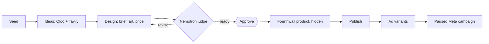

# wovain — Product Requirements

An agentic print-on-demand app, on the website and in ChatGPT, that takes a solo Fourthwall seller from a seed idea to a t-shirt product and a paused Meta campaign, one approval at a time. Source: `scope.md > The Unique Kernel`, `scope.md > The Core Loop`.

## The Core Journey

Source: `scope.md > What "Working" Looks Like`.

1. The seller signs in at <https://wovain.com> (or adds the wovain connector in ChatGPT) and connects Fourthwall and Meta.
2. The seller enters a seed. Wovain asks Qloo for the seed's entities and taste themes, then Tavily for this week's news and marketplace listings inside those themes, and saves ranked ideas.
3. The seller picks an idea. Nemotron writes a design brief and listing, fal draws transparent print art, and the price comes from the blank's base cost.
4. Nemotron judges the design. Code checks the print size itself; a `revise` verdict lists the fixes.
5. The seller approves or rejects the design (with a reason).
6. An approved design becomes a Fourthwall product, hidden. The seller publishes it as a separate step.
7. Nemotron writes up to three ad variants (angle, headline, message) and wovain stages a Meta campaign, ad set and ads, all paused, targeted at the countries and daily budget the seller chose.
8. Success: the product is in the Fourthwall shop and the paused campaign is in Meta Ads Manager. The seller starts it when ready.

Autopilot does steps 2 to 7 in one run: Nemotron picks the idea and approves the design, and the run stops if the judge says to revise.

## Screens and Layout

| Surface | What it holds |
| --- | --- |
| Sign in | Email and password through Better Auth |
| Dashboard | The seller's account and entry point to the flow |
| Connections | Connect Fourthwall and Meta (OAuth) |
| Seller flow | Procedures for ideas, designs, products, campaigns and runs, used by the website |
| ChatGPT | The same steps as MCP tools at `https://wovain.com/api/mcp`, returning JSON |
| Consent | The OAuth consent page ChatGPT sends the seller to |
| Docs | <https://docs.wovain.com> in English, French and Spanish |

## Look and Feel

Friendly coach voice: warm, one-sentence reasons, numbers first. Name in lowercase. shadcn/ui components on Base UI and Tailwind CSS 4, light and dark themes, readable on a phone. Example copy: "Video A wasn't selling, so I paused it to save budget: $30.96 spent, no sales."

## Features and Behavior

### Trend research

- As a seller, I want ideas that come with evidence so that I trust what I design.
  - [ ] Each idea shows its Qloo and Tavily signals, its source links and its score inputs.
  - [ ] Names Qloo matched for the seed are never printed on a design.
  - [ ] A missing Qloo, Tavily or Nebius key fails only that step, with an error naming the variable.

### Designs and judging

- As a seller, I want a priced, checked design before I approve.
  - [ ] Price is at least $10 profit and 30% margin after card fees, sales tax and a refund reserve.
  - [ ] The print-size check is computed by code and overrides Nemotron.
  - [ ] The judge checks title, description, idea fit and originality and returns a verdict, score and up to five fixes.

### Publishing and ads

- As a seller, I want to approve before anything is published or spent.
  - [ ] A product is created hidden on Fourthwall and published only by a separate step.
  - [ ] Every Meta object is created paused; wovain never activates spend.
  - [ ] Daily budget is between $1 and $500 and targeting is limited to the chosen countries.

### Autopilot

- As a seller, I want one command to run the loop with Nemotron deciding.
  - [ ] Nemotron picks the idea and reviews the design; a design the judge says to revise is never approved.
  - [ ] Each step is recorded on the run; a failed run shows where it stopped and why.
  - [ ] The reason for each approval or rejection is stored on the design.

### After deploy

- Self-healing flow: a production error read from evlog events becomes a merge request with a fix and a regression test; feature-flag fault injection demonstrates it.
- Scout flow: KPIs and UI become evidence-backed issues.
- Developer flow: an issue becomes a merge request.

## States and Boundaries

- **First use** — no connections yet; MCP tools return an error with the connect link.
- **Provider key missing** — that step fails with a `NOT_CONFIGURED` error naming the variable.
- **Provider failure** — the run is marked `failed` with its step and error.
- **Persists** — users, sessions, connections (tokens sealed), runs, ideas, designs, products and campaigns in PostgreSQL.
- **Boundary** — every procedure is protected by a session (website) or an OAuth access token (MCP); a seller sees only their own rows.

## Product Decisions

- One app serves the website and the MCP server — a single set of procedures keeps the surfaces identical.
- Models decide, code gates — the print size, price floor, budget range and paused state are code, not model output.
- Paused by default — the seller keeps every spending decision.
- Qloo first — taste decides what is worth designing before the news is consulted.

## What We're Building

Everything in `scope.md > The POC Boundary`: sign-in and connections, Qloo and Tavily trends, a t-shirt design with the Nemotron judge, approval, Fourthwall product and publish, Meta ad variants and a paused campaign, autopilot, the ChatGPT MCP server, the docs site and the three Duo flows.

## Deferred From the POC

- Widgets in ChatGPT: tools return JSON for now.
- Optimizer and campaign results: need spend data first.
- Products beyond the t-shirt, trademark screening and a spend cap for autopilot.

## Possible Later Enhancements

TikTok Shop and ads; Qloo audience demographics for targeting; weights for idea scores recalibrated from real sales; more locales for the docs.

## Non-Goals

- No custom media buying: Meta already optimizes delivery.
- No automatic activation of ad spend: the seller starts campaigns.
- No fabricated customers, sales or testimonials.

## Open Questions

- Meta app review scope for server-side campaign creation — must be settled before the live demo.
- Resolved: the ChatGPT connector URL is `https://wovain.com/api/mcp`, with OAuth discovery under `/.well-known/oauth-*`.
