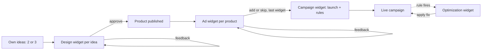

# wovain product requirements

An MCP server, used from ChatGPT or any other agent, that takes a solo print-on-demand merchant from a product idea to live Fourthwall products and a running Meta Advantage+ campaign, one approved widget at a time.

Source: `scope.md > The unique kernel`, `scope.md > The core loop`.

## The Core Journey

Source: `scope.md > What "working" looks like`.

1. The merchant opens wovain in ChatGPT and gives 2 or 3 product ideas.
2. One design widget per idea shows a drop: a hero product plus 3 to 6 matching products (hoodie, mug, poster, sticker…) from the merchant's Fourthwall catalog, each with its placements, listing and price.
3. The merchant approves, skips, or gives feedback on each design widget. Feedback regenerates the whole widget. Approve publishes every product of the drop to Fourthwall right away, grouped in one collection.
4. Right after a product is published, its ad widget shows 2 videos, 1 static image, ad copy, and the margin math.
5. The merchant adds each ad widget to the campaign, skips it, or gives feedback.
6. When the last ad widget is added or skipped, the campaign widget launches one Advantage+ sales campaign with all added ads, plus the kill, scale and alert rules.
7. Success: Meta Ads Manager shows the live campaign and its rules, and the products are live in the Fourthwall shop.
8. Later, when a rule has fired, the next time the merchant checks in, an optimization widget reports what happened and suggests a fix to approve.



## Screens and Layout

Everything happens inside the ChatGPT conversation. Widgets appear inline in the order of the journey, with no separate app or dashboard.

| Surface | When it appears | Count |
| --- | --- | --- |
| Design widget | After the merchant gives their ideas | 1 per idea (2 or 3) |
| Ad widget | Right after its product is published | 1 per published product |
| Campaign widget | After the last ad widget is added or skipped | 1 |
| Optimization widget | When a campaign rule fires | 1 per event |
| Settings widget | When the merchant asks for wovain settings | 1 per request |

Feedback works two ways on every widget: free typing in the chat, or the widget's own controls and feedback field.

Every widget also has a quick-settings menu (⚙) for the values it uses; the Settings widget edits all of them. Changes apply without a redeploy.

### Design widget wireframe

```
┌─ Japanese cat sunset · Bella+Canvas 3001 tee ────────────────┐
│ "Soft bestseller tee, and the art prints sharp at this size." │
│ ┌───────────┐  ● Black ○ Navy ○ Natural ○ Ash   (in stock)   │
│ │  mockup   │  Front · large center · 12×16 in               │
│ │ on model  │    + Back · neck mark · 3×3 in                 │
│ │           │  File: 4500 px ✓ print quality high            │
│ └───────────┘  Sizes XS–3XL  (4XL/5XL out of stock)          │
│ ─────────────────────────────────────────────────────────────│
│ Title  Japanese Cat Sunset Tee – Vintage Sakura Graphic      │
│ Desc   2 short on-brand lines…                               │
│ Price  $30   Base $17.70 → Profit $12.30 · 41% margin        │
│ ─────────────────────────────────────────────────────────────│
│ Sakura Cat Club · 5 products                                 │
│ One of each $140.00 → profit $63.90 · 46% margin             │
│ ┌────────┐ ┌────────┐ ┌────────┐ ┌────────┐                  │
│ │ Hoodie │ │  Mug   │ │ Poster │ │Sticker │                  │
│ │Front+  │ │Both    │ │Front   │ │Front   │                  │
│ │Back    │ │sides   │ │        │ │        │                  │
│ │$48 30% │ │$22 56% │ │$25 50% │ │$15 81% │                  │
│ └────────┘ └────────┘ └────────┘ └────────┘                  │
│ ─────────────────────────────────────────────────────────────│
│ [ Approve 5 products ]  [ Skip ]   Feedback: ______________  │
└──────────────────────────────────────────────────────────────┘
```

### Ad widget wireframe

```
┌─ Ads · Japanese Cat Sunset Tee ──────────────────────────────┐
│ "Two try-on clips plus your mockup. Good margin for a test." │
│ ┌──────┐ ┌──────┐ ┌──────┐  A · 15s · 9:16 · UGC on-model    │
│ │ ▶ A ⛶│ │ ▶ B ⛶│ │ img  │  B · 15s · 9:16 · UGC styling     │
│ └──────┘ └──────┘ └──────┘  Static · Fourthwall mockup       │
│ Headline      Sakura Season Cat Tee                          │
│ Primary text  2–3 lines…                                     │
│ ─────────────────────────────────────────────────────────────│
│ $30 − $17.70 base − $1.38 fees − $0.60 reserve = $10.32      │
│ Breakeven: $10.32 per sale · 2.9× return on ad spend         │
│ Rules: off at $30.96 with no sales · budget +20% under $8.26 │
│ ─────────────────────────────────────────────────────────────│
│ [ Add to campaign ]  [ Skip ]   Feedback: ________________   │
└──────────────────────────────────────────────────────────────┘
```

### Campaign widget wireframe

```
┌─ Campaign · wovain test · Advantage+ sales ──────────────────┐
│ "You're live! I'll watch the numbers and flag anything odd." │
│ 3 products · 9 ads · $45/day · Rules: kill, scale, alert     │
│ Status: ● Live            (or ◐ Ready, blocked: reason)      │
│ [ Open in Ads Manager ↗ ]                                    │
└──────────────────────────────────────────────────────────────┘
```

### Optimization widget wireframe

```
┌─ Rule fired · Japanese Cat Sunset Tee ───────────────────────┐
│ "Video A wasn't selling, so I paused it to save budget."     │
│ $30.96 spent, no sales (3× breakeven)                        │
│ Suggested fix: new 3-second hook, same product               │
│ [ Apply the fix ]  [ Dismiss ]                               │
└──────────────────────────────────────────────────────────────┘
```

### Settings widget wireframe

```
┌─ wovain settings ────────────────────────────────────────────┐
│ "Change anything here; new widgets use it right away."         │
│ Video model   H3 Max Reference 768P ▾  $0.75 per clip        │
│ Audio         MMAudio (background) ▾    $0.015 per clip      │
│ Pricing       ≥ $10 profit or 30% margin                     │
│ Budget        $15 per product per day                        │
│ Rules         kill 3× breakeven · scale +20% / 48 h          │
│ [ Save ]                                                     │
└──────────────────────────────────────────────────────────────┘
```

## Look and Feel

- Built on ChatGPT's own design system (OpenAI's apps UI kit): system fonts, system colors for text, backgrounds and dividers, light and dark themes.
- Accent: indigo dye #3B4CCA, only on primary buttons, badges and icons. White text on it passes WCAG AA (about 6.8:1).
- Status colors stay semantic: green for live, amber for blocked, red for paused.
- Voice: friendly coach. Each widget opens with one coach line that explains the call, with the numbers below it.
- Each widget has at most 2 buttons, no tabs and no scrolling inside the widget (ChatGPT's rules).
- Images use fixed aspect ratios and alt text. Videos are tap to play, muted, with a full-screen control that plays them at phone size over the chat.

## Features and Behavior

### Design widgets

Source: `scope.md > The POC boundary` (Design, Listing).

| Field | Content |
| --- | --- |
| Blank | A Fourthwall blank, preferring Our Pick or Bestseller badges and high reviews |
| Mockup | The design on the blank in 3 to 5 in-stock colors that contrast with the artwork |
| Placement | Print area and size, for example front, large center, 12×16 in |
| File quality | Artwork pixels against Fourthwall's minimum for that print size |
| Sizes | Available sizes; out-of-stock sizes crossed out and excluded |
| Title | Keyword first: main keyword, design element, style |
| Description | 2 short on-brand lines; no garment specs (Fourthwall adds them) |
| Price | Price, base cost, profit and margin |
| Drop | The other products of the idea, one card each: type, blank, placements, colors, price, profit and margin, plus the total for one of each |

- As a merchant, I want each design shown on a real Fourthwall product with its listing so that I approve exactly what will be sold.
  - One design widget appears per idea.
  - Feedback, typed or in the widget field, regenerates the whole widget with the change applied.
  - Approve publishes the product to Fourthwall and the widget shows it as live with a link.
  - Skip removes the design without publishing.
- As a merchant, I want one idea to become a drop that looks like a brand, not one tee, so that fans have more to buy.
  - The agent picks 3 to 6 more product types the idea suits from my Fourthwall catalog (Our Pick or Bestseller blanks that Fourthwall can render), and only placements those blanks print.
  - Placements are planned per product: the hero on the tee front, the big print on the hoodie back with a chest mark, the mark on stickers and hats, both sides of a mug.
  - Art is generated per placement on my fal account (a hero, a back print, a small mark, a wordmark), each matched to the hero so the drop is one style, with a shared palette across garments.
  - wovain prices every product from Fourthwall's per-size costs with my pricing rule; the agent can't set a price.
  - Approve stays off while any print in the drop would come out blurry.
  - Approve opens a wovain page in my browser: I sign in, see every product with its price, profit and margin, and press Confirm. Only that confirms; a redraw afterwards needs a new Approve.
  - Then wovain creates every product, sets its price, makes it public and groups the drop in one Fourthwall collection; nothing is created before I confirm. The live link opens the collection.

### Pricing and economics

Source: `scope.md > The POC boundary` (Economics), `scope.md > Open questions for later phases`.

- Pricing rule: at least $10 profit or a 30% margin, whichever is greater, rounded up to a clean price.
- Breakeven per sale = price − base cost − card fees (2.9% + $0.30 on price, shipping and sales tax) − 2% refund reserve.
- Breakeven return on ad spend = price ÷ breakeven per sale. This is on product price; if the pixel reports value including shipping and tax ($37.10), the matching target in Meta is 3.6×.
- Breakeven uses the base cost of the priciest size offered by default, because 2XL and up cost more; a setting switches to a size-weighted average. The demo numbers below use the XS–XL base cost.

| Demo tee at $30                                      | Amount  |
| ---------------------------------------------------- | ------- |
| Price                                                | $30.00  |
| Fourthwall base cost                                 | −$17.70 |
| Card fees (on $30 + ~$5 shipping + ~$2.10 sales tax) | −$1.38  |
| Refund and reprint reserve (2%)                      | −$0.60  |
| Breakeven per sale                                   | $10.32  |
| Breakeven return on ad spend                         | 2.9×    |

- The design widget shows price, base cost, profit and margin.
- The ad widget leads with breakeven cost per sale, the number the rules use, and shows the return on ad spend target second, based on the purchase value the pixel actually sends.

Breakeven per sale under different assumptions (price $30, base cost $17.70):

| Case     | Shipping | Sales tax  | Refund reserve | Breakeven per sale |
| -------- | -------- | ---------- | -------------- | ------------------ |
| Upside   | $4.50    | None       | 1%             | $10.70             |
| Base     | $5.00    | 7% ($2.10) | 2%             | $10.32             |
| Downside | $6.50    | 9% ($2.70) | 5%             | $9.36              |

Costs of running the proof of concept, on top of per-sale costs:

| POC cost | Amount | Note |
| --- | --- | --- |
| Meta test budget | $135 to $189 | $45 a day for 3 to 4 days; scaling can fire on day 3, raising day 4 to $54; kill rules stop losing ads early |
| Ad videos (6 clips) | $4.59 | MiniMax H3 Max Reference on fal at $0.75 per 15-second clip, plus $0.015 per clip for background audio; switchable in Settings (Kling v3 Standard $2.10 per clip, Kling O1 Reference $0.84 for 10 s, MiniMax H3 Max Turbo $0.24 for test runs). Prices are fal list prices (Oct 19, 2026); the Settings widget shows live fal prices |
| Design images | A few dollars per drop (unverified) | GPT Image 2.5 on the merchant's fal account, 2 to 5 pieces per drop, billed by fal per token at high quality; the agent quotes fal's `estimate_cost` first. ChatGPT's built-in image generation is the free fallback |
| ChatGPT plan | Depends on your plan | Plus works: the merchant adds wovain's hosted `/mcp` as a connector, on chatgpt.com or in the desktop app |
| Fourthwall | $0 | No platform fee on physical products; optional samples at manufacturing cost |
| Server hosting | $0 | Firebase App Hosting, Firestore and Cloud Storage within their no-cost quotas to start (unverified; App Hosting needs the pay-as-you-go Blaze plan with a billing account, so usage past the quotas is billed) |
| Total for the test | $140 to $194 | Ad spend plus $4.59 of video, plus the design art on fal |

### Ad widgets

Source: `scope.md > The POC boundary` (Ads).

| Creative | Spec |
| --- | --- |
| Video A | UGC-style, on-model, 9:16, 15 seconds or less, background audio; no text burned in, since Meta shows the Page name and picture on every ad and the primary text carries the message |
| Video B | UGC-style, a second angle or styling, same spec |
| Static | The Fourthwall mockup image |
| Headline | Short, product-led |
| Primary text | 2 to 3 lines |

Videos come from MiniMax H3 Max Reference on fal with the mockup and the design as references, so the print stays the same; background audio is generated separately. Model and audio are switchable in Settings.

- As a merchant, I want ads and margins for each product right after it goes live so that I can judge whether advertising it makes sense.
  - An ad widget appears right after each product is published.
  - It shows 2 playable videos, 1 static image, a headline and primary text.
  - It shows the breakeven line and the rule thresholds for that product.
  - Each video has a full-screen control that plays it at phone size over the chat.
  - The merchant checks print fidelity in the full-screen view before adding the ad.
  - Feedback regenerates the whole widget.

### Campaign launch

Source: `scope.md > The POC boundary` (Campaign).

- One Advantage+ sales campaign holds every added ad, tagged by product.
- It launches once, after the last ad widget is added or skipped, so learning never resets for new ads.
- Starting budget: $15 per product per day, set for the whole campaign (for example $45 a day for 3 products).
  - After the last ad widget, the campaign widget appears and shows Live with a link to Ads Manager.
  - Ads Manager shows one campaign containing all added ads and the rules below.

### Campaign rules

Source: `scope.md > The POC boundary` (Management).

| Rule | Condition | Action | Checked |
| --- | --- | --- | --- |
| Kill, no sales | An ad's spend reaches 3× breakeven with 0 sales | Pause that ad | Every 30 minutes |
| Kill, design | A product's total spend across its ads reaches 4× breakeven with 0 sales | Pause all of that product's ads | Every 30 minutes |
| Kill, too expensive | Cost per sale above 1.5× breakeven with at least 5 sales in 7 days | Pause that ad | Every 30 minutes |
| Scale | Campaign cost per sale below 0.8× breakeven over 3 days with at least 10 sales | Campaign budget +20%, at most once per 48 hours, capped at 2× the starting budget | Daily |
| Alert | Campaign cost per sale above breakeven | Notify the merchant | Daily |

- All five rules exist in Ads Manager after launch, with each product's thresholds.
- Every ad link carries `utm_content` set to the ad ID, so Fourthwall's sales-by-UTM report can confirm each ad's sales.
- The 3×, +20% and $15 values are practitioner heuristics, not Meta guidance; all are editable in Settings.

### Optimization

Source: `scope.md > The core loop` (interrupt campaign: change direction).

When a rule has fired, wovain runs its optimization step on the flagged item and shows an optimization widget: what happened, and a suggested fix (for example a new hook, a new video, or a price test), using Fourthwall's conversion and visitor reports as evidence. Only the flagged ad changes; everything else keeps running. Every ad link carries `utm_content` set to the ad ID. Before showing the widget, wovain cross-checks Fourthwall's sales-by-UTM report: Meta reports some purchases late and its rules can only read Meta's numbers, so if the shop shows a sale Meta missed, the widget offers to turn the ad back on. ChatGPT can't start a conversation, so wovain checks rule history when the merchant asks how the campaign is doing; Meta also sends its own rule notifications.

- A fired rule produces an optimization widget naming the ad, the numbers, and the rule.
- Apply the fix carries out the suggestion; Dismiss leaves the campaign as is.
- If the shop shows a sale for a paused ad that Meta missed, the widget offers to turn that ad back on.

## States and Boundaries

| # | When | What the merchant sees | Copy | Next action |
| --- | --- | --- | --- | --- |
| 1 | Artwork too low-resolution for the placement | Print quality turns red; Approve is disabled | "This artwork is 1100 px, and this print size needs 1500 px or more, so it would print blurry." | Regenerate at higher resolution, or use a smaller placement |
| 2 | Some colors or sizes out of stock | Those variants crossed out and excluded by default | "Navy is out of 4XL and 5XL, so I left those sizes off." | None needed; the merchant can add them back |
| 3 | Fourthwall rejects the publish | The widget keeps all edits and shows the reason | "Fourthwall didn't accept this product (reason). Your edits are saved." | Try again; after 2 failures, finish in Fourthwall's designer |
| 4 | A video fails to generate | The ad widget shows the failed slot | "Video B didn't render. I can try again, or you can go with the image only." | Retry, or use the static image only |
| 5 | Ad account has no payment method | Campaign widget shows Ready, blocked; products stay live and ad widgets are kept | "Your campaign is ready, but Meta needs a payment method on your ad account before it can launch." | Add payment method, then check again and launch |
| 6 | No purchase events from the store | Same Ready, blocked state | "Meta can't see sales from your store yet, and Advantage+ needs them to learn who buys." | Connect the Meta Pixel and Conversions API in Fourthwall, then check again and launch |
| 7 | A rule has fired on a running campaign | Optimization widget; only the flagged ad changes | "Video A wasn't selling, so I paused it to save budget: $30.96 spent, no sales (3× breakeven)." | Apply the fix, or dismiss |

- Approve and Add to campaign are disabled while their action runs, so nothing is published or added twice.
- Published products stay live whatever happens later in the flow.

## Product Decisions

| Decision | Reason |
| --- | --- |
| Design widgets follow the research-backed fields above | The merchant wanted widgets "informative backed by facts" |
| Feedback is free typing or widget controls, and regenerates the whole widget | A change usually affects several details on the widget |
| Approve publishes each design immediately | Fewer steps; matches the scope's direct publishing |
| Price: at least $10 profit or 30% margin, whichever is greater; demo tee at $30 | Fourthwall's stricter guideline; $30 leaves $10.32 per sale for ads instead of $8.43 |
| Every blank: the rule minimum, raised to the next clean price that leaves at least $10 breakeven per sale | Same headroom choice as the demo tee ($28 to $30); the widget shows the math and flags when competitors sell far lower |
| One Advantage+ campaign for all products | Meta: combining ads combines learning; at $45 a day, split campaigns would all stay Learning Limited; even combined, it may still stay Learning Limited (about 31 sales a week against Meta's ~50) |
| Launch after the last ad widget | Meta: adding ads resets learning |
| 2 videos and 1 static image per product | Meta: up to 10 creatives per ad set and a mix of video and static |
| $15 per product per day | Middle of the $10 to $50 practitioner range |
| Kill at 3× breakeven with no sales, checked every 30 minutes; scale +20% per 48 hours | Practitioner heuristics (unverified). 3× cuts the chance of killing an ad that is really at breakeven from 13.5% to 5%, and shop sales by UTM catch purchases Meta reports late |
| Test designs, not just ads: a design-level kill at 4× breakeven pauses all of a product's ads | In print-on-demand the design is what's being tested; the per-ad rule only trims weak creatives |
| Breakeven on the priciest size by default, size-weighted as an option | Rules never under-protect; the weighted view is closer once real size data exists |
| UGC-style video | Industry standard for apparel on Meta; Meta says native, non-ad-like creative performs better |
| The customer pays shipping; the widget uses the live rate, about $5 otherwise | Fourthwall passes the true rate to the customer (US tees $4.50 to $6.50); breakeven at $30 only moves between $10.28 and $10.34 |
| The campaign launches live; there is no paused option | One button keeps the campaign widget simple |
| Shop optimization uses Fourthwall's built-in reports for now | PostHog or Clarity need custom site code and consent handling, which is outside the POC |
| Look: ChatGPT's design system with an indigo dye accent | OpenAI allows brand color only on buttons, badges and icons; indigo stands apart from the status colors |
| One coach line per widget in a friendly-coach voice | The merchant chose a warm voice that explains each call |
| Ad widget: everything on one widget; each video has a full-screen control | One glance and one decision, while full screen lets you judge videos at phone size |
| Designs come from ChatGPT's built-in image generation, triggered by wovain's design playbook | ChatGPT makes better images (scope); there is no direct API, so the playbook asks the agent to make the image and hand it to wovain |
| A fired rule triggers optimization, not a full pause | The merchant's definition of "change direction" mid-campaign |
| Video: MiniMax H3 Max Reference on fal by default, with the mockup and the design as references | On-model UGC clips that kept the print in the first real test, at $0.75 per clip; Kling v3 ($2.10) and Kling O1 Reference ($0.84, 10 s) are one setting away, and the cheaper MiniMax H3 models serve test runs |
| Audio: generated background audio (MMAudio), configurable | Meta's music only works on image ads; MMAudio costs $0.015 per clip against $0.63 for Kling's own audio |
| Every value is configurable from a Settings widget and per-widget quick settings | The merchant tunes prices, budgets, rules and models without a redeploy |
| Print fidelity is checked by eye in the full-screen video view | No provider offers an automatic check; keeps the POC small |

## What We're Building

- Design widget per idea: mockup, placement, file quality, listing, price; approve, skip, feedback.
- Immediate Fourthwall publishing on approve.
- Ad widget per product: 2 UGC-style videos, 1 static image, copy, breakeven math.
- One Advantage+ sales campaign launched after the last ad widget, at $15 per product per day.
- Five Meta automated rules: kill (no sales), kill (design), kill (too expensive), scale, alert.
- Optimization widget when a rule fires.
- Settings widget and per-widget quick settings for every value.
- The 7 states in States and Boundaries.

## Deferred From the POC

| Item | Why deferred |
| --- | --- |
| Moving a winning product into its own campaign | Needs real results first |
| Bundles and 2-pack offers | Adds a promotion step to the flow |
| Per-product budgets | Advantage+ manages budget for the whole campaign |
| Campaign results widget in chat | Needs spend data first (`scope.md > Later`) |

## Possible Later Enhancements

- A Claude-first experience (`scope.md > Later`); Claude can already connect to the MCP server.
- TikTok Shop and TikTok ads, possibly through TikTok Agentic Hub skills.
- Larger design batches beyond 2 or 3.
- Shop optimization with PostHog or Clarity: heatmaps, session recordings and funnels on the storefront.

## Non-Goals

| Non-goal | Reason |
| --- | --- |
| Trend research | The merchant brings their own ideas |
| A custom video or image model | The goal is minimal code |
| A custom media-buying engine | Advantage+ and Meta rules already optimize campaigns |
| Draft or hidden products | Publishing directly takes fewer steps |
| Cut-and-sew tech packs (materials list, measurement specs, flat sketches) | For print-on-demand they reduce to blank, placement and file specs |

## Open Questions

| Question | Must answer before |
| --- | --- |
| The Meta ad account needs a payment method | The demo |
| The Fourthwall shop is "Coming soon"; ads need a live store | The demo |
| Connect the Meta Pixel and Conversions API in Fourthwall (built in, no code) | The demo |
| Which video tool: Modal, Creatify or HeyGen? (Kling v3 on fal chosen) | Resolved in `spec.md` |
| Rules need Meta's Marketing API; Meta's Ads plugin can't create them | Resolved in `spec.md` |
| Does ChatGPT hand its generated image to wovain's tool when a wovain skill asks for it? | Resolved in `spec.md` |
| Does your ChatGPT plan allow custom plugins? (Plus confirmed: 'Add custom MCP server' is available) | Resolved in `spec.md` |
| Can a widget's video go full screen itself, or does it need ChatGPT's full-screen view? | Resolved in `spec.md` |
| A published plugin must own its Fourthwall and Meta connections; the demo can use the existing ones | Resolved in `spec.md` |
| Do ChatGPT app widgets work in Live voice? | Resolved in `spec.md` |
