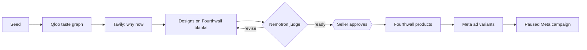

# wovain

An agentic print-on-demand app: Qloo finds who would buy, Tavily finds why now, Nemotron judges the designs, and the seller approves Fourthwall products and a paused Meta ad campaign.

Live at <https://wovain.com> (website and ChatGPT MCP server, on Cloud Run). Docs at <https://docs.wovain.com>.

## The Unique Kernel

Taste times moment, with bounded autonomy. Qloo's taste graph says who would buy and what else they love; Tavily's live search says why now; Nemotron on Nebius Token Factory judges and, in autopilot, decides, but only inside limits that code enforces (price floor from breakeven, budget cap, trademark screen, maximum spend). Nothing spends money until the seller starts the campaign.

## Who It's For

A solo print-on-demand seller with a Fourthwall shop. Today one product takes five tools: guessing what to sell, a chat for designs, a manual upload, a separate ad tool and a hand-built campaign in Ads Manager. They want to approve decisions, not operate tools.

## The Core Loop

The seller gives a seed (a niche, a fandom, a product type), on the website or in ChatGPT. Wovain returns ranked ideas with their evidence, designs the chosen ones for real Fourthwall blanks, has Nemotron judge them, and asks for approval. Approved designs become Fourthwall products, then ad variants, then a paused Meta campaign. They come back because each run turns a new seed into a ready-to-start campaign with one round of approvals.

After the code ships, three GitLab Duo flows keep it healthy: self-healing from production errors, a scout for KPI and UI improvements, and an issue-to-completion developer flow.

## Inspiration & Identity

A friendly coach: warm, explains the why in one sentence, still leads with the numbers. Name: wovain, lowercase. Built from existing services rather than rebuilt: Fourthwall for catalog and shop, Meta for delivery, Qloo and Tavily for signals, Nemotron for judgment. Docs: <https://docs.wovain.com>.

## Why This Matters to the Learner

The builder wants to show that an agent can run the whole print-on-demand loop, from idea to campaign, while the seller keeps every spending decision. The project is built for the Build With AI: Basics, GitLab Transcend, Nebius x NVIDIA and Qloo hackathons.

## What "Working" Looks Like

1. Enter a seed at <https://wovain.com> or in ChatGPT.
2. See ranked ideas, each with its taste signal, its moment signal and the inputs behind the score.
3. See designs on real Fourthwall products with price, profit and margin, and Nemotron's verdict.
4. Approve; the products exist in the Fourthwall shop.
5. See the ad variants and approve.
6. Open Meta Ads Manager: the campaign is there, paused, with the audience Qloo suggested. The "oh, that's cool" beat is step 6 after only talking and approving.

## The POC Boundary

| Area | In |
| --- | --- |
| Surfaces | Next.js 16 website and ChatGPT MCP server in one app on Cloud Run |
| Research | Qloo taste graph and Tavily web search |
| Judging | Nemotron on Nebius Token Factory |
| Publishing | Fourthwall products after approval |
| Ads | Several variants per product and a paused Meta campaign |
| Autopilot | End-to-end run with hard limits and an audit trail |
| Accounts | Better Auth sign-in, Cloud SQL (PostgreSQL) through Drizzle |
| After deploy | Three GitLab Duo flows |

## Later

- An optimizer that reads campaign results and proposes changes.
- TikTok Shop and TikTok ads.
- Campaign results inside chat, once there is spend data.

## Explicitly Cut

| Item | Reason |
| --- | --- |
| A custom image or video model | The goal is to reuse providers, with minimal code |
| A custom media-buying engine | Meta's own delivery and rules already optimize campaigns |
| Automatic activation of ad spend | The seller must stay in control of money |
| Customer, sales or testimonial claims | There is no sales data yet and none is invented |
