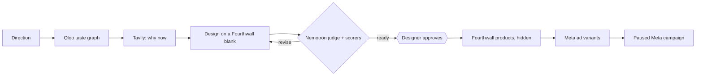

# wovain

Print-on-demand drops for independent fashion designers and small labels: wovain turns a designer's direction into researched, drawn, priced pieces listed on their Fourthwall shop and a paused Meta campaign, one approval at a time.

Live at <https://wovain.com> (website and ChatGPT app, on Cloud Run). Docs at <https://docs.wovain.com>. Last updated 2026-10-26.

## The Unique Kernel

Taste times moment, with bounded autonomy, inside the designer's own accounts. Qloo's taste graph says who the drop is for and what else they love; Tavily's live search says why now; Nemotron on Nebius Token Factory drafts and judges, and in autopilot decides, but only inside gates that code enforces (the print size, a price floor from the blank's base cost, a daily budget range, and a design the judge says to revise is never approved). Every step is scored, and nothing spends money until the designer approves it: campaigns are staged paused, and wovain starts one only after an approval, inside the designer's daily and monthly spend caps.

## Who It's For

An independent fashion designer or a small label (one to five people) who sells, or wants to sell, graphic pieces through print-on-demand: tees, sweatshirts, totes, caps and prints. The founder is also the art director, merchandiser and marketer. Today a small capsule costs a week of non-design work: researching what will land, preparing files for each blank, writing listings, working out prices that survive fees and building ads by hand in Ads Manager. They want to art-direct and approve, not operate tools.

Not for: high-volume sellers who want thousands of listings, trademark or fan-art sellers, or anyone looking for cut-and-sew manufacturing. wovain is print-on-demand only.

## The Core Loop

The designer describes a drop (mood, references, who it is for) on the website or in ChatGPT. wovain returns ranked ideas with their evidence, drafts designs for real Fourthwall blanks, has Nemotron judge them and asks for approval. Approved designs become hidden Fourthwall products, then ad variants, then a paused Meta campaign. They come back because each drop goes from direction to listed and staged in one round of approvals, with the price math shown.

## Inspiration & Identity

Editorial and restrained: short, considered sentences, studio nouns (drop, capsule, blank, edit, margin), numbers instead of adjectives, no hype. On the designer's side: taste stays with them, wovain does the chores. Honest about money: fees, margins and spend stated plainly. References: Aesop, Linear, Everlane and Shopify for tone and craft. Name: wovain, lowercase. A new logo is being redesigned; round 6 recommends the "Impression" wordmark (not final). Voice and audience are written down in `.agents/product-marketing.md`.

Built from existing services rather than rebuilt: Fourthwall for catalog, shop and fulfilment, Meta for ad delivery, fal for artwork, Qloo and Tavily for signals, Nemotron for drafting and judgment, Polar for billing.

## Why This Matters to the Learner

The builder wants wovain to be a real product that independent designers pay for, not a demo: an agent runs the production and marketing chores of a print-on-demand drop while the designer keeps every taste and spending decision. It started as the Build With AI: Basics project and is also entered in the Nebius x NVIDIA and Qloo hackathons.

## What "Working" Looks Like

1. Sign in at <https://wovain.com> with Google or email, or add the wovain app in ChatGPT.
2. Connect Fourthwall and Meta (and, once shipped, your own fal key).
3. Describe a drop. See ranked ideas, each with its taste signal, its moment signal and the inputs behind the score.
4. See designs on real Fourthwall blanks with price, profit and margin, Nemotron's verdict and the scores.
5. Approve; the products exist, hidden, in the Fourthwall shop.
6. See the ad variants and approve.
7. Open Meta Ads Manager: the campaign is there, paused, for the countries and daily budget chosen. The "oh, that's cool" beat is step 7 after only describing and approving.

## The POC Boundary

| Area | In | Status |
| --- | --- | --- |
| Surfaces | Next.js 16 website and ChatGPT app (MCP server with widgets) in one app on Cloud Run | Live |
| Research | Qloo taste graph and Tavily web search | Live |
| Competition | Per-theme saturation, how competitors sell and the audience's gaps (Tavily, Nemotron), fed to the brief, the ad writer and autopilot | In review, behind a flag (dev and next) |
| Design | Brief, transparent print art (fal), pricing from the blank's base cost | Live |
| Judging | Nemotron on Nebius Token Factory, code-checked print size | Live |
| Publishing | Hidden Fourthwall products, published by a separate step | Live |
| Store management | Readiness check, drops with a collection, publish, pause and retire, launch codes on a schedule, orders with refunds and cancels (always approved, with Fourthwall's cost preview), samples, per-size prices; every write through the approval queue | In review, behind a flag (dev and next) |
| Ads | Up to three ad variants per product and a paused Meta campaign | Live |
| Media buying | Start and pause a campaign from wovain through an approval, within spend caps; sales objective on the pixel, UTM links, status read back from Meta | In progress (dev and next) |
| Autopilot | End-to-end run where Nemotron decides and code gates; scheduled Qloo and Tavily triggers that suggest drops and act within the autonomy level | Run mode internal-only in production; triggers in dev and next only (`autopilot-triggers` flag) |
| Accounts | Better Auth with Google and email; Better Auth UI screens and account settings | Google live; UI in review |
| Connectors | Merchant's own Fourthwall and Meta (OAuth); merchant's own fal key | Fourthwall and Meta live; fal in progress |
| Billing | Polar (merchant of record) credits and plans; wovain pays Nebius, Tavily and Qloo from credits | In review, prices are a proposal |
| Agent runtime | Mastra agents, workflows with suspend/resume for approval, durable runs, memory on `@mastra/pg`, tracing | In progress |
| Quality | Mastra scorers on every agent and step, calibrated LLM judges, guardrails | Planned with the Mastra migration |
| Analytics | PostHog; North Star "activated merchants per week" | Dashboards built; some events planned |
| Voice | Hold-to-talk commands: NVIDIA Nemotron ASR on fal, a Nemotron agent picks the action, the merchant confirms once. wovain keeps no audio. Web first; mobile follows the app (#88) | In review, dev and next only |
| Drops | Capsules of 4 to 6 products chosen from Qloo tags: back print, chest mark, sleeve text, embroidery and label, each drawn by the model that suits it, checked in code and priced from Fourthwall's cost | In review, behind `design-drops` (dev and next) |

## Later

- An optimizer that reads campaign results and proposes changes, once there is spend data.
- Varied ads per product of a drop.
- Organizations and seats for labels with more than one person.
- Annual plans, and bring-your-own Nebius key as a Label option.
- TikTok Shop and TikTok ads.

## Explicitly Cut

| Item | Reason |
| --- | --- |
| Apparel-on-demand and cut-and-sew | wovain is print-on-demand only; production stays with Fourthwall |
| A custom image or video model | Reuse providers; the merchant's own fal account draws the art |
| A custom media-buying engine | Meta's own delivery already optimizes campaigns |
| Ad spend without an approval | The designer must stay in control of money: campaigns are created paused, and wovain starts one only after the designer approves it, inside their spend caps |
| Customer, user, sales, revenue or testimonial claims | There are no paying customers, sales or testimonials yet, and none are invented. Pricing is a proposal, not a result |
