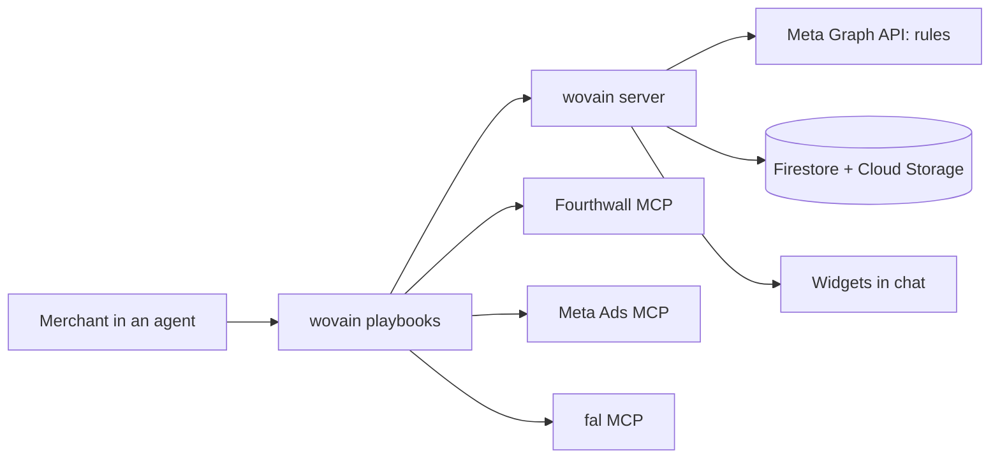

# wovain technical spec

An MCP server that is mostly wiring: its playbooks tell the agent what to do, three existing MCP servers (Fourthwall, Meta Ads, fal) do the heavy lifting, and wovain itself draws the widgets and fills the gaps no MCP covers.

Implements `prd.md` (all of **Features and Behavior**). Scope source: `scope.md > The POC boundary`.

## How This Works, In Plain Language

wovain is a hosted MCP server. You add its URL to an agent that speaks MCP over streamable HTTP with OAuth (ChatGPT, Claude and others), sign in once, and the agent can use it.

| Piece | What it is | What it does in wovain |
| --- | --- | --- |
| Playbooks | Step-by-step instructions the wovain server hands the agent | The playbook for each step: design, ads, campaign (optimization comes later) |
| Fourthwall MCP | Fourthwall's official server | Blanks, mockups, prices, publishing |
| Meta Ads MCP | Meta's official server | Campaign, ad set, video upload, ads, go live |
| fal MCP | fal's official server | Ad videos (MiniMax H3 Max Reference or Kling), background audio, upscaling, background removal |
| wovain server | Our Hono server, hosted on Firebase App Hosting and reached over HTTPS | Serves the playbooks and widgets, does the margin math, Meta rules, settings, and checks each design with Nemotron |
| Nebius Token Factory | NVIDIA Nemotron 3 Super behind an OpenAI-compatible API, called through Genkit | Scores each design brief against the print and listing rules before the widget shows it (`judge_design`), and ranks trend ideas (`research_trends`) |
| Tavily | Web search API, called through its official SDK (`@tavily/core`) | Finds this week's news for a niche (`research_trends`) and screens a phrase for trademark hits before publishing (`screen_trademark`) |
| Widgets | Small web pages the agent shows inline (MCP Apps) | Design, ad, campaign, optimization and settings widgets |

Why a wovain server at all: an agent can only show a widget that an MCP server serves, a widget's buttons can only call its own server, and Meta automated rules have no MCP. Everything else goes through the official servers.

How the agent learns the flow: when it connects, wovain's MCP `instructions` list the steps. Before each step the agent reads that step's playbook, either with the `get_playbook` tool or as the MCP prompt of the same name. Nothing has to be installed on the agent's side.

How a click works: you press Approve on a widget. For a design, Approve first opens a wovain page in your browser: you sign in to wovain there, see every product with its price, profit and margin, and press Confirm. That stores your approval for exactly that content (no tool can approve, and any later redraw needs a new Approve). The widget then posts a short message ("Approve design d2") into the chat; the agent screens the trademark and calls `publish_design`, which creates the whole drop on your Fourthwall shop through your connection and redraws the widget as live.

Where things are kept: Firestore keeps settings and the state of each run, one set of documents per user, so a new chat picks up where you left off. Staged artwork waits in a private Cloud Storage bucket until it is uploaded to Fourthwall.

Where you use it: in any agent that can reach the App Hosting URL's `/mcp` (`https://app--wovain.us-central1.hosted.app/mcp`). ChatGPT works on chatgpt.com and in the desktop app, because the server is hosted rather than started on your Mac.

## The Core Journey Through the System

PRD ref: `prd.md > The Core Journey`.



| # | You do | What happens | You see |
| --- | --- | --- | --- |
| 1 | Give 2 or 3 product ideas | The agent starts the `design` playbook | Next step starts |
| 2 | Wait | `design` playbook: the agent plans a drop from your Fourthwall catalog (a hero product plus 3 to 6 matching products, with placements per product); `generate_art` draws each art piece on your fal account; `stage_artwork` measures it; wovain uploads it to Fourthwall; Fourthwall renders every product's mockups in one call and gives per-size costs; `show_design_widget` prices each product | Design widget per idea, with the whole drop |
| 3 | Approve, Skip or give feedback | Approve posts "Approve design dN"; `publish_design` creates every product, sets prices, makes them public and groups the drop in one collection | Design widget shows Live with a link to the drop |
| 4 | Wait | `ads` playbook: `video_plan` gives the fal request; fal renders two clips (MiniMax H3 Max Reference by default), then MMAudio; copy and margins are computed | Ad widget per product |
| 5 | Add to campaign, Skip or give feedback | `record_ad` saves the choice; after the last widget, the campaign step starts | Next ad widget, or the campaign widget |
| 6 | Wait | `campaign` playbook: checks payment method and pixel; `campaign_plan` gives the budget, ad names and links; Meta MCP creates campaign, ad set, uploads, ads; `create_rules` adds the five rules; Meta MCP activates | Campaign widget: Live, or Ready, blocked |
| 7 | Later: "How's my campaign?" | `optimize` playbook (later): `campaign_check` reads rule history and results; Fourthwall reports and sales by UTM add evidence | Optimization widget per fired rule |
| 8 | Apply the fix or Dismiss | The fix runs through the same tools (new video, new hook, price test) | Updated ad, campaign keeps running |

Steps 7 and 8 moved to later by the learner's call (`checklist.md > Revisions`).

## Stack

| Layer | Choice | Version | Docs |
| --- | --- | --- | --- |
| Runtime and package manager | Node 24 (runs `.ts` by type stripping, no bundle step) and pnpm workspaces | 24 / 12.3.4 | https://nodejs.org/api/typescript.html, https://pnpm.io |
| MCP server | `@modelcontextprotocol/server` v2 over Streamable HTTP at `/mcp` | 2.3.1 | https://github.com/modelcontextprotocol/typescript-sdk |
| Web server | Hono on Node through `@hono/node-server`: `/mcp`, the OAuth metadata, the home page and `public/` | 4.13.13 / 2.1.5 | https://hono.dev |
| Sign-in and OAuth | WorkOS AuthKit (hosted authorization server); `@workos-inc/node` and `jose` on the server | 11.0.0, 6.2.12 | https://workos.com/docs/authkit/mcp |
| Widget protocol | MCP Apps (`@modelcontextprotocol/ext-apps`) | 2.0.3 | https://github.com/modelcontextprotocol/ext-apps |
| Widget UI | React 19 + `@openai/apps-sdk-ui` + Tailwind CSS 4 (its peer) | 19.3 / 0.2.2 / 4.3 | https://developers.openai.com/plugins/build/chatgpt-ui |
| Widget build | Vite 8 + `vite-plugin-singlefile`, one HTML file per widget | 8.3 | https://vite.dev |
| Schemas | zod 4 (required by `ext-apps`), shared by tools and widgets | 4.6 | https://zod.dev |
| Lint and format | Ultracite with oxlint (type-aware via oxlint-tsgolint) and oxfmt (sorts imports and Tailwind classes) | 8.0.1 / 1.88 / 0.73 / tsgolint 7.0 | https://www.ultracite.ai |
| TypeScript | Official dual setup: `typescript` aliased to `@typescript/typescript6` (6.0 API for tools), `@typescript/native` aliased to `typescript@7` (`tsc` 7.0 for type checking) | 6.0.2 / 7.0.2 | https://devblogs.microsoft.com/typescript/announcing-typescript-7-0/ |
| Git hooks | Lefthook | 2.2.2 | https://lefthook.dev |
| Tests | Vitest 5 for the server in two projects: `unit` (pure logic, `pnpm test`, also on pre-push) and `integration` (the store and MCP tools on the Firestore and Storage emulators through `firebase emulators:exec`, needs Java 21, `pnpm test:integration`, CI only); Vitest 5 with Playwright for widget stories | 5.0 | https://vitest.dev |
| Widget states | Storybook 10 (`@storybook/react-vite` with the a11y, docs, themes and vitest addons) | 10.6 | https://storybook.js.org |
| Commits and dead code | commitlint (conventional commits) and knip | 21.x / 6.x | https://commitlint.js.org |
| Database and files | Firestore and a private Cloud Storage bucket through `firebase-admin`; the Firebase CLI (`firebase-tools`) runs the emulators and rollouts | 14.5.0 / 15.34.0 | https://firebase.google.com/docs/admin/setup |
| Hosting and infrastructure as code | Firebase App Hosting: `apphosting.yaml` (build and run commands, instance limits, env and Secret Manager references); `firebase.json` at the root (the App Hosting source upload, emulators and rules files; the upload is the folder holding it, so it sits at the workspace root) with deny-all `apps/server/firestore.rules` and `storage.rules`; `infra/` (Pulumi) for the Google project itself and the AuthKit redirect URIs and MCP resource indicators (`infra/workos.ts`: the community `osodevops/workos` Terraform provider, 2.5.0, and the generic `magodo/restful` one, 0.25.2, for the resource indicators) | — | https://firebase.google.com/docs/app-hosting/configure |
| Telemetry | OpenTelemetry Node tracer with the OTLP/HTTP exporter, to GitLab Observability | sdk-trace-node 2.11.0 / exporter 0.222.0 | https://opentelemetry.io/docs/languages/js/ |
| Model calls | Genkit (was Mastra) with `@genkit-ai/compat-oai` pointed at Nebius Token Factory; model NVIDIA Nemotron 3 Super (`nvidia/nemotron-3-super-120b-a12b`), set in `src/lib/ai.ts`. Genkit is built on zod 3, so wovain's zod 4 schemas go to it as JSON Schema and replies are parsed again with zod 4. Genkit's own OpenTelemetry startup is off, so its spans join wovain's tracer, which drops them (tracer `genkit-tracer`) because they carry the brief, the reply and error text | 1.42.0 / 1.42.0 | https://genkit.dev/docs/integrations/openai-compatible |

- TypeScript everywhere: the learner chose it because OpenAI's examples and the ChatGPT UI kit are TypeScript.
- pnpm and Node 24: replaced Bun once the server moved to Firebase, whose App Hosting runs Node. Node 24 strips TypeScript types itself, so the server runs from `src/` with no bundle step, and `.ts` imports keep their extensions. pnpm's `allowBuilds` (in `pnpm-workspace.yaml`) lists the few packages allowed to run install scripts.
- Hosting: wovain started as a desktop-only stdio plugin and became a hosted server, so it works on chatgpt.com and in other agents, and server or widget changes ship on deploy. One package, `apps/server`, holds the MCP server, the token check and the store. Firebase App Hosting runs it with `pnpm start` (`node apps/server/src/index.ts`, which serves the Hono app with `@hono/node-server` on `PORT`) after `pnpm build` builds the widgets. It replaced Vercel with Neon Postgres and Vercel Blob: one Google project now holds the host, the database and the files. Hono replaced Next.js once the pages turned out to be two forms, and those went too when AuthKit took over sign-in and consent; only the home page is left, an inline `hono/html` template in `app.ts`.
- Sign-in is WorkOS AuthKit: it registers agents, hosts sign-in and consent, and issues the tokens, so no accounts live in Firestore. It replaced self-hosted Better Auth 1.7.7, which needed four plugins, generated tables and our own sign-in and consent pages (free up to 1M monthly active users; WorkOS lists no separate price for MCP auth). Firebase Auth was ruled out: it signs users in but can't act as the OAuth authorization server that ChatGPT registers with (Neon Auth was ruled out earlier for the same reason).
- Ultracite with oxlint and oxfmt: the learner's choice (`ultracite init --linter oxlint`).
- React 19: both `@openai/apps-sdk-ui` and `ext-apps` support it; OpenAI's docs still show 18.

## Where It Runs and How Someone Tries It

wovain is a hosted MCP server. A Hono app (`apps/server`) on Firebase App Hosting serves Streamable HTTP at `/mcp`, and any agent that supports remote MCP servers with OAuth can connect to it: ChatGPT on the web or in the desktop app, Claude, and others. The agent gets everything from the server: the tools, the widgets as `ui://` resources, the flow in the MCP `instructions`, and each step's playbook through `get_playbook` or as an MCP prompt.

Hosting was built in steps:

| # | Step | State |
| --- | --- | --- |
| 1 | Hosted HTTP server | Done |
| 2 | Records and private media store (Neon and Vercel Blob, now Firestore and Cloud Storage) | Done |
| 3 | OAuth 2.1 sign-in so anyone can connect | Done |
| 4 | Each user's own Meta account | Later |

How sign-in works:

| Piece | Behavior |
| --- | --- |
| Discovery | `/mcp` without a valid token answers 401 with an `invalid_token` Bearer challenge whose `resource_metadata` points at `/.well-known/oauth-protected-resource/mcp`, which names the AuthKit domain (`WORKOS_AUTHKIT_DOMAIN`) as the authorization server. AuthKit's own metadata offers PKCE S256, CIMD and dynamic registration; both are switched on in the WorkOS dashboard under Connect → Configuration |
| Sign-in and consent | AuthKit's hosted pages (Google, plus the methods enabled in WorkOS). Its consent screen names the registering app |
| Token check | `requireMcpAuth` (`src/auth/auth.ts`) runs the MCP SDK's `requireBearerAuth` with a verifier that checks AuthKit's signature against its JWKS, the issuer, the expiry and an audience of exactly `<site>/mcp`, then hands the SDK's `AuthInfo` to the tools. A WorkOS or JWKS outage answers 500, not 401 or 403. The audience comes from a resource indicator in WorkOS. For now production and local development share the WorkOS Staging environment, with the App Hosting URL's `/mcp` (`https://app--wovain.us-central1.hosted.app/mcp`) and `http://localhost:3000/mcp`. Those two are AuthKit redirect URIs in `wovain:workosRedirectUris` and resource indicators in `wovain:workosResourceIndicators` (`infra/Pulumi.prod.yaml`), with the hosted one as the default. Without both WorkOS keys every call gets a 401 |
| Site URL | `WOVAIN_SITE_URL` (`apphosting.yaml` sets the App Hosting URL), or `http://localhost:3000` when unset |
| Allowlist | Until each merchant links their own Meta account, everyone signed in acts through the operator's Meta and fal keys, so sign-in is limited to the verified emails in `WOVAIN_ALLOWED_EMAILS`. The list is checked on every `/mcp` call against the user's verified email in WorkOS, so taking an email off it cuts off tokens already issued; an empty list lets nobody in |
| Static files | `apps/server/public/` (icon, favicon), served by the app (`serveStatic` in `src/index.ts`) |

| Need | Value |
| --- | --- |
| Agent | Any agent that speaks MCP over streamable HTTP with OAuth, such as ChatGPT (Plus, developer mode) or Claude |
| Host | Firebase App Hosting (Node 24, Cloud Run underneath; 0 to 2 instances); Node 24, pnpm and Java 21 (emulators) locally |
| Keys in `apps/server/.env` (`apphosting.yaml` in production, secret values as KMS-encrypted Pulumi config, `pulumi config set --secret <name>` in `infra/`) | `META_SYSTEM_USER_TOKEN`, `FAL_KEY` (live fal prices), `NEBIUS_API_KEY` (optional: `judge_design`, skipped without it), `TAVILY_API_KEY` (optional: `research_trends` and `screen_trademark`, which say they aren't set up without it), `QLOO_API_KEY` (optional until a tool uses it), `WOVAIN_KMS_KEY` (the Cloud KMS key that encrypts merchants' Fourthwall and fal grants; without it connections work only on the emulators), `WORKOS_AUTHKIT_DOMAIN` (the AuthKit domain that issues `/mcp`'s tokens), `WORKOS_API_KEY` (reads each caller's email), `WOVAIN_ALLOWED_EMAILS` (who may use `/mcp`), `WOVAIN_SITE_URL`, and optionally `OTEL_EXPORTER_OTLP_ENDPOINT` and `OTEL_EXPORTER_OTLP_HEADERS`. Storage needs no keys: the emulators locally, the backend's own project and bucket on App Hosting |
| Sign-ins in the agent | Fourthwall, Meta Ads and fal (OAuth, once), with auto-approve on for their tools |

Start it:

```bash
pnpm install                    # prepare copies the course and ultracite skills into .claude/skills
cp apps/server/.env.example apps/server/.env   # fill in keys (optional until a tool needs one)
pnpm build                      # builds the widgets
pnpm dev                        # starts the Firestore and Storage emulators, serves /mcp on localhost:3000
```

Connect it: add the App Hosting URL's `/mcp` as a remote MCP server (streamable HTTP) in the agent, or `https://<tunnel>/mcp` for a local `pnpm dev`. The URL carries no credentials; the first call sends you to sign in with Google and approve access. Fourthwall, Meta Ads and fal are connected in the same agent as their own servers.

Demo recording: in a connected agent, follow `scope.md > What "working" looks like` in one chat, then open Ads Manager and the Fourthwall shop. Submission needs the video and the public GitLab repo (https://gitlab.com/gitlab-ai-hackathon/transcend-october-2026/43085639/showcase, mirrored to https://github.com/sami-m-g/wovain); the hosted server on Firebase App Hosting is the deployment.

## Look and Feel

Carried from `prd.md > Look and Feel`.

- Widgets use `@openai/apps-sdk-ui` components and the host's system fonts, text, background and divider colors. Light and dark follow the host theme.
- One token, `--wovain-accent: #3B4CCA`, used only on primary buttons, badges and icons.
- Status colors stay semantic: green Live, amber Ready-blocked, red Paused.
- Each widget opens with one coach line, then the numbers. Money widgets lead with breakeven cost per sale; return on ad spend comes second. At most 2 buttons; the ⚙ quick-settings menu is an icon, not a button. No tabs or inner scrolling.
- Images use fixed aspect ratios and alt text. Videos are muted, tap to play, and the ⛶ control asks the host for full screen (`requestDisplayMode`), since the widget can't go full screen itself.
- No shadcn: ChatGPT requires its own design system, and `@openai/apps-sdk-ui` is the official kit.

## Components

### Server entry: instructions, playbooks and prompts

What it does: tells the agent what wovain is and how to run it. On initialize the server sends MCP `instructions`: the agent also needs the Fourthwall, Meta Ads and fal servers, here are the steps, and each step's playbook comes first. The server also advertises its name, title and logo (`/icon.png`). The URL carries no secret; the agent signs in through wovain's OAuth.

PRD ref: `prd.md > Screens and Layout`.

### Playbooks

One playbook per step in `apps/server/src/playbooks/`. Each has a description (when to use it) and a text that names the tools to call in order and the widget to finish with. The agent gets them three ways:

| Way | What the agent sees |
| --- | --- |
| MCP `instructions` | The list of steps with each playbook's description, on initialize |
| `get_playbook({ step })` | A read-only tool that returns one playbook's text |
| MCP prompts `design`, `ads`, `campaign` | The same text as a user message |

| Playbook | Steps | PRD ref |
| --- | --- | --- |
| `design` | Plan the drop (blanks, placements, palette), `generate_art` per piece, `stage_artwork`, Fourthwall upload (`put_artwork`), mockups for every product in one call, costs, `show_design_widget` (wovain prices); on approve, `screen_trademark` and `publish_design` | `prd.md > Design widgets`, `prd.md > Pricing and economics` |
| `ads` | `video_plan`, fal video ×2, fal MMAudio, copy, `show_ad_widget`, `record_ad` | `prd.md > Ad widgets` |
| `campaign` | Payment and pixel checks, `campaign_plan`, Meta campaign build with `utm_content` = ad ID on every ad link, `create_rules`, activate, `show_campaign_widget` | `prd.md > Campaign launch`, `prd.md > Campaign rules` |
| `optimize` (later) | `campaign_check`, Fourthwall reports and sales by UTM, `show_optimization_widget`, apply the fix or turn an ad back on | `prd.md > Optimization` |

Each playbook starts Fourthwall calls with `get-instructions`, `ecommerce_get-current-shop` and `load-skills`, as Fourthwall requires.

### wovain server

What it does: one Hono app in `apps/server`. `src/app.ts` holds every route: `/mcp`, `/.well-known/oauth-protected-resource[/mcp]` (the metadata naming AuthKit) and `/` (a short page with the connect URL). `src/routes/mcp.ts` checks the token and the allowlist, then hands the request to the MCP handler (`src/http.ts`): Streamable HTTP with a fresh server per request, and the widget files as `ui://` resources. Finished clips stay at the public `fal.media` URLs fal returns. Each tool file registers one step's tools, with zod input and output schemas from `packages/shared`. Tools return user-safe errors and never pass raw upstream errors through.

| Tool | Does | Talks to |
| --- | --- | --- |
| `get_playbook` | Returns one step's playbook (read-only) | Playbooks |
| `stage_artwork` | Receives the artwork (image generation's `data:` URL, a public https URL, or an `openai/fileParams` file for attachments, since a hosted server can't read files on your Mac), checks pixels and transparency, keeps the bytes for upload | records, Blob media |
| `put_artwork` | PUTs the artwork bytes to Fourthwall's signed upload URL with the signed `Content-Type` and `x-goog-content-length-range` headers | Fourthwall upload URL |
| `price_product` | Applies the pricing rule and returns the breakeven math (priciest size or size-weighted) | Settings |
| `generate_art` | Generates a drop's print art, one fal job per piece (hero, back print, sleeve mark, pocket logo, mug wrap), on the merchant's fal account: GPT Image 2.5 with a transparent background at print size (square 2880 px, portrait 2400×3200, wide 3840×1920), the edit route when a piece references earlier art. Spends the merchant's fal credits | fal MCP, merchant's grant |
| `show_design_widget` | Saves and shows one idea's drop: the hero product and up to 7 more (`range`), each with its placements, art, colors, mockups, sizes and listing. Prices every product itself from its offered sizes' costs with the pricing rule; the agent can't pass a price | records, Settings |
| `publish_design` | Only for a design the merchant confirmed in the browser, exactly as it is now (its stored approval names a hash of every product's customization, price and listing); one publish holds the approval at a time: creates every product of the drop from its customization (`create-offers-from-designs`), sets each price (`bulk-update-offer-variant-prices`), makes them public (`update-offer-status`), reads their slugs (`get-offers-by-ids`) and groups a drop into one public collection (`create-collection`, `update-collection-state`). Saves offer and collection ids as they're created, so a retry never duplicates; a refusal records the design as rejected with Fourthwall's reason | Fourthwall MCP, merchant's grant |
| `judge_design` | Before each design widget: Nemotron scores the brief against the print and listing rules (a check per rule, fixes, coach line; zod-checked; code derives the verdict). Code decides print size, transparency and color count and overrides the model on them. Answers `configured: false` without `NEBIUS_API_KEY` | Nebius Token Factory (Genkit) |
| `research_trends` | When the merchant has no idea yet: two Tavily news searches from the past week for a niche, audience or seed, turned into 3 to 5 ranked tee ideas with their source links. Nemotron ranks them when `NEBIUS_API_KEY` is set; otherwise each idea is one of Tavily's most relevant results. Answers `configured: false` without `TAVILY_API_KEY` | Tavily, Nebius Token Factory (Genkit) |
| `screen_trademark` | Before publishing: one Tavily search for the exact phrase plus "trademark". Returns possible hits to check on USPTO or EUIPO; never blocks | Tavily |
| `record_design` | Records a design as skipped or rejected (with the reason); approving and going live happen only through the confirm page and `publish_design`. `get_design` lets the widget follow the state | records |
| `approval_link` | For the widget's Approve: a single-use, 5-minute link to `/confirm/<ticket>`, made for this merchant and this exact content. The page signs the merchant in to wovain with AuthKit in the browser (the same check `/mcp` makes, bound to the tab by a cookie), shows the drop and takes a same-site Confirm POST with a single-use secret | records, AuthKit |
| `video_plan` | Returns the fal endpoint and parameters from Settings (model, resolution, length, elements, audio) | Settings |
| `generate_videos` | Runs exactly the clips `video_plan` priced (fal `submit_jobs`) on the merchant's own fal account and returns the job handles. Spends the merchant's fal credits | fal MCP, merchant's grant |
| `add_video_audio` | Runs the plan's background-audio request on finished clips (fal.media URLs only) on the merchant's fal account | fal MCP, merchant's grant |
| `fourthwall`, `fal` | Proxy one allowlisted read-only or reversible upstream tool on the merchant's own account (`tool` is an enum; publishing, pricing, orders and paid generation are left out). Without a grant they answer `needsConnection` and a personal connect link | Fourthwall MCP, fal MCP |
| `record_ad` | Saves ad choices and copy | records |
| `campaign_plan` | Returns the daily budget and, per added ad, the product link, copy, static image, finished videos, ad names (rules find ads by name) and URL tags for the Meta build | records, Settings |
| `create_rules` | Creates the five rules per the PRD | Meta Graph API |
| `campaign_check` (later) | Reads rule history and campaign results | Meta Graph API |
| `get_settings`, `update_settings` | Read and change any setting | records |
| `show_*_widget` | Return widget data and attach the widget: settings, design, ad and campaign now; optimization later | Widgets |

PRD ref: `prd.md > Features and Behavior`.

### Widgets

One React component per widget, each built into a single HTML file. Buttons use `callTool` for wovain tools and `sendFollowUpMessage` for steps that need Fourthwall or Meta. Each widget keeps its in-progress state (typed feedback, chosen variants) with `setWidgetState`.

| Widget | Buttons | Feedback | PRD ref |
| --- | --- | --- | --- |
| Design | Approve, Skip | Field and chat; regenerates the widget | `prd.md > Design widgets` |
| Ad | Add to campaign, Skip | Field and chat; regenerates the widget | `prd.md > Ad widgets` |
| Campaign | Open in Ads Manager | Chat | `prd.md > Campaign launch` |
| Optimization (later) | Apply the fix, Dismiss | Chat | `prd.md > Optimization` |
| Settings | Save | Fields | `prd.md > Screens and Layout` |

Approve and Add to campaign disable themselves while their action runs, so nothing is published or added twice (`prd.md > States and Boundaries`).

Each widget state from `prd.md > States and Boundaries` has a Storybook story with a mocked host bridge; accessibility and interaction tests run through Vitest.

### Settings

Every value in the PRD is a setting, edited in the Settings widget or a widget's ⚙ menu, saved in the merchant's records, and used by the next widget without a redeploy.

| Group | Settings (defaults) |
| --- | --- |
| Pricing | min profit $10, min margin 30%, round up to a clean price |
| Economics | card fee 2.9% + $0.30, shipping $5, sales tax 7%, refund reserve 2%; breakeven basis: priciest size (default) or size-weighted mix |
| Campaign | $15 per product per day (at most $500; the scale cap at most 5× the start) |
| Rules | kill at 3× breakeven with no sales, checked every 30 min; kill above 1.5× breakeven with 5+ sales in 7 days; scale +20% under 0.8× breakeven with 10+ sales, every 48 h, cap 2× start; kill a design at 4× breakeven with no sales across its ads; alert above breakeven (can be turned off); ad links tagged utm_content = ad ID (can be turned off) |
| Video | model MiniMax H3 Max Reference (or with the print kept: Kling O1 Standard Reference up to 10 s, Kling v3 Standard or Pro; test runs without: MiniMax H3 Max Turbo, H3 Max), 720p, 15 s, 2 clips per product, elements on |
| Audio | source MMAudio (or Kling native, or off), prompt "upbeat background music, no vocals" |

## Development Tooling

Claude Code setup for building wovain, added in the first build step. Nothing here ships with the server.

| Tool | Type | What it does |
| --- | --- | --- |
| Fourthwall, Meta Ads and fal MCPs in `.mcp.json` | MCP | Lets Claude try Fourthwall calls, Kling prompts, elements and MMAudio during the build, outside a chat with wovain |
| `/new-tool` (later) | Project skill | Scaffolds one wovain tool: zod schema in `packages/shared`, tool file, widget stub, fixture and test |
| `/demo-check` (later) | Project skill, user-only | Preflight before recording: `/mcp` reachable, widgets build, shop live, Meta payment method and pixel, fal credit, and a claude-ads Meta audit of the ad account |
| claude-ads plugin (installed) | Plugin | `ads-math` and `ads-budget` check the economics, `ads-test` checks the rules, and its optimization guidance will seed the `optimize` playbook; claude-ads is MIT-licensed, and that playbook will credit it in a NOTICE file |
| `ultracite fix` after each edit | Hook (from `ultracite init --hooks claude`) | Lint and format every edit |
| GitLab Secret Detection (CI template) | CI | Flags secrets and tokens in every push and merge request; replaced the local gitleaks hook |
| Lefthook | Git hooks | Ultracite fix and type check before commits; commitlint on commit messages; tests, knip, arch, dupes and story tests before pushes |
| commitlint | Commit check | Enforces conventional commits locally |
| knip | Dead-code check | Finds unused files, exports and dependencies before pushes and in CI |
| dependency-cruiser 18.7.0 | Architecture check | `pnpm arch` enforces layer and cycle rules from `.config/dependency-cruiser.json` before pushes and in CI |
| jscpd 5.4.2 | Duplication check | `pnpm dupes` fails on any clone of 40 tokens or more (`.config/jscpd.json`) before pushes and in CI |
| Storybook | Widget workshop | One story per widget state with a mocked host bridge; a11y and interaction tests |
| GitLab CI/CD (`.gitlab-ci.yml`, jobs in `.gitlab/ci/`) | CI/CD | See the stage table below |
| GitLab Observability (`apps/server/src/telemetry.ts`, `@opentelemetry/sdk-trace-node` 2.11.0 with `@opentelemetry/exporter-trace-otlp-http` 0.222.0) | Monitor | Sends OpenTelemetry traces over OTLP/HTTP when `OTEL_EXPORTER_OTLP_ENDPOINT` and `OTEL_EXPORTER_OTLP_HEADERS` are set (endpoint from the group's Observe → Observability configuration). `/mcp` adds an `mcp.request` span with the MCP method, tool and status, no user ids or arguments. Next.js's per-request spans went with Next.js. Unset means no telemetry |
| GitLab Duo Agent Platform | Agents | Provisioned in the hackathon workspace. The hackathon's Developer+ role can manage flow triggers, create AI Catalog flows and enable them in our project, but not in the top-level group, and it can't change project settings. `infra/Pulumi.prod.yaml` declares the triggers and `infra/duo.ts` (Pulumi) applies them, each limited to a human action or a red main to save credits: Developer flow on assign or mention, Fix CI/CD Pipeline on a failed push pipeline on main, Code Review when Duo is requested as reviewer or an MR is marked ready (project rules in `.gitlab/duo/mr-review-instructions.yaml`). Custom flows live in `.gitlab/duo/catalog/flows/` and GitLab's `ai-catalog` component syncs them on main; the first is the scout, which is meant to check the main pipeline and production smoke test daily at 07:00 UTC, open one confidential `scout` issue per confirmed new failure, and comment a daily digest (shipped, waiting for review or test, in progress) on the confidential `digest` issue. The component can't enable flows for us, so `infra/duo.ts` enables and schedules them. Since 2026-10-22 every trigger is inactive and no custom flow is enabled, so no Duo credits are spent; enabling the scout at project level created no flow trigger (it likely needs a group-level consumer first). Labels and the Workflow board (`status::intent` → `todo` → `spec` → `plan` → `doing` → `review` → `test`, following the intent, spec and plan stages of Anthropic's AI-native SDLC playbook) are Pulumi resources in `infra/gitlab.ts`. Flows run as service accounts and bill the user whose action triggered them: GraphQL `currentUser.creditsUsage` showed 42.9 credits on the user from 8 Code Review and 6 Fix Pipeline runs (Oct 21–22, 2026), so every trigger stays filtered to human actions; triggers don't fire for MRs or pipelines a flow made. Automatic Duo review, SAST false-positive detection and SAST vulnerability resolution need a Maintainer; that request goes to GitLab contributor-success |
| semantic-release | Releases | semantic-release 25.0.9 in the `release` job (`.config/releaserc.json`): commit-analyzer, release-notes-generator, changelog, exec (`npm pkg set version=…` writes the version to the root `package.json`), git (commits `CHANGELOG.md` and `package.json` as `chore(release): x [skip ci]`) and gitlab (a GitLab release). The tag `v0.1.0` on the first commit is the baseline. It replaces release-please. The same job then pushes the release commit and tag to the GitHub mirror |
| Renovate | Dependencies | renovate/renovate:44.138.0 on the weekly pipeline schedule opens update merge requests; `.gitlab/renovate.json` extends `config:recommended` with semantic commits, waits 7 days before taking a release, groups minor and patch updates. It replaces Dependabot |
| `skills` CLI | Skills sync | `prepare` copies the course skills (GitHub) and package-shipped skills (ultracite) into `.claude/skills` |
| VS Code settings | Editor | oxc formatter on save and fix-all; recommends `oxc.oxc-vscode` and `TypeScriptTeam.native-preview` |
| Claude Code plugins (project scope) | Plugins | modern-web-guidance (web best practices for the widgets), security-guidance (warnings on edits and a background review on commit, push and stop), hookify (custom hook rules in `.local.md` files); pr-review-toolkit (code-simplifier and silent-failure-hunter run before each MR) and feature-dev (code-architect designs the change first); also claude-ads, impeccable, ui-ux-pro-max, humanizer, context7 and commit-commands |

GitLab CI/CD stages (`.gitlab-ci.yml` includes one file per stage from `.gitlab/ci/`, image `node:24` with pnpm 12.3.4 installed by npm):

| Stage | Jobs | What runs |
| --- | --- | --- |
| verify | `build`, `verify`, `integration`, `stories`, `renovate` | In parallel: the build; check, typecheck, knip, arch, dupes and unit tests; integration tests on the emulators (`node:24-trixie` with `openjdk-21-jre-headless`); widget stories on Playwright's image. Installs use `pnpm install --frozen-lockfile --ignore-scripts` and no cache. Renovate only on its schedule ("Renovate dependency updates", Mondays 06:00 UTC) |
| test | GitLab templates | SAST, Secret Detection and Dependency Scanning, on merge requests too; the scanners start at once (`needs: []`) |
| deploy | `infra:production`, `deploy:production` | `main` only: `pnpm infra:up` applies `infra/` (Pulumi) as `GCP_INFRA_SERVICE_ACCOUNT`; then `firebase deploy --only apphosting` zips the workspace (minus `firebase.json`'s ignore list and gitignored files), uploads it to the App Hosting sources bucket and rolls it out. Google access is Workload Identity Federation (GitLab `id_tokens` → an `external_account` credentials file → `GCP_DEPLOY_SERVICE_ACCOUNT`, or `GCP_INFRA_SERVICE_ACCOUNT` for Pulumi), so no Google key is stored; only the protected `main` branch, in the job's GitLab environment (`infrastructure` or `production`), is trusted. The backend has no linked repository. Merge requests get no preview deploy |
| monitor | `smoke:production` | Curls the live OAuth chain at `SITE_URL`: `/mcp` 401, both metadata documents |
| release | `release`, `mirror:github` | semantic-release, only after the smoke test passes; then `mirror:github` (`.post`, runs even after a failure) pushes GitLab's `main` and tags to the GitHub mirror with `GITHUB_MIRROR_KEY`, which carries the `[skip ci]` release commit that lands after the deploy |

Only CI pushes to the GitHub mirror, and nothing builds from it: it's a read-only copy.

CI variables: `GITLAB_TOKEN`, `RENOVATE_TOKEN`, `GITHUB_MIRROR_KEY` (masked), `FIREBASE_PROJECT_ID`, `GCP_WORKLOAD_IDENTITY_PROVIDER` (the provider's full resource name), `GCP_INFRA_SERVICE_ACCOUNT`, `GCP_DEPLOY_SERVICE_ACCOUNT`, `SITE_URL` (the App Hosting URL), all protected, and `GITLAB_OBSERVABILITY_EXPORT`. Pulumi sets them all (`infra/index.ts`, `infra/gitlab.ts`); the tokens are stack secrets, and the mirror key is a key pair Pulumi generates with its GitHub deploy key (`infra/github.ts`). What stays manual is listed in the README (Infrastructure as code).

### Ultracite, TypeScript and Lefthook setup

Setup command (run once at the repo root):

```bash
pnpm dlx ultracite init --pm pnpm --linter oxlint --frameworks react vitest \
  --workspace-framework apps/widgets=react --editors vscode --agents claude codex \
  --hooks claude --integrations lefthook --type-aware --js-plugins oxlint-plugin-react-doctor --install-skill
```

| Piece | What it does |
| --- | --- |
| `--type-aware` | Type-aware lint rules through tsgolint (needs TS 7) |
| `--hooks claude` | Claude Code PostToolUse hook runs `ultracite fix` after every edit; merged with the Impeccable hooks |
| `--agents claude codex` | Writes lint rules for agents; point them at AGENTS.md, not a new CLAUDE.md |
| `--install-skill` | Installs the `ultracite` Claude skill |
| `--js-plugins oxlint-plugin-react-doctor` | React health rules, as in the sister wovain repo |
| oxlint plugins | eslint, typescript, unicorn, oxc, import, promise, node, react (rules of hooks), react-perf, jsx-a11y, vitest |
| VS Code `TypeScriptTeam.native-preview` | Switches the editor's language server between TS 7 and 6 |

`.config/lefthook.yml`:

```yaml
pre-commit:
  parallel: true
  jobs:
    - run: pnpm exec ultracite fix {staged_files}
      glob: ["*.{ts,tsx,json,jsonc,css,md,yml}"]
      exclude: [".claude/skills/**"]
      stage_fixed: true
    - name: typecheck
      run: pnpm typecheck
commit-msg:
  jobs:
    - name: commitlint
      run: pnpm exec commitlint --config .config/commitlint.config.ts --edit {1}
pre-push:
  parallel: true
  jobs:
    - name: test
      run: pnpm test
    - name: knip
      run: pnpm knip
    - name: arch
      run: pnpm arch
    - name: dupes
      run: pnpm dupes
    - name: stories
      run: pnpm test:stories
```

Scripts in the root `package.json`:

```json
"build": "pnpm --filter @wovain/widgets build",
"check": "ultracite check",
"fix": "ultracite fix",
"typecheck": "tsc -b --noEmit",
"typecheck:6": "tsc6 -b --noEmit",
"test": "pnpm --filter @wovain/server test",
"prepare": "lefthook install && skills add challengepost/learn-ai-basics --skill '*' -y -a claude-code --copy && skills experimental_sync -y -a claude-code --copy",
"knip": "knip",
"arch": "depcruise --config .config/dependency-cruiser.json apps packages",
"dupes": "jscpd --config .config/jscpd.json",
"storybook": "pnpm --filter @wovain/widgets storybook",
"test:stories": "pnpm --filter @wovain/widgets test:stories",
"widgets:watch": "pnpm --filter @wovain/widgets build --watch",
"dev": "pnpm --filter @wovain/server dev",
"start": "node apps/server/src/index.ts"
```

`prepare` installs the Lefthook hooks and copies the course and package-shipped skills; CI skips it with `pnpm install --ignore-scripts`. In `apps/server`, `dev` is `firebase emulators:exec --only firestore,storage --project demo-wovain "node --env-file-if-exists=.env --watch src/index.ts"` and `test` runs `vitest run` the same way. App Hosting runs `pnpm build` (the widgets) and `pnpm start`; nothing bundles the server.

## Data Model

Records live in Firestore, read and written by the server only through `firebase-admin`; `firestore.rules` and `storage.rules` deny every client. The user is the `sub` of the merchant's access token (their WorkOS user id). Each record is one document at `users/{userId}/{kind}/{id}`, checked against its zod schema on every read, and a counter per kind (`users/{userId}/counters/{kind}`, bumped in a transaction) hands out ids, so two saves at once never share one. There are no auth collections, since accounts live in WorkOS, and no migrations: a schema change must still parse the documents already saved. Staged artwork bytes go to the project's default Cloud Storage bucket, which only the server's credentials can read. Local development and tests use the Firestore and Storage emulators (project `demo-wovain`), so nothing touches the real project and CI needs no Google credentials to test.

| Data | Lives in | Updated by | When you come back |
| --- | --- | --- | --- |
| Settings | `settings/current` | `update_settings` | Same values |
| Designs | `design/{id}` and `artwork/{id}` (hero product and `range` of drop products, each with art URLs per placement, customization ID, offer ID, quote; drop name, collection ID, status; staged artwork size and file) | `stage_artwork`, `show_design_widget`, `publish_design`, `record_design` | Approved products stay live; pending ones can be redrawn |
| Ads | `ad/{designId}`, one ad set per design (video URLs, static URL, copy, status) | `record_ad` | Choices kept |
| Campaign | `campaign/current` (ad account, campaign ID, rules created in Meta) | `create_rules`, campaign step | Optimization reads it |
| Connections | `connections/{provider}` for `fourthwall` and `fal`: the merchant's OAuth grant, encrypted with Cloud KMS (the document path is the additional authenticated data), plus `connectedAt`, `refreshedAt`, `expiresAt`, a `version` bumped on every write and a refresh lease | Connect flow, token refresh | Calls keep working; a revoked grant gives a reconnect link |
| Pending connects | Top-level `connectTickets/{id}` (single use, 5 minutes) and `oauthFlows/{state}` (10 minutes, bound to the browser's nonce cookie); Firestore TTL deletes leftovers | `/connect/:provider`, the callbacks | Gone |
| Media | Staged artwork in the private Cloud Storage bucket; public copies in Fourthwall's media library; clips at fal's own URLs | `stage_artwork` | Files stay until deleted |

Widget state inside a chat (ticks, typed feedback) lives in the widget's widget state; the host keeps it with the message.

## File Structure

```
wovain/
├── apps/
│   ├── server/                  # the one deployed package: Hono app with MCP, the token check and the store
│   │   ├── src/
│   │   │   ├── index.ts         # entry: serves the Hono app on Node (App Hosting and pnpm dev)
│   │   │   ├── app.ts           # routes: /mcp, /.well-known/oauth-protected-resource, /
│   │   │   ├── runtime.ts       # env, AuthKit token check and the Firebase store from process.env
│   │   │   ├── firebase.ts      # firebase-admin app: Firestore and the private Storage bucket
│   │   │   ├── routes/mcp.ts    # requireMcpAuth (SDK bearer gate), allowlist check, mcp.request span
│   │   │   ├── http.ts          # Streamable HTTP handler for a verified caller
│   │   │   ├── server.ts        # McpServer: instructions, tools, widgets, playbooks
│   │   │   ├── playbooks/       # design.ts, ads.ts, campaign.ts; index.ts: instructions, get_playbook, prompts
│   │   │   ├── tools/           # settings.ts, design.ts, art.ts, publish.ts, judge.ts, research.ts, ads.ts, campaign.ts
│   │   │   ├── widgets.ts         # registers the ui:// widget resources
│   │   │   ├── env.ts           # zod-checked server keys
│   │   │   ├── store.ts         # records in Firestore, artwork in Cloud Storage
│   │   │   ├── auth/            # auth.ts (AuthKit token check), env.ts (site URL, allowlist)
│   │   │   ├── telemetry.ts     # OpenTelemetry Node tracer, on when the OTLP endpoint is set
│   │   │   └── lib/             # fal pricing and usage, fetch-json (one upstream JSON call), image checks and the artwork upload, artwork loading, meta-graph, video-plan, art-plan (fal request per art piece), publish-design (the drop publish on Fourthwall), ai (Genkit on Nebius), design-judge, tavily (Tavily search), trends (trend ranking, trademark screen)
│   │   ├── test/                # unit/ (auth chain, economics, images, fal, design judge, trends, telemetry), integration/ (store, tools, routes on the emulators), live/ (real Nemotron and Tavily calls, opt-in), fixtures/
│   │   ├── public/              # icon.png, favicon.ico
│   │   ├── firestore.rules, storage.rules   # deny all clients; only the Admin SDK reads and writes
│   │   ├── vitest.config.ts
│   │   └── .env.example         # server keys (apps/server/.env, gitignored)
│   └── widgets/                   # React widgets, Vite single-file builds
│       ├── src/
│       │   ├── settings/ design/ ad/ campaign/   # each with *.stories.tsx
│       │   └── lib/bridge.ts    # host bridge feature checks
│       ├── .storybook/          # config, mocked host bridge
│       ├── build.ts             # builds every widget (--watch for widgets:watch)
│       ├── vite.config.ts
│       └── vitest.config.ts
├── packages/shared/             # zod schemas, economics and rule thresholds for server and widgets
├── .gitlab-ci.yml               # stages, defaults and includes; jobs in .gitlab/ci/ (verify, secure, deploy, monitor, release, templates)
├── .gitlab/                     # issue and MR templates, CODEOWNERS, renovate.json
├── .config/                     # lefthook.yml (git hooks), releaserc.json (semantic-release), commitlint.config.ts (conventional commits), knip.json (dead-code check), dependency-cruiser.json (architecture rules), jscpd.json (duplication check)
├── .vscode/                     # settings.json, extensions.json
├── .claude/skills/              # course and ultracite skills, copied by pnpm install (gitignored)
├── scripts/                     # prepare.ts (hooks, skills sync), set-version.ts (release version)
├── .mcp.json                    # dev MCPs: Fourthwall, Meta Ads, fal
├── oxlint.config.ts, oxfmt.config.ts   # from Ultracite
├── apphosting.yaml              # App Hosting: build and run commands, instances, env and secrets
├── firebase.json                # App Hosting source upload (backend app, ignore list), emulators, rules files
├── pnpm-workspace.yaml          # workspaces (apps/*, packages/*) and allowBuilds
├── package.json                 # scripts, packageManager pnpm@12.3.4, engines node >=24
├── tsconfig.base.json           # strict, erasableSyntaxOnly (Node type stripping), moduleResolution bundler, no baseUrl (TS 7)
└── docs/                        # planning docs (Markdown), app-map.html and plan.css
    └── changes/<issue>-<slug>/  # per-change intent.md, spec.md, plan.md, verify.md (templates in _template/)
```

## External Services and Dependencies

| Service | Calls | Auth | Cost | Docs |
| --- | --- | --- | --- | --- |
| Fourthwall MCP | `get-catalog-products`, `get-catalog-product-details`, `request-media-upload-link`, `save-media-library-image`, `generate-product-design-previews` (every product of a drop and every placement in one call), `get-customization-pricing`, `create-offers-from-designs`, `bulk-update-offer-variant-prices`, `update-offer-status`, `get-offers-by-ids`, `create-collection`, `update-collection-state`, `get-conversion-rates-report`, `get-visitors-report` | The merchant's grant through wovain (`fourthwall` proxy for reads, `publish_design` for writes) | $0 | https://docs.fourthwall.com/ai/mcp.md |
| Meta Ads MCP | `ads_get_ad_accounts`, `ads_get_datasets`, `ads_create_campaign` (OUTCOME_SALES, campaign budget), `ads_create_ad_set` (pixel, PURCHASE), `ads_creative_upload_media` (VIDEO by URL), `ads_create_creative`, `ads_create_ad`, `ads_activate_entity`, `ads_get_ad_entities` | OAuth in the agent | Ad spend only | https://developers.facebook.com/docs/marketing-api |
| Meta Graph API | `POST /v26.0/act_{id}/adrules_library` (5 rules); `GET` rule history and insights | System user token, `ads_management` | $0 | https://developers.facebook.com/docs/marketing-api/ad-rules |
| Nebius Token Factory | Chat completions with `response_format: json_schema` on `nvidia/nemotron-3-super-120b-a12b`, one per design (`judge_design`) | `NEBIUS_API_KEY` on the server | About $0.30 in and $0.90 out per million tokens (Eden AI listing, unverified), well under a cent per design | https://docs.tokenfactory.nebius.com |
| Tavily | Basic-depth `search`: two per `research_trends` (topic news, past week, 10 results each), one per `screen_trademark` (exact match, 5 results) | `TAVILY_API_KEY` on the server | 1 credit per basic search, $0.008 per credit pay-as-you-go, 1,000 free credits a month: $0.016 per research, $0.008 per screen | https://docs.tavily.com |
| fal MCP | `submit_jobs` / `wait_for_jobs` for `minimax/h3-max/reference-to-video` (references = mockup and artwork; Kling endpoints when chosen), `fal-ai/mmaudio-v2`, background removal, upscaler; live prices (`FAL_KEY`) | OAuth in the agent; `FAL_KEY` on the server | Kling v3 Standard $0.14/s ($2.10 per 15 s), H3 Max Turbo $0.01625/s ($0.24), MMAudio $0.001/s (list prices, Oct 19, 2026; the server reads live prices with FAL_KEY) | https://fal.ai/docs/model-apis/mcp |

POC running cost on top of ad spend: about $4.60 for 6 H3 Max Reference videos with audio ($12.70 with Kling v3, $1.55 with H3 Max Turbo for test runs), plus a few cents for upscaling.

## Important Failure Modes

- **The agent can't register or sign in** → check that CIMD and DCR are on in WorkOS (Connect → Configuration) and that `WORKOS_AUTHKIT_DOMAIN` and the `workos-api-key` secret are set in `apphosting.yaml`.
- **Signed in, but every `/mcp` call is a 401** → the token's audience doesn't match `<site>/mcp`; add that URL to `wovain:workosResourceIndicators` in `infra/Pulumi.prod.yaml`.
- **The generated image is too small or not transparent** → fal removes the background and upscales; if still under the print size, the widget shows print quality red and Approve disabled (`prd.md > States and Boundaries` #1).
- **Fourthwall rejects the publish** → widget keeps edits and shows the reason; after 2 failures it links to Fourthwall's designer (#3).
- **A video or its audio fails** → the ad widget shows the failed slot with Retry, or image only (#4).
- **Meta blocks launch (no payment method or no purchase events)** → campaign widget shows Ready, blocked with the fix (#5, #6).

## What Was Simplified and Why

- **Official MCPs for Fourthwall, Meta and video** instead of our own API clients: least code. The fuller version would proxy every call through the wovain server for true one-step clicks.
- **Widget buttons post a chat message** for Fourthwall and Meta steps instead of calling them directly: a widget can only call its own server. Costs one model turn per click.
- **Optimization widget on check-in** instead of a pushed alert: the agent can't start a conversation. Meta's own rule notifications cover the gap. The fuller version would need a notification channel.
- **Print fidelity checked by eye** in the full-screen view instead of an automatic check: no provider offers one. The fuller version would compare video frames to the mockup with a vision model.
- **Schemaless documents checked on read** instead of typed tables and migrations: each Firestore document is checked by its zod schema on read, and tests run on the emulators rather than a mock.
- **Hosted sign-in and consent (WorkOS AuthKit)** instead of our own pages: less code and no auth tables, at the cost of AuthKit's generic consent screen and a WorkOS dependency for every account.
- **Server-rendered forms for sign-in and consent** instead of a React front end: two pages don't need one.

## Decisions and Open Issues

| Decision | Chosen by | Why | Tradeoff accepted |
| --- | --- | --- | --- |
| One MCP server with playbooks, beside the Fourthwall, Meta and fal MCPs (was: a ChatGPT plugin with child MCPs) | Learner | Any agent can connect with just a URL; reuse Fourthwall, Meta and fal; code only what's missing | One extra model turn per click; the agent must read the playbook before each step |
| Playbooks served by the server (MCP `instructions`, `get_playbook`, prompts `design`, `ads`, `campaign`) instead of plugin skills | Learner | Skills only reached ChatGPT through an installed plugin, and never through a server URL alone | Depends on the agent reading the instructions or calling `get_playbook` |
| Auto-approve for Fourthwall, Meta and fal tools | Learner | One click per widget | Fewer safety prompts; widgets stay the approval point |
| wovain connects to the merchant's Fourthwall and fal itself (MCP client, one OAuth grant per merchant per provider) instead of the merchant adding those connectors (#19) | Owner | The merchant installs only wovain, and no operator key acts on a merchant's account | Grants stored encrypted (Cloud KMS) in Firestore; a connect link needs a browser sign-in to wovain and works once for 5 minutes; three more tools for the host model |
| Video: MiniMax H3 Max Reference on fal by default (mockup and artwork as references) | Learner | Kept the print on-model in the first real test at $0.75 a clip, cheaper than Kling v3 ($2.10) after fal's price change | Newer model with less track record; Kling one setting away |
| Audio: fal MMAudio, configurable | Learner | Meta's music skips video ads; 42× cheaper than Kling audio | Generic background music |
| Every value in Settings and per-widget ⚙ | Learner | Tune without redeploys | A bigger settings schema |
| No trend research: the merchant brings the ideas (was: SerpApi, Etsy and Marker evidence on a trend widget) | Learner | Nothing in the code used it, and own ideas prove the loop | No research help before designing |
| Vite, React 19, Ultracite with oxlint, TypeScript (Bun at first) | Learner | Fast tooling and their preference | — |
| pnpm 12 and Node 24 instead of Bun (2026-10-21) | Learner | App Hosting runs Node; Node 24 runs `.ts` directly, so no bundle step and no second runtime | Install scripts must be allowed one by one (`allowBuilds`); TypeScript limited to erasable syntax |
| Hosted server, Streamable HTTP (on Vercel at first) | Learner | Works on chatgpt.com and in other agents, ships on deploy | A host and an OAuth server to run |
| Firebase: App Hosting, Firestore and a private Cloud Storage bucket instead of Vercel, Neon and Vercel Blob (2026-10-21) | Learner | One Google project for host, data and files; the emulators make tests and local runs offline-capable | No migrations or SQL; Java 21 for the emulators; App Hosting built from GitHub, so CI pushed the mirror before each rollout (replaced by the next row) |
| Deploys from GitLab CI: `firebase deploy --only apphosting` uploads the source, with Workload Identity Federation (was: push to GitHub and roll out from there) | Learner | GitLab stays primary and nothing depends on GitHub; no Google key in CI | `firebase.json` sits at the root, since the upload is its folder |
| Every setting a token can reach is Pulumi code: GitLab CI variables, environments and schedule (`@pulumi/gitlab`), the GitHub mirror repository, deploy key and ruleset (`@pulumi/github`, `@pulumi/tls`), Firebase and the Storage rules (2026-10-22) | Learner | One place to change and review; no copied values or hand-made keys | Four personal access tokens as stack secrets; WorkOS has no official provider, so the AuthKit redirect URIs use the community osodevops/workos provider and the MCP resource indicators the generic magodo/restful one (`infra/workos.ts`, 2026-10-22). WorkOS Connect settings (CIMD, DCR), Maintainer-only GitLab settings and the state bootstrap stay manual (no API, or not our role) |
| Genkit as the one layer for wovain's own model calls (was Mastra), decided with the move to Firebase; first used by `judge_design` on Nemotron 3 Super through Nebius Token Factory (2026-10-22, #2) | Learner | Learner's call; Nemotron on Nebius for the Nebius × NVIDIA requirements | Genkit brings zod 3, express and an older OpenTelemetry SDK; schemas cross as JSON Schema |
| One Hono package `apps/server` (was: Next.js `apps/web` plus `packages/db` around the server library) | Learner | Sign-in and consent are two forms, so Next.js was more than needed; one package holds MCP, auth and database | Next.js's per-request trace spans are gone |
| Planning docs in Markdown only (was: `.md` plus `.html` review pages kept in sync by `sync-plan`, `scripts/plan-sync.ts` and a Stop hook) | Learner | One copy to keep current | No styled review page per doc; `app-map.html` stays |
| Fidelity by eye | Learner | Smallest POC | Relies on attention |
| Superpowers plugin skipped | Learner | It would override the course skills | Revisit for `5-build` |
| Kill at 3× breakeven every 30 min; shop sales by UTM cross-check | Learner | Fewer false kills; the shop is the source of truth for sales | One ad can spend up to about $31 before it's paused |
| Design-level kill at 4×; breakeven on priciest size, size-weighted optional | Learner | Matches print-on-demand: the design is the test, sizes cost differently | Slightly stricter kills |
| TypeScript 6 + 7 dual setup, Ultracite with oxlint, oxfmt, Lefthook, Ultracite skill and hooks | Learner | Official setup; fast type checks and lint on every edit and commit | Two TypeScript versions to keep in step |
| DX set from the sister wovain repo: commitlint, knip, Lefthook with type check on commit, MSW with mock mode, Storybook, CI, Dependabot, release-please, plus modern-web-guidance, security-guidance and hookify; no shadcn | Learner | Same habits as their main project; rehearse without spending; check widget states outside a chat | About an hour more setup. Since then GitLab CI/CD, Renovate and semantic-release replaced the GitHub pieces, and MSW mock mode moved to later |
| JSON-document store on Firestore, optimization on check-in | Derived | Follow from the choices above | See What Was Simplified |

Learning moment: the learner asked "why even a server, not a plain plugin with child MCP servers?" Three platform facts answered it: widgets must be served by our own MCP server, widget buttons can only call that server, and Meta rules have no MCP. The learner then picked the thinnest server. A second question, "what is elements, and can't we support it ourselves?", was clarified: it is reference-image conditioning inside the model, so only a provider that exposes it can offer it; our side can only add checks.

Verify early in the build, in this order:

| # | Check | If it fails |
| --- | --- | --- |
| 1 | Desktop-only plugin installs from the local folder on Plus; the app starts the stdio server; a widget renders; a widget button's message triggers a Fourthwall tool with auto-approve (passed in build step 1; the plugin has since been replaced by the hosted server, see #10) | HTTP mode + ngrok on chatgpt.com |
| 2 | `openai/fileParams` delivers a ChatGPT image with a fetchable URL in the desktop app (build step 2: it doesn't; image generation returns a `data:` URL, which `stage_artwork` accepts) | Ask the merchant to upload the image |
| 3 | A fal video model keeps the print readable on-model; MMAudio adds audio (build step 3: MiniMax H3 Max Reference passed with the mockup and artwork as references) | Switch models in Settings |
| 4 | Meta accepts a fal.media video URL; one NOTIFICATION rule created with the system user token; rule filters match per-product ads by name | Upload from file; adjust filters |
| 5 | Meta MCP campaign gets `ADVANTAGE_PLUS_SALES` state | Set fields through the Graph API |
| 6 | Dropped with trend research | — |
| 7 | The package manager resolves the TS 6/7 npm aliases; `tsc` runs 7.0 (checked on Bun, then pnpm) | Pin TS 6 only and skip type-aware lint |
| 8 | Ultracite's Claude hook merges cleanly with the Impeccable hooks in `.claude/settings.json` | Merge the hooks by hand |
| 9 | Storybook renders the widgets with the mocked host bridge | Use a plain Vite gallery page |
| 10 | An agent completes the OAuth flow (discovery, AuthKit registration, sign-in, consent) against the hosted `/mcp`; a widget renders on chatgpt.com | Check the 401 challenge and metadata URLs, then the WorkOS resource indicators |
| 11 | A connected agent reads wovain's `instructions` and calls `get_playbook` before a step, without the old plugin skills | Tell the agent to start with "read the wovain design playbook", or use the MCP prompt |

Carried from `prd.md > Open Questions` (still open, before the demo): Meta payment method, shop set live, Meta pixel and Conversions API connected in Fourthwall. Voice: tools work in Live voice since 2026-09-23; whether widgets render in voice is unverified, so voice stays a bonus.

Not decided by the learner and flagged for review: the `self_ai_disclosure` value on Meta creatives (the campaign playbook asks the merchant each time; there is no setting) and the Meta API version pin (v26.0, a constant in `lib/meta-graph.ts`, given Meta's removals on 2026-10-27).
